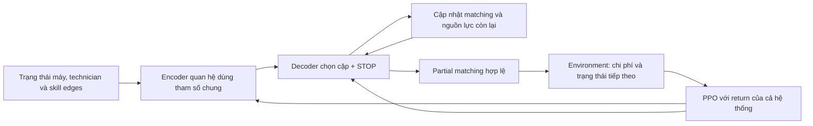

# Idea nghiên cứu: Centralized RL cho điều phối bảo trì theo giá trị dài hạn của technician

**Tên tiếng Anh tạm:** *Learning Resource Opportunity Costs for Scalable Maintenance Scheduling with Heterogeneous Technicians*.

**Ngày:** 10/10/2026 · **Phiên bản:** idea v1 · **Trạng thái:** đề xuất nghiên cứu để thảo luận; thuật toán và các experiment mới chưa được triển khai.

## 1. Quyết định nghiên cứu

Phát triển **centralized RL cho môi trường bảo trì không FIFO**, tập trung vào quyết định ưu tiên bảo trì và phân công technician khác kỹ năng. Policy cần xét ảnh hưởng của việc sử dụng một technician hiện tại đối với khả năng phục vụ các máy ở những thời điểm tiếp theo.

**Idea trong một câu:** học một policy điều phối có xét giá trị dài hạn của nguồn lực, biểu diễn được hệ thống với số máy/technician thay đổi, rồi kiểm tra chất lượng quyết định, khả năng chuyển quy mô và chi phí tính toán so với rule mạnh và planner.

Trọng tâm phiên bản đầu là **quyết định dài hạn dưới ràng buộc nguồn lực và kỹ năng**. Duration ngẫu nhiên, uncertainty prediction, learning/forgetting, mentorship và MARL là các hướng mở rộng sau khi có bằng chứng về giá trị của hướng chính.

Tên gọi “học chi phí cơ hội” là một giả thuyết về hành vi policy. Nó chưa có nghĩa mạng học được một đại lượng chi phí cơ hội được hiệu chuẩn, hoặc đây là cơ chế mới so với toàn bộ literature.

## 2. Nguyên nhân cần giải quyết

Các máy dùng chung một nhóm technician hữu hạn. Technician khác nhau về thời gian service, hiệu quả phục hồi và khả năng phục vụ từng máy. Một phân công có lợi cho một máy có thể làm mất lựa chọn tốt cho máy khác.

Ví dụ: technician T1 phục vụ được cả A và B; T2 chỉ phục vụ được A. T1 sửa A nhanh hơn T2, nhưng B cũng có nguy cơ cần service sớm. Nếu luôn chọn người nhanh nhất cho A, hệ thống có thể mất khả năng phục vụ B khi cần. Giá trị của việc giữ T1 tùy thuộc tình trạng B, thời gian T1 bị chiếm dụng và năng lực thay thế còn lại.

Một quyết định tốt phải cân nhắc ba yếu tố:

1. Lợi ích của việc phục vụ máy hiện tại: giảm rủi ro hỏng, downtime hoặc chờ quá ngưỡng.
2. Chi phí chiếm dụng technician: thời gian bận và khả năng phục vụ các máy khác bị mất.
3. Giá trị của trì hoãn: dùng người thay thế, phục vụ máy khác hoặc giữ nguồn lực cho các thời điểm tiếp theo.

Đây là giả thuyết về sự liên kết giữa các quyết định. Cần chứng minh tác động bằng đối chứng; không mặc định rằng mọi setting đều cần policy phân công phức tạp.

## 3. Bài toán và phạm vi môi trường

### 3.1. Hệ thống được xét

Giữ contract của môi trường non-FIFO hiện tại làm điểm xuất phát:

- Có N máy suy giảm theo thời gian, có thể phát sinh hỏng hóc theo dynamics của simulator.
- Có K technician thụ động: scheduler tập trung ra quyết định phân công.
- Máy đang hoạt động có thể được chọn bảo trì phòng ngừa, viết tắt PM; máy đã hỏng cần bảo trì sửa chữa, viết tắt CM.
- Duration và restoration phụ thuộc cặp máy–technician; một số cặp không đủ điều kiện phục vụ.
- Một technician chỉ phục vụ một máy tại một thời điểm; một máy chỉ nhận một technician.
- Service đã bắt đầu không bị ngắt hoặc chuyển người giữa chừng.
- Scheduler được chọn một **partial matching**, kể cả không bắt đầu service mới. Yêu cầu CM chưa được phục vụ tiếp tục tồn tại.
- Không áp thứ tự FIFO bắt buộc cho các máy chờ.

Trong phiên bản đầu, duration của mỗi cặp vẫn xác định theo cấu hình. Hỏng hóc là nguồn ngẫu nhiên trong dynamics; scheduler không biết trước realization tương lai. PM/CM tiếp tục gắn với tình trạng máy, thay vì đổi sang bài toán ticket đến từ bên ngoài.

Dynamics về suy giảm khi service, phục hồi sau completion và cách tính unavailable cost phải được giữ nguyên và kiểm tra khi mở rộng N/K. Việc mở rộng kích thước cần làm cho cả environment và baseline; actor nhận đầu vào dài hơn chưa đủ tạo ra một benchmark quy mô mới.

### 3.2. Thông tin và hành động

| Thành phần | Thông tin policy được dùng |
|---|---|
| Máy | Tình trạng suy giảm, hỏng/hoạt động, đang service hay chờ, thời gian chờ CM |
| Technician | Rảnh/bận, máy đang phục vụ, thời gian service còn lại theo contract hiện tại |
| Cặp máy–technician | Eligibility, duration, restoration và các đặc trưng suy ra từ chúng |
| Hệ thống | N/K, thời gian còn lại, tham số chi phí và dynamics đã được công khai |

Hành động tại thời điểm t là tập các cặp bắt đầu service mới, ký hiệu M_t. M_t phải thỏa eligibility và không dùng lặp máy hoặc technician. Không chọn một cặp có thể mang nghĩa trì hoãn PM, để CM tiếp tục chờ hoặc giữ một technician rảnh.

**Ngưỡng chờ hiện tại là giá mềm cho CM chưa bắt đầu service.** Nó không phải deadline hoàn thành sửa chữa hoặc bảo đảm SLA cứng. Phiên bản này không thêm completion deadline để tạo một mục tiêu khác.

## 4. Mục tiêu và câu hỏi nghiên cứu

### 4.1. Mục tiêu tối ưu

Giữ tổng chi phí kỳ vọng của episode làm mục tiêu chính:

$$
J(\pi)=\mathbb{E}_{\pi}\left[\sum_{t=0}^{H-1}
\left(C_t^{\mathrm{maintenance}}+C_t^{\mathrm{failure}}+
C_t^{\mathrm{unavailable}}+C_t^{\mathrm{overdue\ waiting}}\right)\right].
$$

Policy tối thiểu hóa J. Reward huấn luyện dùng âm chi phí tương ứng; các lựa chọn discount, bootstrap ở biên và treatment của trạng thái cuối phải được ghi rõ trong protocol triển khai.

Hệ số chi phí, horizon và semantics được dùng chung giữa các phương pháp. Không điều chỉnh hệ số sau khi xem test để làm một policy thắng. Chỉ báo tổng cost có thể che các đánh đổi, nên phải báo riêng từng thành phần và backlog cuối episode.

### 4.2. Câu hỏi trung tâm

> Centralized RL có học được cách ưu tiên và phân bổ technician theo hậu quả dài hạn, giữ chất lượng khi số máy/technician và cấu trúc kỹ năng thay đổi, với đánh đổi chất lượng–chi phí tính toán tốt hơn các đối chứng mạnh hay không?

Ba câu hỏi cụ thể:

| Mã | Giả thuyết cần kiểm tra | Bằng chứng cần có |
|---|---|---|
| H1 | Xét tương tác tương lai giữa các máy có giá trị | Joint lookahead cải thiện đủ lớn so với valuation từng máy rồi matching, trong cùng contract |
| H2 | Cách biểu diễn và giải mã đề xuất cải thiện quyết định | Thắng RL học ưu tiên và/hoặc RL chấm điểm cặp; ablation xác định thành phần tạo lợi ích |
| H3 | Policy chuyển được sang hệ thống mới với compute cạnh tranh | Checkpoint khóa chạy trên quy mô/skill graph mới; so đường chất lượng–compute với planner |

H1 có hỗ trợ giới hạn từ experiment cũ. H2 và H3 vẫn là giả thuyết chưa được xác nhận.

## 5. Bằng chứng hiện có và giới hạn

Nguồn chính: [phân tích solver comparison ngày 08/10/2026](</Users/bachng/Coding/Reinforcement Learning/marl/reports/maintenance_solver_comparison_v1_analysis_20261008/analysis_vi.md>).

Trên condition specialized, N=4, K=2, H=12:

| Kết quả | Ý nghĩa được hỗ trợ | Giới hạn |
|---|---|---|
| Joint rollout giảm priced cost 3,35% so với valuation độc lập + matching | Xét tương tác tương lai có ích trong panel đã thử | Không chứng minh mọi cấu trúc kỹ năng đều có cùng tác động |
| Central matching PPO có cost 163,279; joint rollout 162,073 | Central RL đạt gần chất lượng planner ở condition này | RL vẫn cao hơn khoảng 0,74%; planner không phải optimum đã được chứng nhận |
| Mean latency common-state: RL 1,191 ms; planner 8,037 ms | RL nhanh hơn khoảng 6,7 lần trong microbenchmark này | Chưa phải lợi thế compute ở quy mô lớn hoặc kết luận p95 cho mọi trạng thái |
| Full matching PPO so với fixed-allocation PPO: delta +0,110; CI 95% [−0,924; +1,143] | Chưa thấy lợi ích rõ từ học toàn bộ assignment | CI cắt zero cũng chưa chứng minh hai phương pháp tương đương |
| Central RL kém rule ở homogeneous trong run này | Lợi ích hiện có chưa ổn định qua condition | Cần training coverage và kiểm tra riêng từng condition |

Source snapshot của actor hiện tại dùng N=4, K tối đa 4 và catalogue 209 matching: [maintenance_heterogeneous_policy.py](</Users/bachng/Coding/Reinforcement Learning/marl/lab_results/maintenance_solver_comparison_v1_full_cpu_20261007T151955Z/source_snapshot/maintenance_heterogeneous_policy.py>).

Vì vậy, chưa thể nói thuật toán hiện tại đã generalize sang số máy/người mới. Panel test cũ đã được đọc và dùng để định hướng; kết quả mới trên panel đó chỉ là development/exploratory. Claim xác nhận mới cần panel test chưa mở.

## 6. Phương pháp dự kiến

### 6.1. Kiến trúc tổng thể

Đây là một policy tập trung; máy và technician là các thực thể trong biểu diễn, chưa phải các agent học riêng.

### 6.2. Encoder máy–technician

Dùng biểu diễn tập hợp/đồ thị hai phía với tham số dùng chung. Node máy mô tả tình trạng và nhu cầu phục vụ; node technician mô tả availability; edge mô tả duration, restoration và eligibility. Encoder tổng hợp thông tin về các phương án thay thế và cạnh tranh nguồn lực.

Mục đích là để policy nhận ra sự khác nhau giữa một technician có nhiều người thay thế và người duy nhất phục vụ được một nhóm máy. Không dùng one-hot theo chỉ số máy/người để ghi nhớ role cố định; kiểm tra tính nhất quán khi hoán vị nhãn.

Thiết kế nhận N/K thay đổi mà không tạo lại catalogue hành động. Tính chất này cho phép chạy trên kích thước mới, nhưng chất lượng transfer vẫn phải đo bằng experiment.

### 6.3. Decoder với ngữ cảnh nguồn lực còn lại

Tại mỗi thời điểm điều phối, decoder bắt đầu từ matching rỗng. Nó chọn từng cặp máy–technician hoặc STOP; sau mỗi lựa chọn, cập nhật máy đã chọn, technician đã dùng và khả năng phục vụ còn lại.

Điểm của một cặp phụ thuộc cả trạng thái ban đầu và matching đã xây một phần. Điều này cho phép cùng một cặp nhận ưu tiên khác nhau khi các lựa chọn khác trong đợt điều phối đã thay đổi.

Feasibility mask loại các cặp không đủ kỹ năng, máy đang service và technician đang bận/đã được chọn. STOP kết thúc việc tạo matching; nó cho phép policy giữ nguồn lực rảnh. Việc phát ra action hợp lệ là chức năng của contract và mask, không phải bằng chứng mạng tự học được constraint.

PPO tối ưu chuỗi lựa chọn với return của cả hệ thống. Khi triển khai cần lưu log-probability của toàn chuỗi, kể cả STOP, thay vì coi các lựa chọn là các policy độc lập. Decoder tuần tự cũng có chi phí inference tăng theo số cặp, cần đưa vào profiling.

### 6.4. “Học chi phí cơ hội” có nghĩa gì trong phiên bản này?

Policy được thưởng/phạt bởi tổng chi phí dài hạn. Nó có thể học rằng một phân công giúp máy hiện tại nhưng làm mất năng lực phục vụ có giá trị hơn ở tương lai.

Phiên bản đầu **không bắt buộc có một head xuất ra giá chi phí cơ hội**. Muốn diễn giải cơ chế, cần kiểm tra quyết định bằng rollout/exact value ở setting nhỏ và so với các đối chứng. Chỉ quan sát người rảnh hoặc heatmap attention chưa đủ chứng minh giả thuyết.

PPO là lựa chọn optimizer ban đầu. GNN/attention, mask, STOP và decoder autoregressive đều có tiền lệ; đóng góp dự kiến phải nằm ở thiết kế phù hợp bài toán và lợi ích được xác nhận, thay vì tên thành phần.

## 7. Các đối chứng bắt buộc

| Nhóm | Đối chứng | Vai trò |
|---|---|---|
| Không học, nhanh | Rule mạnh + matching, chọn trên development | Kiểm tra giá trị thêm của learning |
| Không học, có xét kỹ năng | Rule xét độ khan hiếm technician/phương án thay thế | Kiểm tra liệu một heuristic đơn giản đã đủ giải quyết nguyên nhân |
| Valuation tách máy | Isolated dynamic valuation + matching | Đo lợi ích của xét tương tác liên máy |
| Học ưu tiên | Central RL học quyết định phục vụ, dùng allocation cố định theo contract công khai | Kiểm tra có cần học assignment linh hoạt không |
| Học cặp | Cùng encoder, học điểm cặp rồi giải matching với lựa chọn không phục vụ | Đo lợi ích thêm của decoder có ngữ cảnh matching |
| Mốc hiện tại | Central matching PPO dùng catalogue | So trên N/K mà implementation này hỗ trợ |
| Nhìn trước | Joint rollout planner được tối ưu và tuning theo ngân sách | Đối chứng chất lượng–compute chính |
| Chính xác ở nhỏ | Exact stochastic DP khi khả thi | Đo optimality gap và kiểm tra hậu quả quyết định |

Rule và matching phải hỗ trợ partial matching để không bị ép thực hiện PM không cần thiết. Heuristic mới phải được tuning trên development, với ngân sách ghi lại.

Planner được dùng cùng thông tin về state và dynamics công khai, có quyền lấy forecast samples từ model; nó không được đọc shock tape thực tế của tương lai. Tối ưu candidate generation, batching/pruning và continuation policy hợp lý trước benchmark lớn. Không giữ một cách liệt kê matching tăng bùng nổ rồi coi sự chậm đó là bằng chứng RL tốt hơn.

Không ép joint planner qua bộ chấm điểm cạnh cộng đơn giản nếu làm mất khả năng xét tương tác. Các baseline cũng không bắt buộc dùng cùng decoder; chỉ các đối chứng nhằm cô lập scoring mới cần chung bộ matching.

MARL là đối chứng phụ nếu cần nối với nghiên cứu cũ. Phần chính tập trung vào các phương pháp tập trung mạnh. Cần chọn ít nhất một hướng neural scheduling gần nhất từ literature để adaptation minh bạch; đổi dynamics phải training lại, không lấy checkpoint của một bài toán khác để so trực tiếp.

## 8. Thiết kế kiểm chứng

### 8.1. Giai đoạn A: xác nhận cơ chế và headroom

Dùng setting nhỏ có thể giải exact hoặc rollout đủ mạnh để so joint decisions với valuation tách máy. Đo mức tác động của cạnh tranh nguồn lực khi thay đổi khả năng thay thế technician; giữ condition ít cạnh tranh làm đối chứng.

Với một state cố định, đánh giá các phân công thay thế bằng expected cost-to-go. Nếu dùng Monte Carlo, lấy nhiều rollout với dynamics và randomness ghép cặp phù hợp. Không chọn action tốt nhất sau khi nhìn một realization tương lai rồi gọi đó là quyết định khả thi của scheduler.

Nếu các rule mạnh đã gần reference và không còn khoảng cải thiện đáng kể, không mặc định tăng độ phức tạp kiến trúc. H1 hỗ trợ nhu cầu xét tương tác; nó không tự xác nhận H2.

### 8.2. Giai đoạn B: so phương pháp và ablation

So thuật toán đầy đủ với học ưu tiên + allocation cố định và học điểm cặp + matching. Trong các ablation trọng tâm, giữ optimizer, reward, encoder đầu vào và training budget tương đương ở mức có thể; báo phần nào thay đổi.

| Ablation | Câu hỏi |
|---|---|
| Allocation cố định | Lợi ích nằm ở timing/priority hay assignment? |
| Điểm cặp + matching | Học score đơn giản đã đủ thay decoder chưa? |
| Decoder không cập nhật ngữ cảnh quan hệ còn lại, vẫn có feasibility mask | Cập nhật thông tin nguồn lực sau mỗi lựa chọn có giúp không? |
| Hạn chế thông tin về phương án thay thế, huấn luyện riêng | Skill graph toàn hệ thống có giá trị quyết định đến đâu? |

Ablation giảm thông tin kiểm tra giá trị của thông tin, không cô lập riêng kiến trúc. Ablation ngữ cảnh vẫn có mask nên chưa loại hoàn toàn mọi tín hiệu về availability. Cần diễn giải đúng phạm vi.

### 8.3. Giai đoạn C: transfer và robustness

Grid khởi đầu dự kiến, chưa phải cấu hình full run đã khóa:

| Panel | Ví dụ cấu hình | Điều kiểm tra |
|---|---|---|
| Training | (N,K) = (4,2), (8,4); H=12/24 | Học trên nhiều instance và cả condition dễ/khó |
| ID test mới | Cùng N/K, profile và shocks mới | Generalization instance |
| Size transfer | (12,6), (24,12), giữ H chung | Chuyển quy mô với checkpoint khóa |
| Skill-structure transfer | Cùng N/K, đổi nhóm chuyên môn và khả năng thay thế | Chuyển cấu trúc kỹ năng |
| Stress test | Thay tải/nguy cơ hỏng hoặc giảm technician | Độ bền khi áp lực nguồn lực tăng |

Giữ N/K tương đương chưa bảo đảm tải tương đương: cần kiểm tra duration, restoration, eligibility và capacity hiệu dụng. Size transfer và scarcity stress được báo riêng. Mọi máy trong panel khả thi phải có ít nhất một technician đủ điều kiện; panel không thể phục vụ phải được định nghĩa riêng.

Policy transfer dùng nguyên checkpoint và quy tắc inference đã khóa, không fine-tune hoặc chọn lại checkpoint bằng test. RL được training riêng tại size mới là tham chiếu phụ để đo mất mát transfer; chi phí training của nó được báo riêng.

Train/development/test tách profile, shock seed và generator settings theo claim. Với claim skill graph mới, tránh trùng vật lý chỉ khác hoán vị nhãn; nếu không loại được trùng phải giới hạn cách diễn giải. Hoán vị máy/người là kiểm tra tính nhất quán, không thay thế bằng chứng OOD.

### 8.4. So chất lượng–compute

Đánh giá planner ở nhiều ngân sách forecast/search đã khóa trên development. Báo cost–latency Pareto frontier, chất lượng tại ngân sách compute tương đương và compute cần để đạt chất lượng tương đương khi có thể.

Benchmark dùng cùng phần cứng, số thread và quy tắc warm-up. Đo end-to-end gồm feature extraction, encoder, decoding/matching và xử lý constraint. Với stochastic multi-sampling, tính toàn bộ lượt suy luận và lựa chọn action. Báo cả common-state microbenchmark và latency trong closed-loop evaluation.

Không đặt một deadline tùy ý sau khi xem kết quả để làm planner thất bại. Nếu không có deadline ứng dụng được chứng minh, báo đường đánh đổi thay vì claim đáp ứng thời gian thực.

## 9. Metrics, splits và thống kê

### 9.1. Metrics

| Nhóm | Số đo bắt buộc |
|---|---|
| Chất lượng chính | Priced cost; base cost; relative improvement trong cùng cell N/K/H/condition |
| Thành phần tổn thất | Maintenance, failure, unavailable/downtime, overdue waiting cost |
| Chất lượng phục vụ | Failure count; overdue request count/ticks; tổng thời gian chờ quan sát; backlog cuối episode |
| Phân phối chờ | Mean/p95 cho request đã bắt đầu service, kèm số request chưa bắt đầu và trạng thái censoring |
| Compute online | Latency p50/p95/p99, CPU time, RAM, số forecast/search/inference samples |
| Chi phí offline | Training samples/time/compute, development evaluation và tuning budget |
| Transfer | Delta so baseline cùng cell và so policy training riêng tại size mới nếu có |

Không suy ra policy không gây starvation từ waiting của những request đã được phục vụ. Request còn chờ cuối H phải được ghi lại; xử lý terminal chung được chốt trước test. Horizon dài hơn là sensitivity có ích nhưng phải công bố là panel riêng.

Khi so các kích thước, báo thêm cost trên machine-tick và các thành phần tương ứng; không so raw cost N=24 với N=4 để kết luận policy kém hơn. Nếu không có exact optimum thì dùng từ **reference gap**, không gọi là optimality gap.

### 9.2. Splits và uncertainty của kết quả

- Khởi đầu với 10 training seed cho mỗi arm học; đánh giá tất cả seed.
- Checkpoint, hyperparameter, rule và continuation policy của planner được chọn trên development.
- Tạo test panel mới trước full run, giữ kín kết quả cho đến khi khóa protocol.
- Dùng cùng configuration và nguồn shocks được ghép cặp theo máy/thời gian vật lý khi phù hợp; không làm random stream thay đổi ý nghĩa chỉ vì policy tiêu thụ số random khác nhau.
- Báo CI của chênh lệch ghép cặp, effect size, kết quả từng seed và từng condition. Không chọn seed tốt nhất.
- Phân biệt bất định training với bất định profile/shock. Nếu suy luận trên cả hai, cần bootstrap phân cấp/thiết kế thống kê tương ứng; episode không phải replica training độc lập.
- Chốt trước primary contrasts, cách gộp condition và xử lý multiple comparisons. Không gộp điều kiện dễ để che một condition thất bại.

### 9.3. Stopping rule và ngưỡng thành công

Trước một code experiment cần khóa số physical steps/update, lịch development evaluation, quy tắc chọn checkpoint, budget tuning và xử lý run lỗi. Không tăng budget hoặc thêm seed vì đã nhìn test chưa thuận lợi. Run lỗi phải lưu nguyên nhân và artifact; run lại dùng thư mục mới và provenance rõ.

Biên cải thiện thực dụng **δ_cost**, biên chất lượng chấp nhận so planner **ε_quality**, mức tăng tốc mục tiêu **r_speed** và guard cho waiting/backlog phải được đặt từ yêu cầu bài toán hoặc development trước test. Bản idea này không tự coi một tỷ lệ tùy ý là tiêu chuẩn ứng dụng đã được xác nhận.

| Kết quả sau test | Quyết định nghiên cứu |
|---|---|
| Full method vượt đối chứng học đơn giản và có ablation ủng hộ | Tiếp tục bảo vệ cơ chế kiến trúc |
| Học ưu tiên + matching đạt tương đương với compute thấp hơn | Đơn giản hóa phương pháp; tập trung priority learning |
| Frozen transfer giữ quality guard và lợi thế compute | Có cơ sở claim chuyển quy mô trong phạm vi đã thử |
| Planner/rule chiếm ưu thế về cả cost và compute | Chưa có cơ sở phát triển RL thành solver chính |
| CI rộng hoặc tác động chưa đạt biên thực dụng | Báo chưa phân biệt được; không tuyên bố thắng |

“Gần planner” cần kiểm định với biên non-inferiority/equivalence đã khóa; CI cắt zero của kiểm định khác biệt chưa đủ chứng minh tương đương. Nhanh hơn nhưng chất lượng kém đáng kể chỉ là một điểm đánh đổi.

## 10. Đóng góp có thể bảo vệ và liên hệ literature

Ba đóng góp **dự kiến**, tùy kết quả:

1. Định lượng tác động của khả năng thay thế technician và chiếm dụng nguồn lực lên quyết định bảo trì trong simulator non-FIFO.
2. Một policy biểu diễn quan hệ và tạo partial matching có ngữ cảnh nguồn lực còn lại, với bằng chứng lợi ích so các phương pháp học đơn giản hơn.
3. Đánh giá frozen transfer và chất lượng–compute với các đối chứng planner/rule mạnh, báo rõ phạm vi lợi thế và thất bại.

Nếu (2) không được xác nhận, không giữ claim thuật toán chỉ vì kiến trúc phức tạp. “Centralized RL”, “GNN”, “PPO”, “matching” và “học hậu quả dài hạn” riêng lẻ chưa đủ tạo tính mới.

Các nguồn nền tảng đã được đối chiếu trong [literature review của dự án](</Users/bachng/Coding/Reinforcement Learning/marl/docs/research/maintenance_nonfifo_lit_review_20261010/literature_review_vi.md>):

| Nguồn | Liên quan và giới hạn |
|---|---|
| [Ruiz-Rodríguez et al., 2024 — maintenance scheduling, RL/GA/rules](https://orbilu.uni.lu/bitstream/10993/62366/1/1-s2.0-S0957417424002690-main.pdf) | Tiền lệ trực tiếp về maintenance và đánh đổi phương pháp dưới uncertainty; chưa phải bằng chứng novelty của skill matching đề xuất |
| [Zhang et al., 2020 — Learning to Dispatch](https://proceedings.neurips.cc/paper/2020/file/11958dfee29b6709f48a9ba0387a2431-Paper.pdf) | Graph-based centralized PPO và transfer kích thước trong JSSP; objective/dynamics khác maintenance |
| [Wang et al. — DANIEL, arXiv 2305.05119](https://arxiv.org/abs/2305.05119) | Biểu diễn competition và quyết định operation–machine trong FJSP; nguồn gần cần đối chiếu/adaptation cho baseline |
| [Kool et al., 2019 — Attention Model](https://arxiv.org/abs/1803.08475) | Decoder autoregressive, partial solution và feasibility mask đã có tiền lệ ở routing |
| [Luo et al., 2023 — LEHD](https://proceedings.neurips.cc/paper_files/paper/2023/file/1c10d0c087c14689628124bbc8fa69f6-Paper-Conference.pdf) | Cập nhật biểu diễn phần lời giải còn lại và scale transfer; routing/supervised learning khác bài toán này |
| [Bertsekas & Castanon, 1999 — stochastic scheduling rollout](https://link.springer.com/article/10.1023/A:1009634810396) | Nền tảng cho baseline nhìn trước; không gán bảo đảm lý thuyết tự động cho finite-scenario planner hiện tại |
| [Liu et al., 2023 — evaluation of neural CO](https://arxiv.org/abs/2209.10913) | Lý do phải đo chất lượng, compute và generalization với solver truyền thống mạnh |
| [Agarwal et al., 2021 — RL evaluation](https://arxiv.org/abs/2108.13264) | Cần báo bất định qua training runs; không áp một CI duy nhất cho mọi thiết kế |

Đối chiếu trên là nền tảng cho idea, không phải chứng nhận đã tìm hết literature hoặc có thể claim “đầu tiên”. Khi chốt method cần đối chiếu sâu các thành phần và baseline gần nhất.

Mục tiêu paper là AI ứng dụng/neural scheduling ở hội nghị nhỏ đến trung, nếu effect và protocol đủ mạnh. Đây là định hướng, chưa là cam kết chất lượng chấp nhận hoặc quyết định venue.

## 11. Kế hoạch triển khai theo workflow repository

Tài liệu này chốt hướng nghiên cứu, chưa khởi chạy code experiment. Khi triển khai, tuân theo [experiment_workflow.md](</Users/bachng/Coding/Reinforcement Learning/marl/docs/experiment_workflow.md>):

1. Khóa hypothesis, metrics, seed splits, stopping rule và artifact schema.
2. Implement; kiểm tra dynamics, eligibility, permutation behavior, log-probability và baseline; chạy tests và macOS smoke.
3. Commit/push code đã kiểm chứng.
4. Cung cấp compound command chính xác để người dùng chạy tại `bachng@100.111.83.52`; không tự SSH hoặc chạy full run.
5. Hiện tiến độ bằng tqdm cho training và multi-seed evaluation.
6. Mỗi run dùng artifact directory có timestamp mới, không ghi đè full run cũ.
7. Cung cấp lệnh rsync chính xác để người dùng chạy trên Mac, giữ partial transfers và hiện progress.

Artifact schema dự kiến gồm `plan.md`, `config.json`, `seed_registry.json`, `manifest.json`, source/checkpoint metadata, training/development logs, `episodes.csv`, `requests.csv`, `latency.csv` và analysis. Manifest lưu commit, environment version, hardware, model/config hashes và status. Các tên này sẽ được đối chiếu với contract thực tế khi viết experiment plan.

## 12. Tự kiểm tra và claim–evidence map

| Chiều kiểm tra | Câu hỏi | Trạng thái hiện tại |
|---|---|---|
| Đóng góp | Cơ chế đề xuất khác tiền lệ ở đâu? | Cần đặc tả method và đối chiếu literature sâu hơn; chưa claim novelty |
| Mạch lập luận | Nguyên nhân, mục tiêu và thiết kế có nối với nhau không? | Đã nối: nguồn lực thay thế hạn chế → hậu quả dài hạn → encoder/decoder → đối chứng |
| Sức mạnh experiment | Có lợi ích đủ lớn và ổn định không? | Cần experiment mới; kết quả cũ chỉ hỗ trợ một phần |
| Độ đầy đủ đánh giá | Có rule mạnh, RL đơn giản, planner, transfer và ablation không? | Đã đưa vào thiết kế; chưa chạy |
| Thiết kế phương pháp | Độ phức tạp có đem lại lợi ích thực không? | Chưa biết; có nhánh chuyển về priority + matching nếu full decoder không cần thiết |

| Claim | Evidence | Status |
|---|---|---|
| Joint lookahead có ích trong specialized panel N4/K2/H12 cũ | Solver comparison và contrast đã phân tích | **Supported trong phạm vi panel cũ** |
| Central PPO gần planner và nhanh hơn trong microbenchmark cũ | Cost/latency của run cũ | **Supported có giới hạn** |
| Full matching tốt hơn fixed allocation | CI cũ cắt zero | **Chưa được chứng minh** |
| Decoder mới học và sử dụng chi phí cơ hội tốt hơn đối chứng | Cần ablation và counterfactual value evaluation | **Needs evidence** |
| Frozen policy giữ chất lượng ở N/K và skill graph mới | Cần test panel mới | **Needs evidence** |
| Phương pháp tối ưu hơn mọi planner | Không có bằng chứng; planner thử nghiệm là approximate | **Không đặt claim này** |

**Hướng đã chốt:** centralized RL cho quyết định bảo trì theo giá trị dài hạn của nguồn lực, với transfer và chất lượng–compute làm kiểm chứng chính. **Phần phải chứng minh tiếp:** học assignment có cần thiết không và kiến trúc đề xuất tạo thêm giá trị ở đâu.
