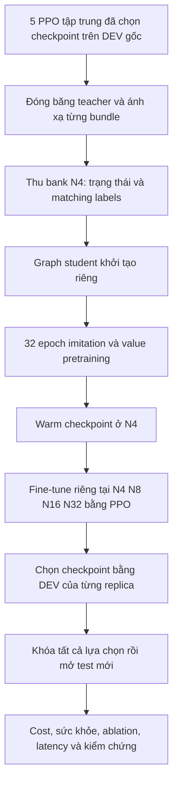
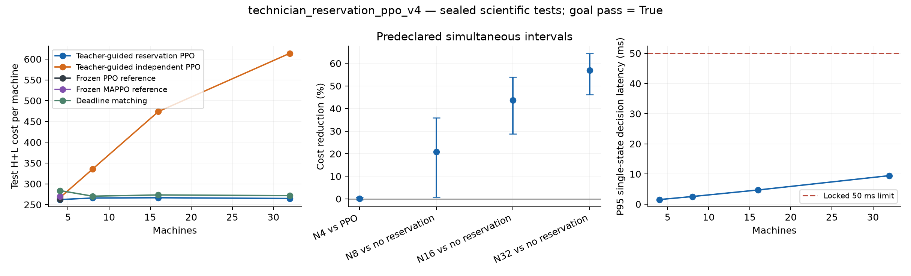
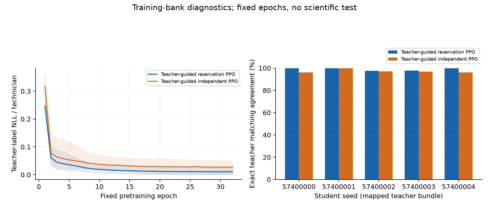
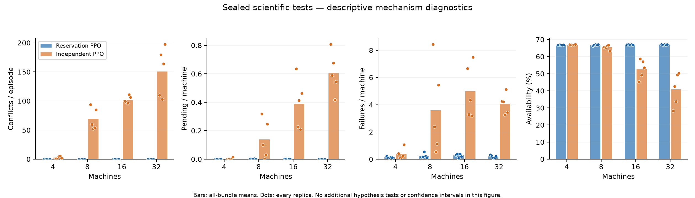

# Báo cáo nghiên cứu giai đoạn goal đầu tiên: Teacher-assisted Reservation PPO

**Ngày tổng hợp:** 16/10/2026.

**Phương pháp cuối của giai đoạn này:** `technician_reservation_ppo_v4`.

**Phạm vi:** giải thích phương pháp dùng PPO tập trung làm teacher, pretrain graph student bằng imitation learning, sau đó fine-tune student bằng PPO; tổng hợp lịch sử development và kết quả scientific confirmation đã hoàn tất.

Tài liệu này chỉ trình bày **giai đoạn teacher-assisted đã kết thúc**. Thuật toán mới đang được nghiên cứu theo yêu cầu học từ khởi tạo ngẫu nhiên, không teacher, là một giai đoạn khác; kết quả của nó không được đưa vào đây.

## 1. Kết quả chính và cách đọc báo cáo

Giai đoạn đầu đã xây dựng được một policy phân công technician có chất lượng gần PPO tập trung ở bài toán nhỏ, đồng thời dùng chung kiến trúc khi tăng từ 4 máy/2 technician lên 32 máy/16 technician mà không liệt kê toàn bộ matching ở các setting lớn.

Kết quả xác nhận cuối hỗ trợ ba nhận định:

1. Ở 4 máy/2 technician, cost gần PPO tập trung trong biên noninferiority 1% đã khóa trước; cost thấp hơn local MAPPO trên test seeds mới.
2. Khi tăng quy mô, policy giữ cost/máy quanh 262–267 và thời gian gọi policy p95 dưới 10 ms trên máy lab đã đo.
3. Khi bỏ dịch vụ phối hợp reservation/prefix trong một ablation cùng thông tin, kiến trúc và ngân sách, chất lượng giảm rõ ở N8, N16 và N32.

Các giới hạn quan trọng cũng thuộc kết quả nghiên cứu:

- Chưa chứng minh cost tốt hơn PPO tập trung với mức cải thiện thực tế tối thiểu 1%.
- Chưa chứng minh lợi ích phối hợp dương ở N4 bằng khoảng tin cậy đã đăng ký.
- Kết quả sử dụng teacher, thêm dữ liệu pretraining và graph policy lớn hơn baseline; không chứng minh học từ đầu tốt hơn PPO hay tiết kiệm mẫu hơn PPO.
- Fine-tuning không cải thiện đều mọi seed; một số mô hình chọn checkpoint ngay sau pretraining, trước khi fine-tune.
- Đây là benchmark bảo trì có cấu trúc kỹ năng lặp lại, cùng dịch vụ quan sát graph và reservation; chưa phải triển khai phân tán chỉ dùng local sensors hay toàn bộ bài toán FJSP sản xuất.

## 2. Câu hỏi nghiên cứu ban đầu

Câu hỏi đặt ra là:

> Làm thế nào để các agent phối hợp phân công technician, đạt chất lượng gần policy tập trung và mở rộng được khi số máy tăng?

PPO tập trung đã là một baseline tốt ở setting nhỏ. Trở ngại khi mở rộng là cách biểu diễn hành động: policy chọn một matching hoàn chỉnh từ danh mục đã liệt kê. Số matching tăng rất nhanh theo số máy và technician.

Hướng teacher-assisted sử dụng kiến thức quyết định tốt của PPO nhỏ để huấn luyện một cách biểu diễn policy khác: graph policy dùng chung trọng số, mỗi technician đề xuất một máy hoặc WAIT, và các technician phối hợp qua reservation/prefix trước khi thực thi đồng thời.

Đóng góp được xem xét ở giai đoạn này nằm ở **quy trình chuyển giao policy, phối hợp phân công và khả năng mở rộng thực nghiệm**. PPO, policy distillation, attention và sinh hành động tuần tự đều có prior art; kết quả này không chứng minh phát minh lại những nguyên lý đó.

## 3. Bài toán, trạng thái và cost

### 3.1. Các đối tượng được mô hình hóa

Có N máy và K technician. Mỗi máy có tuổi, trạng thái hỏng, thời gian chờ nếu hỏng và thông tin đang được bảo trì. Mỗi technician có trạng thái rảnh/bận và thời gian còn lại của công việc đang làm. Mỗi cặp máy–technician có thời gian dịch vụ và mức phục hồi riêng.

Tại một thời điểm, hành động là một matching gồm các cặp `(máy, technician)`. Mỗi máy và mỗi technician xuất hiện nhiều nhất một lần. Technician đang bận không nhận thêm việc. Policy được phép WAIT.

Mask của benchmark chỉ cho bắt đầu bảo trì khi máy đã hỏng hoặc có tuổi ít nhất `failure_age - 1`; ngoài ra phải thỏa điều kiện vật lý về máy và technician đang rảnh. Vì vậy policy không được chọn tùy ý một công việc bảo trì sớm ngoài tập hành động của benchmark.

### 3.2. Vật lý ở setting 4 máy/2 technician

Setting chuẩn là `balanced_a2_b4_u12`:

| Tham số | Giá trị |
|---|---|
| Số máy / technician | 4 / 2 |
| Ngưỡng tuổi bắt đầu có nguy cơ hỏng | 4 |
| Xác suất hỏng khi đạt ngưỡng và không được bảo trì | 0,45 mỗi tick |
| Tuổi tối đa lưu trong trạng thái | 8 |
| Chi phí bắt đầu bảo trì phòng ngừa | 1 |
| Chi phí bắt đầu sửa chữa sau hỏng | 2 |
| Chi phí máy không khả dụng | 12 mỗi máy mỗi tick |
| Chi phí một sự kiện hỏng mới | 15 |
| Ngưỡng chờ sửa chữa | 4 tick |
| Chi phí chờ vượt ngưỡng | 12 mỗi máy mỗi tick vượt ngưỡng |

Hai loại technician có đặc tính dịch vụ như sau. Mức phục hồi 0,5 nghĩa là khi hoàn tất, tuổi còn lại bằng phần nguyên của một nửa tuổi trước dịch vụ; mức 1,0 đưa tuổi về 0.

| Máy | Thời gian với T1 | Phục hồi với T1 | Thời gian với T2 | Phục hồi với T2 |
|---|---:|---:|---:|---:|
| M1 | 1 | 0,5 | 2 | 1,0 |
| M2 | 1 | 0,5 | 4 | 1,0 |
| M3 | 2 | 1,0 | 1 | 0,5 |
| M4 | 4 | 1,0 | 1 | 0,5 |

Quyết định cần cân bằng dịch vụ nhanh, mức phục hồi sâu, nguy cơ hỏng và sự tranh chấp technician. Chọn cặp có mức phục hồi cao nhất không tự động tối ưu vì máy vẫn không khả dụng trong lúc được bảo trì.

### 3.3. Horizon và định nghĩa đánh giá

Mỗi episode có 48 quyết định của policy, sau đó 12 tick dùng chung một deadline policy. Phần đuôi này giúp tính cả hậu quả của backlog/công việc mà policy để lại ở cuối horizon.

Cost chính:

```text
extended_cost = cost trong 48 tick policy + cost trong 12 tick deadline tail
cost mỗi tick = maintenance + unavailability + new failures + overdue waiting
```

Reward huấn luyện là `-cost / 20`, gamma bằng 1. Ở quyết định cuối của policy, reward tính cả phần tail tương ứng. Do đó `-20 × tổng reward` phải bằng `extended_cost`; phép đối chiếu này được kiểm tra trong artifacts.

Các chỉ số được phân biệt rõ:

- **Cost/máy:** `extended_cost / N`.
- **Availability:** `1 - unavailable_ticks / (N × 48)`, tính tại cutoff của policy. Máy đang hỏng hoặc đang được bảo trì đều không khả dụng.
- **Pending/máy:** số máy đã hỏng và chưa được technician nào phục vụ tại cutoff, chia N; máy đang được sửa không nằm trong pending này.
- **Failures/máy:** số sự kiện hỏng phát sinh trong 48 tick policy, chia N; không phải xác suất một máy hỏng.
- **Conflict/rejected proposals:** thống kê tranh chấp và đề xuất bị loại trong giai đoạn phân công.

Kết quả cost tốt chỉ được coi là đạt khi đồng thời vượt qua các giới hạn sức khỏe hệ thống đã định trước.

### 3.4. Cách tạo setting lớn

Các setting xác nhận là N/K = 4/2, 8/4, 16/8, 32/16. Mẫu kỹ năng của bốn loại máy và hai loại technician được lặp lại. Các cặp máy–technician giữa các block vẫn được phép; đây không phải các bản sao N4 vận hành tách biệt.

Tỷ lệ K=N/2, cấu trúc kỹ năng và horizon được giữ cố định. Đây là một họ benchmark cụ thể, chưa bao phủ mọi tỷ lệ nguồn lực hoặc phân bố kỹ năng mới.

## 4. PPO gốc, teacher và student khác nhau thế nào?

| Thành phần | PPO tập trung gốc | Teacher-assisted Reservation PPO |
|---|---|---|
| Đầu vào | Vector trạng thái toàn cục phẳng ở N4 | Graph máy–technician, global features, ID công khai |
| Hành động | Một chỉ số chọn cả matching từ catalogue | K token: mỗi technician chọn WAIT hoặc một máy |
| Kiến trúc | MLP với đầu ra gắn với catalogue N4 | Graph encoder và decoder dùng chung trọng số |
| Số tham số tại N4 | 18.966 | 82.819 |
| Chống trùng phân công | Matching trong catalogue đã hợp lệ | Reservation mask giữa các lượt chọn |
| Nguồn khởi tạo kiến thức | Học PPO ở baseline gốc | Student mới học nhãn teacher rồi fine-tune bằng PPO |
| Khi triển khai student | Không cần gọi model PPO gốc | Student tự quyết định bằng trọng số của mình |
| Mở rộng N/K | Catalogue lớn nhanh | Trọng số giữ nguyên kích thước; tăng số cạnh/lượt chọn |

**Teacher chính là PPO tập trung gốc đã huấn luyện**, không phải một người gán nhãn, oracle tối ưu hay bộ giải được phép nhìn tương lai.

Student có kiến trúc khác và được khởi tạo riêng. Không sao chép trực tiếp ma trận trọng số của MLP PPO gốc sang graph network. Kiến thức được chuyển qua **các quyết định phân công do teacher gán nhãn**.

Vì vậy, cách gọi chính xác của quy trình là:

> Dùng PPO tập trung làm teacher để pretrain graph student; sau đó dùng thuật toán PPO fine-tune graph student.

Cụm “fine-tune PPO gốc” có thể gây hiểu nhầm rằng chỉ tiếp tục huấn luyện cùng network baseline. Việc thực tế đã làm là thay kiến trúc policy rồi chuyển giao hành vi.

## 5. Kiến trúc graph policy V4

### 5.1. Đầu vào của mỗi cạnh

Với cặp máy m và technician j, encoder nhận 24 đặc trưng:

| Nhóm | Số chiều | Nội dung |
|---|---:|---|
| Máy | 6 | Tuổi/8, hỏng, thời gian chờ/12, đang dịch vụ, thời gian dịch vụ còn lại/12, nguy cơ hỏng hiện tại |
| Technician | 3 | Rảnh, thời gian còn lại/12, tình trạng hỏng của máy đang được technician phục vụ |
| Cạnh | 4 | Có kỹ năng, thời gian dịch vụ/12, mức phục hồi, đang được phân công cho cặp này |
| Toàn cục | 9 | Đồng hồ và các tham số vật lý/chi phí đã chuẩn hóa |
| ID công khai | 2 | Chỉ số hàng máy và cột technician đã chuẩn hóa |

Cả reservation arm và independent arm đều nhận đầy đủ graph ban đầu này. Không có realized failure shock tương lai trong đầu vào.

ID giúp policy phân biệt các đối tượng có đặc trưng vật lý trùng nhau. Chúng cũng có nghĩa rằng không được tuyên bố kiến trúc bất biến hoán vị một cách tuyệt đối.

### 5.2. Edge encoding và competition attention

Actor edge encoder là MLP hidden width 64. Từ embedding ban đầu `h0[m,j]`, lấy trung bình qua technician để tạo embedding máy `u[m]`.

Mỗi cạnh dùng query riêng để attention đến các embedding máy. V4 sử dụng 4 attention heads, mỗi head 16 chiều. Sau attention:

```text
h[m,j] = h0[m,j] + u[m] + attention_context[m,j]
```

Bổ sung `u[m]` giúp cạnh biểu diễn kỹ năng của các technician khác đối với cùng máy. Attention cung cấp bối cảnh cạnh tranh giữa các máy. Global pooling và technician pooling được tính từ graph này.

Đây là graph/attention architecture cụ thể trong repository, không phải triển khai nguyên xi Multi-Agent Transformer và không thừa hưởng một định lý monotonic improvement từ mô hình khác.

### 5.3. Reservation và prefix message

Decoder chạy theo thứ tự technician cố định `T1 → T2 → ... → TK`. Ở lượt j:

1. Lấy mask hợp lệ của technician j theo trạng thái vật lý hiện tại.
2. Loại các máy đã được technician trước đặt chỗ trong tick này.
3. Tạo resource summary từ các cạnh còn khả dụng và technician chưa dùng lượt, gồm cả technician hiện tại.
4. Chấm điểm WAIT và từng máy bằng graph context, resource summary, prefix message và thống kê lượt chọn.
5. Chọn một token, ghi reservation nếu có máy được chọn, rồi cập nhật prefix message.

Prefix là tổng embedding những cạnh đã chọn, chia K. WAIT đóng góp vector 0. Các thống kê nhỏ gồm tỷ lệ máy còn hợp lệ, tỷ lệ máy đã reserved và vị trí lượt j.

Machine scoring head nhận `4 × 64 + 3` chiều: embedding cạnh, global pool, resource pool, prefix và ba thống kê. WAIT head nhận `3 × 64 + 3` chiều: technician pool, resource pool, prefix và ba thống kê.

Technician đã dùng lượt bị loại khỏi planning resource summary kể cả khi chọn WAIT. Mỗi technician chỉ có một lượt trong tick; không có retry ngầm.

**Sau khi chọn xong cả K token, các dịch vụ mới bắt đầu đồng thời.** Không cho thời gian vật lý trôi qua giữa T1 và T2. Prefix là thông tin lập kế hoạch trong tick, không phải quan sát một kết quả vật lý tương lai.

Ví dụ minh họa: nếu T1 chọn M2, T2 nhận thông tin M2 đã được đặt chỗ và không còn chọn M2 trong tick đó. T2 có thể chọn máy khác hoặc WAIT. Ví dụ này giải thích quy tắc, không phải một kết quả thực nghiệm mới.

### 5.4. Critic và giá trị khi đổi quy mô

Critic có value edge encoder riêng, không dùng chung trọng số với actor edge encoder. Việc này ngăn gradient của value loss trực tiếp thay đổi actor encoder.

Critic lấy pooled value-edge summaries và global features để dự đoán một giá trị cho trạng thái toàn plant. Code ghép hai phép trung bình trên lưới cạnh; về mặt đại số chúng là hai cách tính trung bình toàn bộ cạnh tương đương, không phải hai nguồn thông tin độc lập.

Đầu ra value được nhân `N/4`. Lý do là teacher pretraining ở N4 trong khi reward RL là tổng cost của plant: khi số máy tăng, độ lớn return cũng tăng. Đây là hiệu chỉnh bằng kích thước graph công khai, áp dụng cho cả hai graph arms.

### 5.5. Tính mở rộng và giới hạn triển khai

Số tham số actor+critic luôn là **82.819** ở bốn quy mô. Policy không cần output layer có một logit cho mỗi matching hoàn chỉnh.

Competition attention thực hiện tính toán đa thức theo N và K; thành phần attention có độ lớn xấp xỉ `O(N² K H)`, còn decoder có K lượt scoring/pooling. Vì vậy “không liệt kê matching” không đồng nghĩa “chi phí tính toán không tăng theo quy mô”.

Implementation dùng full current graph và một reservation service chung. Có thể diễn giải các lượt chọn theo technician agents chia sẻ trọng số, nhưng chưa có kiểm chứng local-only sensing, giao thức mạng, mất gói hay latency truyền thông.

## 6. Quy trình teacher → pretraining → PPO fine-tuning



### 6.1. Teacher nào đã được sử dụng?

Teacher được lấy từ full balanced baseline run `maintenance_balanced_algorithm_benchmark_v1_full_cpu_20261012T115140Z`, source commit `2e19043`. Dùng đủ năm PPO checkpoints được chọn trên development của baseline; giữ nguyên năm MAPPO checkpoints làm reference.

Teacher seeds gốc là 46000000–46000004. Trong confirmation, student seed `57400000 + i` gắn cố định với teacher seed `46000000 + i`. Không chọn teacher tốt nhất sau khi xem test, không trộn tất cả teacher thành một ensemble và không bỏ bundle yếu.

Teacher được đóng băng. Các checkpoints, metadata, config vật lý và parameter digests được kiểm tra và sao chép vào thư mục run để khóa provenance.

### 6.2. Tạo teacher bank

Mỗi bundle thu đúng **122.880 lần quan sát trạng thái N4** bằng 16 môi trường:

- Hành động thực sự tạo trajectory được lấy mẫu từ logits teacher với temperature 1,5, giúp bank có trạng thái đa dạng hơn so với chỉ chạy greedy.
- Nhãn cho student tại mỗi trạng thái là matching `argmax` của teacher ở chính trạng thái đó.
- Matching catalogue N4 được chuyển thành hai token: WAIT=0, máy m được mã hóa bằng m+1.
- Lưu reward, done, return-to-go của trajectory behavior, physical seeds, population hashes và teacher SHA.
- Worker IDs 1000–1015 cho bank tách khỏi worker IDs 0–15 dùng fine-tuning.

**Nhãn là hard matching labels**, không phải toàn bộ phân phối soft logits của teacher. Return target của critic là return của stochastic teacher-behavior trajectory; không phải giá trị tối ưu được oracle tính.

122.880 là số state exposures, không bảo đảm 122.880 trạng thái vật lý khác nhau. Một bank tương ứng 2.560 episode hoàn chỉnh. Cả hai graph arms dùng đúng cùng một bank.

### 6.3. Pretraining student

Hai graph arms có cùng random initialization trước pretraining, cùng minibatch order và augmentation RNG. Mỗi arm chạy cố định 32 epoch, minibatch 512, Adam learning rate 0,0003, gradient clipping 0,5.

Loss:

```text
L_pretrain = - mean(log probability of teacher matching) / K
             + 0.1 × SmoothL1(student_value, behavior_return)
```

Ở bank N4, K=2. Mỗi arm có 7.680 optimizer steps và 3.932.160 state presentations. Không dừng sớm hay chọn epoch bằng teacher agreement.

Mỗi lần trình bày dữ liệu dùng hoán vị máy và technician độc lập; observation, edge tensors, mask và matching tokens được biến đổi nhất quán. Đây là đổi tên cùng một mẫu vật lý, không phải thu thêm trajectory hay hỏi thêm oracle. Cả hai arms nhận cùng những phép biến đổi, được đối chiếu bằng augmentation digest.

Hai arm có thể có warm weights khác nhau sau pretraining vì intervention reservation/prefix thay đổi conditional policy và loss. Điều được ghép cặp là initialization **trước** pretraining, bank, augmentation và ngân sách; không ép trọng số sau pretraining giống nhau.

### 6.4. Fine-tune graph student bằng PPO

Warm checkpoint N4 của mỗi arm/bundle được dùng làm điểm bắt đầu cho các fit độc lập ở từng target scale. Trong giai đoạn này student tương tác môi trường, nhận reward và cập nhật bằng PPO; teacher không tiếp tục gán nhãn cho các rollout fine-tuning.

Với reservation, xác suất joint action được viết thành tích các xác suất có điều kiện theo prefix:

```text
π(a | s) = product_j π(a_j | s, reservations_before_j, prefix_before_j)
log π(a | s) = sum_j log π(a_j | ...)
ratio = exp(log π_new(a | s) - log π_old(a | s))
L_clip = mean(min(ratio × advantage,
                  clip(ratio, 1-0.2, 1+0.2) × advantage))
```

PPO dùng return Monte Carlo của episode hoàn chỉnh, một scalar state value và advantage được chuẩn hóa. Không có counterfactual advantage riêng cho từng technician trong phương pháp này.

Loss RL kết hợp `-L_clip`, entropy coefficient 0,01 và value MSE coefficient 0,5. Entropy trong implementation là tổng conditional entropies của các lượt chọn đã ghi nhận, không phải liệt kê để tính entropy joint chính xác trên mọi matching.

| Hyperparameter fine-tuning | Giá trị |
|---|---:|
| Joint decisions / arm / bundle / scale | 491.520 |
| Vector environments | 16 |
| Rollout decisions | 3.072 |
| PPO epochs / rollout | 4 |
| Minibatch | 256 |
| Adam learning rate | 0,0003 |
| PPO clip | 0,2 |
| Entropy coefficient / value coefficient | 0,01 / 0,5 |
| Gradient clip | 0,5 |
| Gamma | 1 |
| Optimizer steps / fit | 7.680 |

PPO ở đây giữ objective clipped PPO quen thuộc. Phần thiết kế chính của giai đoạn này là biểu diễn graph, chuyển giao teacher, reservation/prefix và quy trình đánh giá khả năng mở rộng.

### 6.5. Tại sao có fine-tuning, và nó có luôn hữu ích không?

Imitation giúp student học một cách phân công tốt ở N4. Khi chuyển sang graph lớn, mức cạnh tranh tài nguyên và phân bố trạng thái thay đổi; RL fine-tuning tạo cơ hội thích nghi với cost thực của target setting.

Đây là động cơ thiết kế. Thực nghiệm **không chứng minh fine-tuning luôn cải thiện**. Checkpoint ngay sau pretraining, gọi là step 0, vẫn được phép được chọn nếu có DEV cost tốt hơn các checkpoint RL. Toàn bộ ngân sách RL vẫn được chạy dù cuối cùng chọn step 0.

Vì mỗi target scale đều có fine-tuning riêng, kết quả cuối là **transfer rồi thích nghi theo quy mô**, không phải chứng minh zero-shot generalization của cùng một final checkpoint sang mọi N/K.

## 7. Ablation nào cho phép nói về cơ chế phối hợp?

So sánh với local MAPPO chỉ cho biết chất lượng quyết định so với baseline đó. Graph student có nhiều thông tin hơn, nhiều tham số hơn và thêm teacher training; vì vậy chênh lệch với MAPPO không tự nó chứng minh reservation có tác dụng.

Ablation chính là `independent_ppo`:

| Thành phần | Reservation arm | Independent arm |
|---|---|---|
| Full current graph, public IDs và thứ tự technician | Có | Giống hệt |
| Attention, hidden width và số tham số | 82.819 | 82.819 |
| Initialization trước pretraining | Ghép cặp | Ghép cặp |
| Teacher, bank, augmentation và pretraining budget | Ghép cặp | Ghép cặp |
| Physical tapes và ngân sách PPO mỗi scale | Ghép cặp | Ghép cặp |
| Machine reservation mask | Có | Bỏ |
| Selected-edge prefix message | Có | Bỏ, prefix bằng 0 |
| Resource summary biết máy đã được chọn | Có | Không; chỉ biết trạng thái ban đầu và thứ tự lượt |
| Nếu hai technician cùng đề xuất một máy | Ngăn bằng reservation | Arbitration chọn một, loại phần còn lại, không retry |

Independent arm vẫn nhận thông tin đầy đủ để học cách tránh xung đột, kể cả ID để phá đối xứng; không cố tình làm nó mù về skill hay số máy. Intervention loại bỏ **toàn bộ reservation/message service**, gồm collision prevention và thông tin prefix. Không thể dùng kết quả này để tách riêng tác dụng của attention, value scaling, augmentation hoặc từng message type.

## 8. Lịch sử development từ V1 đến V4

Các vòng dưới đây dùng development panels khác nhau; không nên coi cost giữa các hàng là một phép so sánh paired hoặc một kiểm định cải thiện trực tiếp.

| Vòng | Thiết kế chính | Trạng thái và bài học |
|---|---|---|
| V1 | Graph bids và reservation, học từ đầu; budget development 122.880 quyết định/fit | Hoàn tất, audit PASS, chưa mở scientific test. N4 reservation cost 1.210,1458, independent 1.121,8125; small screen không đạt. N16 tốt hơn independent nhưng chưa giải quyết được N4. |
| V2 | Tách actor/value encoder, thêm selected-edge prefix, public IDs; tăng budget lên 491.520/fit; chưa dùng teacher | Run development FAILED vì `sampled/re-evaluated behavior policy mismatch`. Đây là technical failure; không có summary cuối hợp lệ để kết luận hiệu năng toàn grid. |
| V3 | Thêm teacher distillation và competition attention, dùng warm start rồi PPO | Hoàn tất, audit PASS, development screen đạt. N4 cost 1.061,1354 so với PPO 1.057,5521. N16 cost 4.469,6458 so với deadline 4.383,25; biến động replica và suy giảm khi fine-tuning còn lớn. |
| V4 | Machine incident-edge pooling, 4 attention heads, paired permutation augmentation, summary loại technician đã dùng lượt, value scale N/4; numerical replay guard rõ ràng | Hoàn tất development, audit PASS, screen đạt và N16 ổn định hơn V3. Sau khi khóa thiết kế mới chạy scientific confirmation được trình bày dưới đây. |

Development V4 có 3 bundles, N4 và N16. Kết quả tổng cost sau chọn checkpoint:

| Setting | Reservation | Independent | Frozen PPO | Frozen MAPPO | Deadline |
|---|---:|---:|---:|---:|---:|
| N4/K2 | 1.055,3229 | 1.063,4688 | 1.054,7708 | 1.084,1458 | 1.170,5312 |
| N16/K8 | 4.220,3542 | 7.887,6563 | — | — | 4.387,1563 |

Đây là development evidence, không có test confidence interval. Việc chọn V4 dựa trên development; các failure/negative rounds được giữ lại.

Một thay đổi yêu cầu đã được công khai ở protocol V2 **trước scientific confirmation**: lợi ích phối hợp dương trở thành điều kiện bắt buộc ở từng setting lớn; ở N4 yêu cầu noninferiority 1% với independent, còn positive small mechanism được báo cáo như mục tiêu bổ sung. Nguồn gốc thay đổi là failure N4 trên development V1. Do đó kết quả V4 không được diễn giải như đã vượt điều kiện positive coordination ở mọi quy mô của bản ý tưởng đầu tiên.

V4 cũng tách kiểm tra sai số float32 của log probability và value: log atol 2e-5; value atol 2e-5 cộng rtol 1e-6; normalized error phải không quá 1. Đây là guard số học, không phải nới biên chất lượng hay tăng budget sau khi xem scientific test.

## 9. Thiết kế scientific confirmation cuối

### 9.1. Panels và khóa checkpoint

| Thành phần | Panel |
|---|---|
| Student/teacher bundles mới | 57400000–57400004, đủ 5 bundles |
| Development chọn checkpoint | 57500000–57500063, 64 episode seeds mỗi scale |
| Scientific test | 57600000–57600255, 256 episode seeds mỗi scale |
| Analysis seed | 57700000 |
| Scales | N4/K2, N8/K4, N16/K8, N32/K16 |

Mỗi graph replica chọn checkpoint có mean development extended cost thấp nhất trong `{0, 122880, 245760, 368640, 491520}`; nếu hòa chọn checkpoint sớm nhất. Tất cả replicas đều được giữ lại. PPO/MAPPO references giữ checkpoint từ DEV gốc, không reselect trên panel mới.

Các lựa chọn cuối được khóa lúc **2026-10-13 17:59:15 UTC**, trước khi mở scientific test. Tổng grid có **13.824 episodes** và **829.440 physical transitions**. Toàn bộ transitions được replay độc lập theo scalar physics và kiểm tra cả proposal/arbitration, phần common tail và cost/health aggregates.

Run bắt đầu 2026-10-12, hoàn tất **2026-10-13 18:49:43 UTC**, sau **76.390,108 giây**, khoảng **21 giờ 13 phút**, trong hard stop 24 giờ đã định trước. Chạy trên Ubuntu lab với 8 CPU workers độc lập và 1 Torch thread mỗi worker. Đây là execution topology, không phải đóng góp tăng tốc huấn luyện của thuật toán.

### 9.2. Khoảng tin cậy và quy tắc quyết định

Định nghĩa gain so với reference:

```text
gain = 1 - mean(candidate cost) / mean(reference cost)
```

Gain dương nghĩa là candidate có cost thấp hơn. Gain là tỷ lệ; khi trình bày phần trăm nhân 100. Đây là tỷ lệ của mean costs, không phải mean của từng episode gain.

Dùng **crossed bootstrap 40.000 draws** trên hai trục: teacher/student bundle và paired episode seed. Trong một scale, các phương pháp dùng cùng episode weights; bundle weights dùng chung qua các scale, còn episode axes resample độc lập giữa các scale vì physical namespaces khác nhau.

Scientific round 1 dùng alpha 0,025, Bonferroni family 24 endpoints, confidence hai phía cho mỗi endpoint bằng `1 - 0.025/24 = 99.895833%`. Chỉ có 5 bundles nên coverage là xấp xỉ; đây là inference có điều kiện trên bộ năm teacher đã có, không phải năm teacher mới được refit độc lập cho vòng xác nhận. Kèm kết quả từng replica và leave-one-bundle-out.

Các điều kiện chính:

| Nhóm | Điều kiện đã khóa |
|---|---|
| Gần PPO ở N4 | Lower bound gain so PPO ≥ −1% |
| Vượt local MAPPO ở N4 | Lower bound gain so MAPPO > 0 |
| N4 không kém matched independent đáng kể | Lower bound gain so independent ≥ −1% |
| Lợi ích phối hợp ở từng N8/N16/N32 | Lower bound gain so independent > 0 |
| Chất lượng lớn so deadline | Lower bound gain so deadline ≥ −2% |
| Giữ normalized cost khi tăng quy mô | Upper bound cost/máy lớn chia cost/máy N4 ≤ 1,10 |
| Availability | Lower bound candidate − reference ≥ −0,01 |
| Pending/máy | Upper bound candidate − reference ≤ +0,025 |
| Failures/máy | Upper bound candidate − reference ≤ +0,25 |
| Latency và legality | Neural `select` p95 ≤ 50 ms, 0 invalid assignments |

Health reference là PPO gốc tại N4 và deadline tại các setting lớn. Đây là điều kiện của **giai đoạn cũ**; không tự động thay bằng những baseline/health references của nghiên cứu mới.

Muốn tuyên bố practical cost superiority so với PPO cần thêm lower bound gain **ít nhất +1%**. Muốn nói positive coordination ở N4 cần lower bound gain so independent > 0. Hai điều kiện bổ sung này không đạt trong kết quả cuối và luôn được báo cáo.

## 10. Kết quả xác nhận: chất lượng quyết định

### 10.1. Setting N4/K2

Các giá trị dưới đây lấy từ test panel mới, giữ đủ 5 bundles và 256 episodes/bundle. Dấu thập phân trong các bảng kết quả dùng dấu chấm để đối chiếu trực tiếp artifacts.

| Phương pháp | Tổng cost | Cost/máy |
|---|---:|---:|
| Teacher-assisted Reservation PPO | 1048.6914 | 262.1729 |
| PPO tập trung gốc | 1049.5078 | 262.3770 |
| Local MAPPO | 1079.4961 | 269.8740 |
| Matched independent graph PPO | 1066.2094 | 266.5523 |
| Deadline | 1135.5391 | 283.8848 |

| So sánh N4 | Gain (%) | Khoảng tin cậy (%) | Kết luận |
|---|---:|---:|---|
| So PPO tập trung gốc | 0.0778 | [-0.2960, 0.6168] | Đạt noninferiority 1%; chưa chứng minh practical superiority |
| So Local MAPPO | 2.8536 | [0.5184, 5.8940] | Cost thấp hơn trên panel mới; khác thông tin và ngân sách |
| So Matched independent graph PPO | 1.6430 | [-0.5997, 5.7302] | Đạt noninferiority 1%; chưa chứng minh positive mechanism |

Mean gain so PPO chỉ khoảng **0,078%**. Interval đi qua 0 và lower bound thấp hơn ngưỡng practical +1%, nên câu đúng là **gần chất lượng PPO tập trung**, không phải đã vượt PPO về cost.

Chênh lệch so MAPPO có interval dương, nhưng graph student có full graph, 82.819 tham số so với 15.364 của local MAPPO, cùng thêm teacher/pretraining. Vì vậy phải đi kèm matched ablation ở phần cơ chế.

## 11. Kết quả xác nhận: khả năng mở rộng

| N/K | Reservation cost/máy | Independent cost/máy | Deadline cost/máy | `select` p95 (ms) | Tham số graph policy |
|---|---:|---:|---:|---:|---:|
| 4/2 | 262.1729 | 266.5523 | 283.8848 | 1.527 | 82,819 |
| 8/4 | 265.9545 | 335.7488 | 270.3623 | 2.534 | 82,819 |
| 16/8 | 266.5710 | 473.8705 | 273.2949 | 4.703 | 82,819 |
| 32/16 | 264.8450 | 613.9570 | 271.6785 | 9.460 | 82,819 |

Mỗi neural timing panel của một graph arm/scale có **61.440 single-state calls**, được đo sau khi training pool đóng. `select` trong implementation gồm tensor preparation và forward/decoding của model, có cả tính value trong đường gọi hiện tại. Nó không gồm xây observation từ môi trường, physical stepping/arbitration hoặc network transport. Không dùng các giá trị này để tuyên bố end-to-end network latency.

| Scale lớn | Gain so deadline (%) | Khoảng tin cậy (%) | Upper bound tỷ số cost/máy lớn / N4 |
|---|---:|---:|---:|
| N8 | 1.6303 | [-0.4475, 3.1747] | 1.03477 |
| N16 | 2.4603 | [1.4766, 3.6162] | 1.02934 |
| N32 | 2.5153 | [1.7799, 3.2717] | 1.01933 |

N8 đạt điều kiện không kém deadline quá 2%, nhưng interval gain còn đi qua 0. N16 và N32 có gain so deadline với interval dương. Tất cả upper bounds của tỷ số cost/máy đều dưới 1,10.

### 11.1. Vì sao bỏ catalogue có ý nghĩa?

Với graph đầy đủ, số partial matchings lý thuyết là `sum_r C(N,r) C(K,r) r!`, với r từ 0 đến min(N,K):

| N/K | Số matching lý thuyết |
|---|---:|
| 4/2 | 21 |
| 8/4 | 3,393 |
| 16/8 | 1,174,226,049 |
| 32/16 | 30,777,323,181,433,121,541,633 |

Các con số này là số cấu trúc lý thuyết, không phải một benchmark thời gian chạy catalogue ở N32. Teacher và centralized reference chỉ dùng catalogue 21 entries ở N4. Graph actor, critic, large environment và common tail ở N>4 không liệt kê các matching đó; deadline tail lớn dùng min-cost flow.

## 12. Kết quả xác nhận: cơ chế phối hợp và sức khỏe

### 12.1. Cost khi bỏ reservation/prefix

| Scale | Gain so matched independent (%) | Khoảng tin cậy (%) | Positive coordination được xác nhận? |
|---|---:|---:|---|
| N4 | 1.6430 | [-0.5997, 5.7302] | Chưa |
| N8 | 20.7877 | [0.8414, 35.9730] | Có |
| N16 | 43.7460 | [28.7488, 53.9615] | Có |
| N32 | 56.8626 | [46.1729, 64.4576] | Có |

Lợi ích phối hợp ở ba scale lớn đạt các điều kiện đã khóa. N4 có point estimate thuận lợi nhưng interval chưa đủ để kết luận hiệu ứng dương.

### 12.2. Chẩn đoán tranh chấp, backlog, failure và availability

| N | Arm | Conflicts/episode | Rejected/episode | Pending/máy | Failures/máy | Availability |
|---|---|---:|---:|---:|---:|---:|
| 4 | Reservation | 0.000 | 0.000 | 0.000000 | 0.142773 | 0.668319 |
| 4 | Independent | 2.546 | 2.546 | 0.003125 | 0.388086 | 0.669246 |
| 8 | Reservation | 0.000 | 0.000 | 0.001367 | 0.244629 | 0.668184 |
| 8 | Independent | 69.134 | 71.469 | 0.139063 | 3.585938 | 0.653868 |
| 16 | Reservation | 0.000 | 0.000 | 0.000732 | 0.270703 | 0.669636 |
| 16 | Independent | 102.185 | 226.402 | 0.389746 | 4.990283 | 0.527655 |
| 32 | Reservation | 0.000 | 0.000 | 0.000122 | 0.195264 | 0.670397 |
| 32 | Independent | 150.800 | 537.093 | 0.607129 | 4.061035 | 0.408832 |

Zero conflict ở reservation là tính chất của dịch vụ đặt chỗ. Bằng chứng chất lượng nằm ở chênh lệch cost/health với control đã ghép cặp, không phải chỉ ở việc conflict bằng 0. Các diagnostics này mô tả hệ thống; không thêm kiểm định ngoài family đã khóa.

### 12.3. Health margins đạt nhưng vẫn có trade-off

| Scale | Health reference | Availability difference | Pending/máy difference | Failures/máy difference |
|---|---|---|---|
| N4 | PPO | +0.000179 [-0.001201, +0.001994] | -0.000586 [-0.004688, +0.000000] | -0.009961 [-0.156250, +0.114486] |
| N8 | Deadline | +0.007255 [+0.002075, +0.010388] | -0.000098 [-0.004004, +0.003613] | -0.180664 [-0.372462, +0.107796] |
| N16 | Deadline | +0.019200 [+0.016515, +0.021161] | -0.000732 [-0.003369, +0.001660] | +0.078320 [-0.116992, +0.241073] |
| N32 | Deadline | +0.020566 [+0.019058, +0.021968] | +0.000000 [-0.000610, +0.000513] | +0.111890 [+0.011788, +0.241614] |

Các ô là point estimate và interval của candidate − reference. Availability dùng tỷ lệ 0–1; +0,01 tương ứng +1 điểm phần trăm. Pending/failure dùng đơn vị mỗi máy.

Tất cả health gates đạt. Tuy nhiên, ở N32, failures/máy cao hơn deadline **0,111890**, interval **[0,011788; 0,241614]**; upper bound vẫn dưới margin 0,25 nhưng interval dương. Ở N16, chênh lệch failures/máy **+0,078320**, upper bound khoảng **0,241073**, cũng gần margin. Những trade-off này phải giữ nguyên khi viết paper; không được thay câu “đạt giới hạn sức khỏe” bằng “mọi chỉ số sức khỏe đều tốt hơn”.

Availability N32 cao hơn deadline khoảng **2,0566 điểm phần trăm**, interval **[1,9058; 2,1968] điểm phần trăm**. Đây là một ví dụ vì sao cần đồng thời đọc cost, availability và failures.

## 13. Ngân sách và chi phí huấn luyện thực tế

Không được chỉ tính 491.520 PPO decisions rồi bỏ qua teacher bank/pretraining.

| Pha | Đơn vị | Ngân sách |
|---|---|---:|
| Foundation PPO teacher đã huấn luyện trước | Mỗi teacher, 5 teachers | 491.520 original decisions/teacher |
| Frozen MAPPO reference đã huấn luyện trước | Mỗi reference, 5 references | 491.520 original decisions/reference |
| Teacher bank mới | Mỗi bundle | 122.880 state exposures, 2.560 episodes |
| Teacher bank mới | Tổng 5 bundles, được chia sẻ giữa hai arms | 614.400 state exposures, 12.800 episodes |
| Pretraining | Mỗi graph arm/bundle, một lần ở N4 | 32 epochs, 3.932.160 presentations, 7.680 optimizer steps |
| Pretraining | Tổng 2 arms × 5 bundles | 39.321.600 presentations, 76.800 optimizer steps |
| PPO fine-tuning | Mỗi graph arm/bundle/scale | 491.520 joint decisions, 10.240 episodes, 7.680 optimizer steps |
| PPO fine-tuning | Tổng 2 arms × 5 bundles × 4 scales = 40 fits | 19.660.800 decisions, 409.600 episodes, 307.200 optimizer steps |
| Frozen references trong run mới | 5 PPO + 5 MAPPO | Đánh giá lại trên panel mới; không refit |
| Scientific test | Tổng toàn grid | 13.824 episodes, 829.440 physical ticks |

40 graph fits và 10 frozen-reference jobs tạo ra 50 model jobs trong audit. Không nên đọc `training_models=50` thành 50 mô hình đều được huấn luyện mới ở vòng confirmation.

Bank được thu một lần mỗi bundle, chia sẻ giữa hai arms; warm checkpoint của mỗi arm được dùng lại qua bốn target scales. Không tính những lần dùng lại cùng bank là thêm physical interactions. Ngược lại, 32 epoch/presentation là chi phí optimizer thật và không được bỏ đi khi bàn về compute.

Những con số trên mô tả confirmation cuối. Chưa cộng tất cả development, engineering checks, các vòng thất bại và những baseline khác trong lịch sử nghiên cứu. Vì vậy đây không phải tổng compute của toàn dự án.

Kết quả không hỗ trợ câu “sample-efficient hơn PPO” hoặc “tốt hơn ở cùng tổng ngân sách so với PPO/MAPPO”. So sánh matched reservation/independent mới là so sánh có cùng phần teacher và training budget bổ sung.

## 14. Độ ổn định, teacher agreement và chọn checkpoint

### 14.1. Teacher agreement chỉ là diagnostic của bank

Teacher matching agreement dưới đây đo exact matching trên training bank sau đúng 32 epoch. Đây không phải test accuracy trên panel độc lập và không được dùng để chọn teacher/epoch.

| Student seed | Reservation agreement (%) | Independent agreement (%) |
|---|---:|---:|
| 57400000 | 100.000 | 96.204 |
| 57400001 | 100.000 | 100.000 |
| 57400002 | 97.626 | 97.059 |
| 57400003 | 97.856 | 96.824 |
| 57400004 | 100.000 | 96.186 |

### 14.2. Checkpoint Reservation PPO được chọn

Thứ tự cột là student seeds 57400000–57400004. Step 0 nghĩa là checkpoint sau pretraining, trước PPO fine-tuning.

| N | Seed 57400000 | Seed 57400001 | Seed 57400002 | Seed 57400003 | Seed 57400004 |
|---|---:|---:|---:|---:|---:|
| 4 | 491520 | 0 | 122880 | 491520 | 0 |
| 8 | 368640 | 491520 | 491520 | 491520 | 491520 |
| 16 | 245760 | 245760 | 122880 | 245760 | 245760 |
| 32 | 122880 | 491520 | 368640 | 368640 | 491520 |

Ở N4 có **2/5 replicas chọn warm checkpoint**. Điều này không có nghĩa những replicas đó được chạy ít ngân sách hơn: chúng vẫn hoàn tất 491.520 RL decisions. Nó có nghĩa rằng RL không tạo ra checkpoint DEV tốt hơn warm start cho mọi replica.

Ở N16, checkpoint cuối 491.520 của hai replicas có development cost/máy khoảng **854,5391** và **471,1104**, trong khi selection chọn checkpoint sớm hơn. Vì vậy kết quả cuối thuộc **quy trình huấn luyện + chọn checkpoint bằng DEV**, không phải chất lượng của checkpoint cuối hay bằng chứng learning cải thiện đơn điệu.

Không có ablation loại teacher/pretraining trong scientific confirmation này; vì vậy chưa tách được teacher đóng góp bao nhiêu so với graph architecture hoặc fine-tuning. Teacher-assisted result không chứng minh teacher là cần thiết, cũng không chứng minh cùng kết quả đạt được khi học từ đầu.

### 14.3. Sensitivity khi bỏ một bundle

Đây là phân tích descriptive, không reselect checkpoint, không thêm hypothesis tests:

| Gain point estimate (%) khi leave-one-bundle-out | Min | Max |
|---|---:|---:|
| N4 so PPO | -0.0160 | 0.1115 |
| N4 so MAPPO | 2.1287 | 3.4013 |
| N8 so independent | 15.8268 | 24.8076 |
| N16 so independent | 39.9838 | 46.5752 |
| N32 so independent | 54.3679 | 58.9643 |

## 15. Các kết luận được và chưa được hỗ trợ

| Nhận định | Đánh giá từ bằng chứng hiện có |
|---|---|
| Gần PPO tập trung ở N4 trong margin 1% | Được hỗ trợ bởi confirmation interval |
| Cost thấp hơn local MAPPO ở N4 | Được hỗ trợ trên panel mới, phải công khai khác biệt thông tin/capacity/teacher budget |
| Reservation service giúp ở N8/N16/N32 | Được hỗ trợ bởi matched intervention và intervals dương |
| Giữ chất lượng và inference hợp lý ở bốn quy mô đã kiểm tra | Được hỗ trợ trong họ benchmark đã khóa |
| Cost vượt PPO với practical improvement ≥1% | Chưa được hỗ trợ |
| Positive coordination effect ở N4 | Chưa được hỗ trợ bởi interval đã khóa |
| Fine-tuning luôn cải thiện teacher-pretrained student | Không được hỗ trợ; có warm checkpoints và suy giảm cuối training |
| Học từ đầu bằng thuật toán mới tốt hơn PPO | Chưa được thí nghiệm chứng minh trong giai đoạn này |
| Zero-shot generalization cùng một checkpoint sang mọi scale | Chưa được chứng minh; mỗi target scale có RL adaptation riêng |
| Kiến trúc permutation invariant tuyệt đối | Không; public IDs và fixed order vẫn tồn tại |
| Giao tiếp phân tán local-only hoặc triển khai mạng thực | Chưa kiểm chứng |
| Generalization sang mọi FJSP workload, skill ratio hoặc horizon | Chưa kiểm chứng |

Một cách mô tả có thể dùng trong báo cáo/paper:

> Trên balanced maintenance benchmark, teacher-assisted graph reservation PPO đạt noninferiority 1% so với PPO tập trung ở N4/K2 và duy trì cost trên mỗi máy cùng thời gian quyết định hợp lý đến N32/K16, không liệt kê matching ở các setting lớn. Ablation ghép cặp cùng thông tin, dung lượng và ngân sách cho thấy lợi ích của reservation/message service ở N8, N16 và N32. Kết quả sử dụng teacher và pretraining bổ sung; chưa chứng minh practical cost superiority so PPO hoặc positive coordination effect ở N4.

Việc giai đoạn này đạt các required gates của protocol V4 cũ không có nghĩa mục tiêu nghiên cứu mới đã hoàn tất. Yêu cầu mới của người dùng là đóng góp nằm trong cơ chế thuật toán học từ khởi tạo ngẫu nhiên, không teacher/distillation/warm start. Đó là động cơ mở giai đoạn tiếp theo, với ưu tiên giải quyết N4/K2 trước khi mở rộng.

## 16. Hình minh họa từ các báo cáo gốc

Các hình dưới đây được sao chép nguyên bản từ analysis/evidence reports của confirmation đã hoàn tất; không dùng kết quả từ experiment mới. `goal pass=True` trong hình đầu là kết luận theo **protocol teacher-assisted V4 cũ**, với các giới hạn ở trên.



*Hình 1. Cost/máy, các contrast đã đăng ký và neural decision p95. Contrast N4 ở panel giữa là so PPO; các contrast N8/N16/N32 là so independent, vì vậy cần đọc đúng nhãn.*



*Hình 2. NLL qua fixed pretraining epochs và exact teacher-matching agreement trên training bank. Các vùng min–max là biến động giữa replicas, không phải confidence intervals của scientific test.*



*Hình 3. Descriptive system-health diagnostics. Reservation loại conflict bằng construction; cost và health được đánh giá riêng theo các gates đã khóa.*

## 17. Nguồn dữ liệu, code và kiểm chứng của tài liệu này

### 17.1. Run khoa học làm nguồn chính

```text
artifacts/technician_reservation_ppo_v4_confirmation_20261012T213632Z
source commit: 92b675a94fc5f390f12fd9a4ce44b4eefe0c0f4a
manifest SHA256:
6ce814bd89dc181c4c3c8a75baf76110530752326dbfb336a1248a021b25df03
```

Các file cần đọc để kiểm chứng kết quả:

- `resolved_config.json`, `physics.json`, `protocol.md`: cấu hình và luật đánh giá đã khóa.
- `teachers/references.json`: mapping teacher/reference, source seeds, checkpoint paths và SHA.
- `warm_choices.json`, `warm/<seed>/bank_audit.json`, các pretraining journals: dữ liệu và ngân sách teacher/pretraining.
- `training_audit.json`, `training_episodes.csv`, `training_progress.csv`: ngân sách RL và learning diagnostics.
- `checkpoint_choices.json`, `development_episodes.csv`: checkpoint nào được chọn, dựa trên DEV nào.
- `episodes.csv`, `summary.json`: raw test outcomes, means, intervals và guards.
- `decisions.csv`, `coordination.csv`, `audit.json`: replay vật lý và kiểm chứng phân công.
- `manifest.json`: trạng thái, Git/runtime, choice seals và output bindings.

Bản review gốc tại `artifacts/technician_reservation_ppo_v4_completion_review_20261013T185159Z` ghi PASS cho 666 output bindings, 248 source seals, exact test grid và các required guards. Runner đã độc lập replay 829.440 physical transitions.

Khi viết tài liệu này, đã kiểm tra lại hash/size của 11 đầu vào được dùng, đối chiếu code policy/environment/distillation/runner hiện có với source snapshot đã đóng băng, dựng lại exact 13.824-episode test grid và tính lại raw means/gain point estimates. Tất cả khớp summary trong sai số số học; không chạy lại training hoặc sửa raw experiment.

Evidence của lần đối chiếu này được lưu riêng tại:

```text
artifacts/teacher_assisted_goal1_retrospective_20261016T022606730712Z/
  verified_facts.json
  evidence_collector.py
  manifest.json
```

### 17.2. Các tài liệu gốc trong repository

- [Protocol V1](technician_reservation_ppo_v1_plan.md), [V2](technician_reservation_ppo_v2_plan.md), [V3](technician_reservation_ppo_v3_plan.md), [V4](technician_reservation_ppo_v4_plan.md).
- [Development findings V3](technician_reservation_ppo_v3_development_findings.md).
- [Development findings V4](technician_reservation_ppo_v4_development_findings.md).
- [Confirmation findings V4](technician_reservation_ppo_v4_confirmation_findings.md).
- [Confirmation engineering gate](technician_reservation_ppo_v4_confirmation_engineering_gate.md).

Code ở đúng commit khoa học:

- [Graph actor, critic và reservation decoder](https://github.com/bachng23/ht-pdm-fjsp/blob/92b675a94fc5f390f12fd9a4ce44b4eefe0c0f4a/src/ht_pdm_fjsp/technician_reservation_policy.py).
- [Freeze teacher, tạo bank, augmentation và distillation](https://github.com/bachng23/ht-pdm-fjsp/blob/92b675a94fc5f390f12fd9a4ce44b4eefe0c0f4a/src/ht_pdm_fjsp/technician_reservation_distillation.py).
- [Runner, checkpoint selection, thống kê và audit](https://github.com/bachng23/ht-pdm-fjsp/blob/92b675a94fc5f390f12fd9a4ce44b4eefe0c0f4a/src/ht_pdm_fjsp/technician_reservation_experiment.py).
- [Observation, masks, arbitration và common tail](https://github.com/bachng23/ht-pdm-fjsp/blob/92b675a94fc5f390f12fd9a4ce44b4eefe0c0f4a/src/ht_pdm_fjsp/technician_reservation_env.py).

Các đường dẫn `artifacts/...` là dữ liệu trên máy lab, không ngầm khẳng định toàn bộ artifacts đã được đưa lên GitHub. Ba hình trong `docs/assets/teacher_assisted_goal1/` đi kèm Markdown để đọc được cùng tài liệu.

### 17.3. Prior art dùng để đặt phương pháp vào đúng bối cảnh

- Schulman và cộng sự, [Proximal Policy Optimization Algorithms](https://arxiv.org/abs/1707.06347): nền tảng clipped PPO được dùng cho RL fine-tuning.
- Rusu và cộng sự, [Policy Distillation](https://arxiv.org/abs/1511.06295): prior art chuyển hành vi từ teacher sang student. Implementation ở đây sử dụng hard matching labels và value pretraining cụ thể của benchmark.
- Wen và cộng sự, [Multi-Agent Reinforcement Learning is a Sequence Modeling Problem](https://arxiv.org/abs/2205.14953): prior art về biểu diễn quyết định nhiều agent thành chuỗi hành động. Không đồng nhất graph reservation implementation này với MAT hoặc gán các bảo đảm lý thuyết của MAT cho kết quả hiện tại.

## Phụ lục A. Đủ 24 endpoints của scientific confirmation

Bảng dưới giữ **đơn vị gốc**: gain và availability difference là tỷ lệ, pending/failure là mỗi máy, cost ratio không có đơn vị. Ví dụ gain 0,02 nghĩa là giảm cost 2%. Các bounds là khoảng tin cậy hai phía đã hiệu chỉnh như mục 9.

| Endpoint | Estimate | Lower | Upper | Điều kiện bắt buộc | Đạt? |
|---|---:|---:|---:|---|---|
| `N4_gain_vs_ppo` | +0.0007779 | -0.0029599 | +0.0061679 | lower ≥ −0.01 | Có |
| `N4_gain_vs_mappo` | +0.0285362 | +0.0051837 | +0.0589403 | lower > 0 | Có |
| `N4_gain_vs_independent_ppo` | +0.0164301 | -0.0059971 | +0.0573020 | lower ≥ −0.01 | Có |
| `N4_availability_difference` | +0.0001790 | -0.0012010 | +0.0019938 | lower ≥ −0.01 | Có |
| `N4_pending_per_machine_difference` | -0.0005859 | -0.0046875 | +0.0000000 | upper ≤ +0.025 | Có |
| `N4_failures_per_machine_difference` | -0.0099609 | -0.1562500 | +0.1144864 | upper ≤ +0.25 | Có |
| `N8_gain_vs_independent_ppo` | +0.2078766 | +0.0084139 | +0.3597304 | lower > 0 | Có |
| `N8_gain_vs_deadline` | +0.0163034 | -0.0044754 | +0.0317469 | lower ≥ −0.02 | Có |
| `N8_availability_difference` | +0.0072550 | +0.0020752 | +0.0103882 | lower ≥ −0.01 | Có |
| `N8_pending_per_machine_difference` | -0.0000977 | -0.0040039 | +0.0036133 | upper ≤ +0.025 | Có |
| `N8_failures_per_machine_difference` | -0.1806641 | -0.3724615 | +0.1077965 | upper ≤ +0.25 | Có |
| `N8_cost_ratio_vs_N4` | +1.0144242 | +1.0008358 | +1.0347695 | upper ≤ 1.10 | Có |
| `N16_gain_vs_independent_ppo` | +0.4374602 | +0.2874878 | +0.5396148 | lower > 0 | Có |
| `N16_gain_vs_deadline` | +0.0246032 | +0.0147664 | +0.0361616 | lower ≥ −0.02 | Có |
| `N16_availability_difference` | +0.0191996 | +0.0165151 | +0.0211614 | lower ≥ −0.01 | Có |
| `N16_pending_per_machine_difference` | -0.0007324 | -0.0033691 | +0.0016602 | upper ≤ +0.025 | Có |
| `N16_failures_per_machine_difference` | +0.0783203 | -0.1169923 | +0.2410729 | upper ≤ +0.25 | Có |
| `N16_cost_ratio_vs_N4` | +1.0167757 | +1.0021795 | +1.0293370 | upper ≤ 1.10 | Có |
| `N32_gain_vs_independent_ppo` | +0.5686262 | +0.4617294 | +0.6445764 | lower > 0 | Có |
| `N32_gain_vs_deadline` | +0.0251529 | +0.0177995 | +0.0327170 | lower ≥ −0.02 | Có |
| `N32_availability_difference` | +0.0205663 | +0.0190581 | +0.0219679 | lower ≥ −0.01 | Có |
| `N32_pending_per_machine_difference` | +0.0000000 | -0.0006104 | +0.0005127 | upper ≤ +0.025 | Có |
| `N32_failures_per_machine_difference` | +0.1118896 | +0.0117879 | +0.2416143 | upper ≤ +0.25 | Có |
| `N32_cost_ratio_vs_N4` | +1.0101922 | +0.9991735 | +1.0193348 | upper ≤ 1.10 | Có |

Hai tiêu chí bổ sung chưa đạt: practical superiority so PPO yêu cầu lower gain ≥+0,01; positive N4 coordination yêu cầu lower gain so independent >0. Các kết luận trong nội dung giữ nguyên hai giới hạn này.
