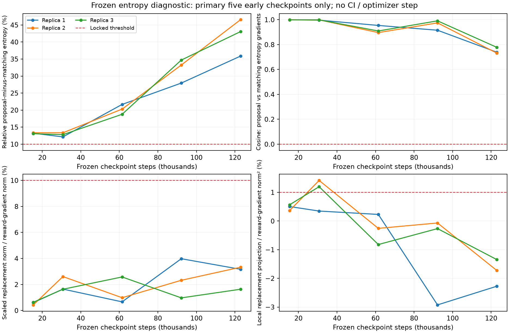

# Entropy không giải thích được sự thiếu ổn định đã đo

**Loại giả thuyết “proposal entropy gây gradient đối nghịch đáng kể với matching
entropy” trong phép diagnostic đã khóa.** Entropy proposal có phần aliasing rõ
ràng, nhưng mean actor gradients vẫn cùng hướng và việc thay thế ở coefficient
hiện tại nhỏ so với reward gradient. Chỉ3/12replica checks PASS. Không mở entropy
learner/coefficient sweep, scientific test hoặc largerN từ kết quả này. Goal vẫn
ACTIVE, chưa có bằng chứng hoàn thành đóng góp thuật toán.

## Bối cảnh và giả thuyết

[FULL learning-efficiency](technician_broker_learning_efficiency_v1_findings_vi.md)
có pooled AUCgain+0,948%, nhưng một replica−1,960%, nên FAIL guard ổn định. Giữ
nguyên verdict đó. Candidate tối ưu PPO likelihood matchingq(S), trong khi auxiliary
entropy là Hp=H(proposals)/K. Nhiều proposal tạo cùng matchingS=T(U); Hq=H(S)/K
thường thấp hơn Hp. Entropy chain rule Hp−Hq=H(U|S)/K không tự chứng minh regularizer
có hại, gradient nằm trong null space hoặc thay entropy sẽ giảm cost.

Giả thuyết cụ thể cần đồng thời có entropy gap đủ lớn, gradient Hp/Hq đối nghịch,
ảnh hưởng thay thế đủ lớn so với reward gradient, và projection thay thế thuận
lợi. Những điều kiện này được đăng ký trước kết quả, không chọn từ plots.

## Đã chạy đủ, không training/fine-tuning

- Prospective protocolb37f3c4; code e17d0e2,43testsPASS3,59s rồi commit/push trước
  chạy FULL diagnostic trực tiếp trên lab. Không separate smoke.
- Cả24candidate checkpoints:3replicas310000000..2 ×steps0/15360/30720/61440/92160/
  122880/184320/245760. Không reselect, không dùng checkpointcontrol làm teacher.
- Mỗi model64stochastic episodes do chính frozen policy tạo ra; rawphysical
  320100000..63 ghép cặp, action320200000..2 theo replica.67raw/67derived seeds
  được audit. Source physical namespace giữ nguyên; private action generator
  reset theo replica ở mỗi checkpoint, không giả vờ actions giống nhau giữa policies.
- Tổng1.536episodes,73.728policy decisions,92.160physical ticks; H48+common12tail,
  zero invalid, reward/cost/clock/population và frozen parameter/grad fields PASS.
- Primary window chỉ5early checkpoints15360/30720/61440/92160/122880 mỗi replica;
  initial/two late checkpoints descriptive, không dùng cứu gate.
- COMPLETED/auditPASS43,624415s. Không optimizer/update, teacher labels, distillation,
  warm-start, thay physics/mask/decoder hay mở CF/test states.

## Cách đo

Mỗi frozen model có3.072state/action samples. Tính MC bằng float64 và đối chiếu
source float32; normalized A=(G−V) dùng đúng source float32 recurrence và population
standard deviation trên toàn batch. Ba **actor-only ascent gradients**:

    gR = grad mean[log q(S|s) * stopgrad(A)];
    gP = grad mean Hp;    gQ = grad mean Hq.

gR là surrogate derivative ở behavior weights, khi ratio=1; không phải actual
Adam/global-clipped update có critic. Hp/Hq cùng chiaK=2, beta giữ0,01. Hq được
tính chính xác bằng25preimages→21matching masses, chỉ cho N4reference diagnostic;
không phải entropy estimator có khả năng mở rộng được đề xuất.

R=0,01||gQ−gP||/||gR|| đo độ lớn thay thế; P=0,01gR·(gQ−gP)/||gR||² là projection
cục bộ. P dương không phải phần trăm cải thiện cost. Lưu đầy đủ11141actor gradients,
thêm4reward-gradient blocks16episodes/model; normalizationA không đổi giữa blocks.

## Kết quả primary

Mean qua5early checkpoints/replica; không CI hoặc population-variance claim.

| Replica | Mean alias gap/Hp | Cosine gP/gQ min..max | Max R | Mean P |
|---|---:|---:|---:|---:|
|310000000|22,170970%|0,739232..0,999416|3,981993%|−0,823152%|
|310000001|25,366324%|0,732177..0,999606|3,327801%|−0,053350%|
|310000002|24,486885%|0,778513..0,999581|2,580363%|−0,132579%|



Từng replica cần đủ4điều kiện:

1. Mean relativealiasgap>=10%: cả3PASS.
2. Ít nhất3/5checkpoints có cos(gP,gQ)<=0, entropy gradients nonzero: cả3FAIL,
   **0/5điểm đối nghịch ở mọi replica**.
3. Ít nhất3/5có R>=10%, reward gradient nondegenerate: cả3FAIL, **0/5điểm**.
   Mean R lần lượt2,014452% /1,935947% /1,492219%.
4. Mean P>=1%, mọi gR nondegenerate: cả3FAIL, mean P đều âm.

Một vài checkpoint riêng lẻ có P dương; không chọn lại window để bỏ các điểm âm.
Cosines ở đây là gradient của entropy **trung bình trên3.072states**, không suy
ra gradient ở mọi state riêng lẻ đều cùng hướng. Projection từ frozen batch cũng
không xác định causal effect lên learning curves/AUC của replica0 hay cost H60.
Entropy có thể giúp exploration dài hạn dù local reward projection âm/dương;
diagnostic không kiểm chứng điều đó.

## Kiểm chứng độc lập

Verifierd4d7e11,10testsPASS3,48s trước commit/push/run; COMPLETED/PASS15,309368s.
Không dùng source policy class hoặc preimage-matrix entropy implementation:

- Replay tất cả92.160primitive transitions bằng event tape/dictionary physics
  độc lập, đủ1.536episode cost components/H48health và73.728used observations,
  action/broker/support/reward/behavior logs/values.
- Manual float32 MLP từ source checkpoint, private RNG hash độc lập: tái tạo
  **toàn bộ stochastic action sequence bit-exact**, không chỉ kiểm log density.
- Manual float64 MLP + closed product-of-sums matching masses, khác với source
  densepreimage calculation: tính lại đủ24×11141actor gradients cho3global
  directions và4blocks (168vectors), Hp/Hq/masses/logq và MC/normalization.
- Maxgradienterror: gR1,2061e−8,gP1,5432e−8,gQ1,3555e−8,blocks3,3788e−8.
  Max Hp error2,0921e−7,Hq3,3704e−7,mass2,6506e−7,logq1,4227e−6,
  đều trong tolerance F32/F64 đã khóa.
- Source/checkpoint/output hashes trước/sau, primarymeans/12checks/verdict PASS.

Đây là kiểm chứng phép đo mới, không replay historical training updates hay chứng
minh nguyên nhân tổng thể của việc chưa thắng baseline. Không có policy mới được
huấn luyện trong lượt này; stochastic costs chỉ là mô tả frozen evaluators.

## Quyết định nghiên cứu và artifacts

`entropy_remedy_further_design_motivated=false`;3/12checksPASS. Không có căn cứ từ
diagnostic này để đổi beta hoặc triển khai physical-entropy learner. Không gọi
entropy hiện tại “đúng tối ưu”; chỉ bác bỏ giải thích material-opposition đã khóa.
NegativeFULL/mode/H4/learning-efficiency verdicts giữ nguyên. Trước vòng học mới
cần nguyên nhân và hypothesis khác có phép kiểm riêng; không thêm component để
tìm một baseline win. Original goal về cơ chế, fair ablation, CI/health và scaling
chưa đạt; scientific panels/larger-N tiếp tục đóng.

- Branch diagnostic `codex/broker-entropy-alignment-diagnostic`; verification/report
  `codex/broker-entropy-verification`.
- Diagnostic: `artifacts/technician_broker_entropy_alignment_diagnostic_v1_20261016T171130446036Z`.
- Verification: `artifacts/technician_broker_entropy_alignment_verification_v1_20261016T171726391100Z`.
- Report0eaec1a: `artifacts/technician_broker_entropy_alignment_report_v1_20261016T171906281664Z`,
  analysis.json/hashmanifest/PNG đã kiểm tra trực quan.
- [Diagnostic protocol](technician_broker_entropy_alignment_diagnostic_v1_plan.md),
  [verification protocol](technician_broker_entropy_alignment_verification_plan.md),
  [prior-art boundary](technician_broker_method_prior_art_boundary_vi.md).

Tất cả processes đã kết thúc, hiện không có training đang chạy. Khi cần lấy
artifacts trên Mac, chạy thủ công; assistant không thực hiện transfer:

```sh
mkdir -p "/Users/bachng/Coding/Reinforcement Learning/marl/lab_results" && \
rsync -avhP --partial bachng@100.111.83.52:~/ht-pdm-fjsp/artifacts/ \
"/Users/bachng/Coding/Reinforcement Learning/marl/lab_results/"
```
