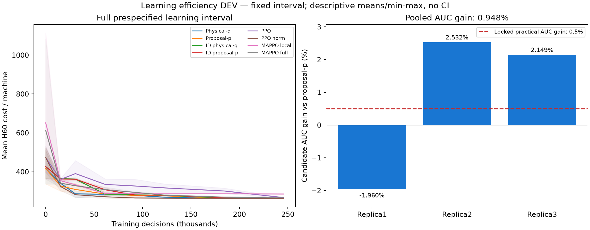
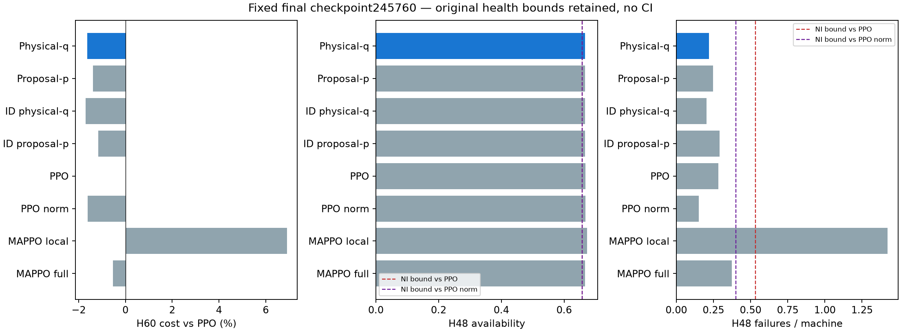

# Learning efficiency của broker-marginal PPO — FULL N4/K2

**Chưa qua development gate: AUC trung bình cải thiện0,948%, nhưng một replica
kém hơn control1,960%.** Cả14point endpoints PASS, guard bắt buộc “gain dương ở
mọi replica” FAIL. Không mở scientific confirmation/test hoặc largerN. Goal
thuật toán học từ đầu vẫn ACTIVE, chưa đạt; không bỏ replica âm hoặc nới guard.

FULL COMPLETED/auditPASS493,016885s (8,22phút),24fits từ random initialization,
5.898.240training decisions,122.880training episodes,92.160Adam updates. Independent
verification PASS12,471156s, gồm replay physical/actor và tính lại AUC/gates.

## Câu hỏi nghiên cứu và phương pháp

Đây là câu hỏi **tốc độ học trong một khoảng ngân sách cố định**, khác với claim
final-quality ở983.040steps đã thất bại. Các curves cũ gợi ý lợi thế sớm nhưng
không bền về cuối; chúng chỉ dùng để chọn hypothesis/protocol, không nhập vào
ước lượng mới. [H4audit](technician_temporal_opportunity_audit_v1_findings_vi.md)
vừa hoàn tất cũng chưa đủ động cơ cho conditional-Q learner. Không dùng H4oracle
values làm nhãn, teacher, distillation, pretraining hoặc warm-start.

Giữ nguyên learner dcef1f5: actor raw103→64→64→5,critic71→64→64→1,independent
technician proposals rồi quality/ID winner-only broker, người thua WAIT/no retry.
Candidate PPO dùng physical matching likelihood q(T(U)); primary control dùng
proposal likelihood p(U). Actor/info/capacity/broker/entropy/optimizer/budget
giống nhau trong contrast chính. Tất cả4core cùng19.974params và initial tensors;
8arms cùng initial critic tensors nhưng private objects/updates. PPO/norm18.966,
MAPPOlocal15.364,full18.052params được công bố; core ablation khớp capacity hoàn toàn.
Full current state vẫn được broadcast cho core actors, không local-only claim.

PPO-MC gamma1,clip0,2,Adam3e-4,entropy0,01(auxiliary proposal entropy),value0,5,
global grad clip0,5;16envs,rollout3072,4epochs,minibatch256,8workers/1thread.
PPO gốc unit1; core/norm/MAPPO normalized critic unitU4=115,2. Balanced_a2_b4_u12,
H48policy+common deadline tail12 không đổi. Greedy proposal+broker cho deployment;
không dùng exact matching-mode vốn đã fail diagnostic. Không đổi encoder/LR.

## Budget, seeds và cách tính AUC đã khóa

Tất cả24fits dùng **245.760decisions/model**. Checkpoints/evaluation nodes cố định:
0 /15.360 /30.720 /61.440 /92.160 /122.880 /184.320 /245.760.
Mỗi node32freshDEV physical seeds; tổng6.144checkpoint evaluation episodes.

Tính trapezoidal integral của **greedy DEV H60cost/máy** theo training decisions,
chia245.760. Dùng đúng độ dài từng khoảng, có step0, giữ từng replica×physical seed;
768AUCrows. Đây không phải cost đã chịu trong quá trình stochastic training,
wall-clock efficiency, average các checkpoint hoặc best-checkpoint cost.

Endpoint chất lượng/health/latency dùng đúng **checkpoint245.760 cho mọi arm**.
7/24ancillary earliest-min choices chọn bước sớm hơn; tất cả đều không được dùng
thay endpoint chính. Các checkpoints vẫn có source learner protocol metadata;
outer manifest ghi protocol study mới, tránh nhầm thành load model cũ.

Train310000000..2;DEVphys310100000..31;analysis310200000. CFtrain310300000..4,
DEV310400000..63,TEST310500000..255,analysis310600000 chỉ đăng ký/hash-exclusion,
chưa tạo states. ENG310700000..2 tách biệt. Seed audit PASS365raw /41.480derived,
676.758known historical derived checked. Các role thực dùng source namespace với
raw seeds mới; không sửa/monkeypatch frozen learner hoặc dùng lại weights cũ.

## Kết quả: đủ14point gates nhưng thiếu ổn định giữa replicas

Mean3training replicas×32physical DEV seeds, **chưa có CI**. AUC/cost trên H60;
availability/failures trên H48; pending tại48. Các dấu phẩy dưới đây là thập phân.

| Phương pháp | AUC cost/máy | Fixed-final cost/máy | Availability | Failure/máy | Pending/máy |
|---|---:|---:|---:|---:|---:|
|Broker physical-q(candidate)|280,427327|262,484375|0,666992|0,221354|0|
|Broker proposal-p|283,112061|263,106771|0,666775|0,247396|0|
|ID physical-q|291,960286|262,273438|0,666829|0,203125|0|
|ID proposal-p|295,285563|263,742188|0,666829|0,291667|0|
|PPO|324,513916|266,822917|0,667535|0,283854|0|
|PPO normalized|276,499919|262,500000|0,667752|0,151042|0|
|MAPPO local|306,419678|285,281250|0,673340|1,421875|0,015625|
|MAPPO full-info|299,271973|265,408854|0,666938|0,372396|0|



| Replica | Candidate AUC | Control AUC | AUC gain |
|---|---:|---:|---:|
|310000000|280,712891|275,316895|**−1,959922%**|
|310000001|284,011230|291,388428|+2,531740%|
|310000002|276,557861|282,630859|+2,148738%|

Pooled AUCgain**+0,948293%**≥0,5%: PASS. Mọi replica phải>0: **FAIL**.
Replica0 tại15.360steps có cost335,781 vs control300,141; trong61.440..122.880
candidate vẫn cao hơn khoảng7,5cost/máy. Đây là mô tả curves, không xác định được
nguyên nhân optimization/variance. Không chọn bỏ đoạn này khỏi integration.

PPO normalized có AUC thấp hơn candidate; vì vậy không nói phương pháp mới học
nhanh nhất hoặc tốt hơn PPO về sample efficiency. ID physical-q có final cost
thấp hơn candidate; không đổi candidate sau kết quả.

## Quality, health và thời gian quyết định

Fixed-final point gain vs proposal-p+0,236556%, vsIDq−0,080427%,vsIDp+0,476910%:
đều trong NI1%. Gain vs PPO gốc+1,626000%, vsnorm+0,005952%; không gọi đó là
scientific superiority khi chưa có CI/test mới. Gain vs localMAPPO+7,991018%,
vsfullMAPPO+1,101877% tại point means; core/full-info controls được giữ nguyên.



Candidate−PPO H48 availability−0,000542535,pending0,failure/máy−0,0625;
candidate−norm availability−0,000759549,pending0,failure/máy+0,0703125.
Sáu health bounds đều PASS (availability>=−0,01,pending<=+0,025,failure<=+0,25).
Failure vẫn lớn hơn normalized PPO; mean cost gần nhau không chứng minh mọi mặt
health tương đương. Zero invalid trong recorded training/evaluation/replay.

NN+broker p95**0,422039ms**,432raw samples đo riêng sau workers đã đóng;
mean0,393849ms,p99 0,473367ms. Không gồm observation/physics/network hay matching
q/gradient trong training. Timing N4 chưa chứng minh N/Kscalability.

Candidate−proposal-p H60cost/máy=−0,622396: maintenance−0,028646,
unavailability−0,125,failure−0,46875,waiting0. Candidate−norm=−0,015625:
maintenance−0,039063,unavailability−0,25,failure+0,273438. Đây là accounting H60,
không phải phân rã nhân quả; H48health có endpoint riêng.

Frozen candidate đổi q→p likelihood giữ nguyên mọi action/physical matching,
cost262,484375. Đổi broker sangID bằng cùng weights cost269,007813, nhưng retrained
IDq đạt262,273438. Fixed-weight degradation không thay được trained mechanism
ablation và không chứng minh quality broker tốt hơn ID.

## Kiểm chứng, prior art và quyết định

- Prospective protocol48eca09; frozen run8a3c1f9,branch
  `codex/broker-marginal-learning-efficiency`.45testsPASS12,09s trước push;
  wrapper guard changes được kiểm lại5testsPASS2,50s rồi commit/push trước FULL.
- Independent verifier8ca1954,26testsPASS3,97s trước chạy. Kiểm24fresh constructors,
  common critics/capacities,1.920updates journals,122.880episodes/15.360paired tapes,
  6.144DEV nodes,768AUCs với cách gán trọng số node độc lập, ancillary vsfixed choices,
  đủ14points và replica guard,432rawtimings/source/committed snapshot hashes.
- Replay độc lập1.088fixed-final episodes,65.280physical transitions,
  52.224decisions; NumPy greedy deficitmax0 trên33label/replica groups.32.256core
  target-log checks; maxabsolute error7,6354e−7.21direct gradient contexts,
  maxerror5,3291e−15. Toàn bộ likelihood/source mode/frozen execution checks PASS.
- Không replay mọi historical training gradient hoặc nonfinal DEV trajectory;
  nonfinal AUCnodes là recorded evaluations có binding, final trajectories được
  replay đầy đủ. Không dùng verification PASS để tuyên bố science PASS.

Ranh giới novelty: [đối chiếu nguồn sơ cấp](technician_broker_method_prior_art_boundary_vi.md).
Marginalization/variance identities có prior art; khác biệt broker likelihood là
can thiệp thuật toán xác định được, nhưng giảm variance không tự chứng minh AUC
hoặc cost cải thiện ở mọi run. Không có objective RL mới được xác nhận từ đây.

**Verdict giữ nguyên:**14/14points PASS,2/3extra guards PASS, overallDEV FAIL.
Loại bounded consistent-learning-efficiency claim ở protocol này; không suy ra
MPG vô ích nói chung. Không tự thêm seeds, chọn window/cadence/checkpoint khác,
tăng/giảm budget hoặc sweep hyperparameters để cứu verdict. Không mở CF/test hoặc
N lớn. Các negative983040step/mode/H4verdicts giữ nguyên. Mọi học mới cần một
nguyên nhân và giả thuyết khác được kiểm cụ thể và đăng ký trước.

## Artifacts

- FULL: `artifacts/technician_broker_learning_efficiency_v1_development_20261016T164552654335Z`.
- Verification: `artifacts/technician_broker_learning_efficiency_v1_verification_20261016T165503354876Z`.
- Main report: `artifacts/technician_broker_learning_efficiency_v1_report_20261016T165706902361Z`.
- First report165552 vẫn giữ; reporter0768fd9 chỉ nới label space/hiện cảhaihealth
  bounds, không đổi data/math/verdict. Hai PNG mới đã kiểm tra trực quan.
- [Learning protocol](technician_broker_learning_efficiency_v1_plan.md),
  [verification protocol](technician_broker_learning_efficiency_v1_verification_plan.md).

Không có training đang chạy sau completion. Lấy kết quả thủ công trên Mac;
assistant không thực thi transfer:

```sh
mkdir -p "/Users/bachng/Coding/Reinforcement Learning/marl/lab_results" && \
rsync -avhP --partial bachng@100.111.83.52:~/ht-pdm-fjsp/artifacts/ \
"/Users/bachng/Coding/Reinforcement Learning/marl/lab_results/"
```
