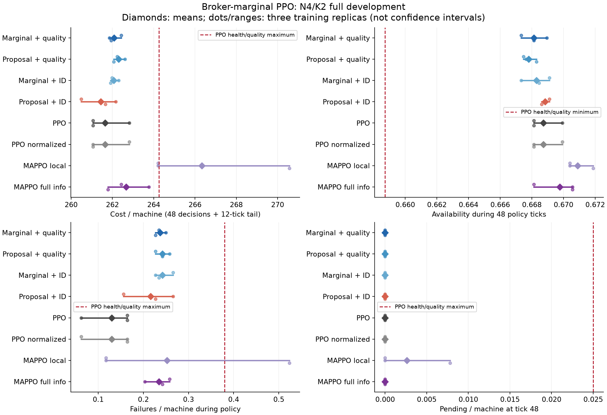
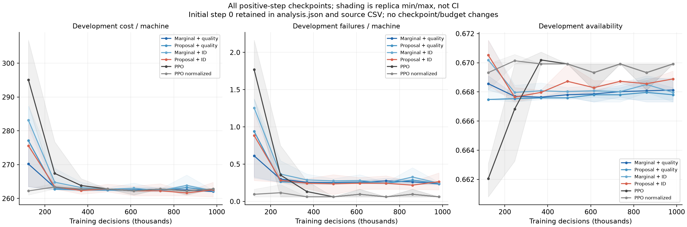
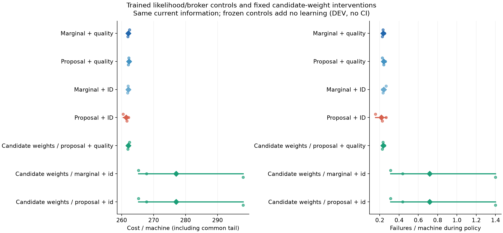

# Broker-marginal PPO v1 — FULL N4/K2 và giới hạn kết luận

**FULL đạt12/13 gate DEV, chưa đạt mục tiêu nghiên cứu.** Candidate gần PPO và vượt cả local/full-info MAPPO ở point DEV, nhưng lợi ích so với control cùng broker chỉ **0,085383%**, dưới ngưỡng **0,5%** đã khóa. Scientific confirmation/test và larger N/K vẫn đóng. Không đổi ngưỡng, không đổi candidate sang control thắng sau khi xem kết quả.

## Phương pháp và contrast chính

PPO học từ random initialization, không teacher/distillation/pretraining/warm-start. Shared raw-state actor103→64→64→5 đề xuất WAIT/máy độc lập cho mỗi technician. Broker giữ requester có restoration/duration cao nhất, tie theo ID; người thua WAIT, không retry. Actor/critic/physics/optimizer giữ nguyên trong contrast chính. Candidate dùng xác suất matching thực thi q(T(U)) trong joint PPO ratio; control dùng xác suất proposal p(U). Toàn bộ proposal vẫn được ghi và gửi vào broker thực, không giả vờ matching là proposal đã sample.

Formula q là product of winner probabilities và idle-agent allowed-request sums, không liệt kê matching trong actor/likelihood. Generic marginal policy gradients đã có prior art; không nhận là objective hay theorem PPO mới. Xem [protocol](technician_broker_marginal_ppo_v1_plan.md) và [derivation](technician_broker_marginal_algebra_note.md). Fixed full current-state broadcast được giả định; không tuyên bố local-only, permutation equivariance hoặc zero-shot transfer.

Bốn core arms là factorial quality/ID broker × marginal/proposal likelihood, cùng19974parameters (actor11141,critic8833), cùng initial tensors/RNG roles/info/budget, private on-policy updates. Cả tám phương pháp có identical fresh initial critic tensors ở object riêng, GLOBAL normclip0,5. Critic chỉ thấy state. PPO giữ unit1, core/norm/MAPPO dùng U4. PPO/norm18966, MAPPO local15364/full18052 parameters, khác biệt với core được công bố; contrast cơ chế khớp chính xác.

Entropy0,01×mean proposal categorical entropy/K được giữ cho cả bốn core: auxiliary proposal regularizer, **không phải physical entropyH(q)**. Deployment là greedy proposals + broker, không phải global mode của q. Actor select không dùng critic, matching density hay Jacobian.

## Budget và kết quả

24fits×983040decisions =23592960decisions,491520train episodes,368640Adam updates;16envs/rollout3072/epochs4/minibatch256,Adam3e-4,clip0,2,value0,5,gamma1,reward−cost/20. H48+common tail12, balanced_a2_b4_u12. Train290000000..2, DEV290100000..31. Chín checkpoint0..983040 mỗi122880steps×32DEV; earliest minimum H+Lcost, tiêu hết budget. Mean DEV dưới đây qua3train replicas×32physical seeds, không phải CI/scientific confirmation.

| Method | Cost/máy H60 | Availability H48 | Failure/máy H48 | Pending/máy ở48 |
|---|---:|---:|---:|---:|
| Marginal + quality (candidate) | 262.075521 | 0.668132 | 0.236979 | 0.000000 |
| Proposal + quality (matched control) | 262.299479 | 0.667806 | 0.242188 | 0.000000 |
| Marginal + ID | 262.065104 | 0.668294 | 0.242188 | 0.000000 |
| Proposal + ID | 261.434896 | 0.668837 | 0.216146 | 0.000000 |
| PPO | 261.643229 | 0.668728 | 0.130208 | 0.000000 |
| PPO normalized | 261.643229 | 0.668728 | 0.130208 | 0.000000 |
| MAPPO local | 266.330729 | 0.670898 | 0.252604 | 0.002604 |
| MAPPO full-info | 262.658854 | 0.669759 | 0.234375 | 0.000000 |



- Main gain vs proposal-quality **+0,085383%**, cần >=+0,5%: FAIL.
- Candidate gap vs PPO/norm **+0,165222%**, trong biên NI1%: PASS.
- Gain vs MAPPO local **+1,597716%**, full-info **+0,222088%**: PASS point gate; chưa có CI.
- Hai ID-control NI checks PASS; không phải superiority của quality broker.
- Availability delta vs cả hai PPO **−0,000596788**; pending delta0; failure delta **+0,106770833/máy/H48**. Cả sáu health checks PASS.
- Invalid0; isolated NN+broker p95 **0,41314245ms** từ432raw samples, sau workers đóng; không gồm observation/physics/network/training likelihood.

Candidate selected steps860160/983040/983040. Không tự động tăng budget lần nữa; bounded budget-remedy trước đã bị loại. Ba candidate trajectories trên firstDEV seed trùng observation hashes không có nghĩa toàn bộ weights/policies hoặc mọi seed đều giống nhau.



## Cơ chế: chứng cứ nào đúng, chứng cứ nào chưa có

Nguồn diagnostic trước cho thấy39–76% unit-weight actor-score Fisher có thể bỏ đi bằng conditioning qua broker ở một fixed greedy-DEV state panel. Đây không phải return-gradient/clipped-PPO variance hay cost gain. FULL này cho thấy giảm loại nhiễu đó **chưa tạo được lợi ích cost thực tế đã yêu cầu** ở cấu hình đã khóa. Không dùng theorem/diagnostic để bỏ qua gate thất bại. Trong ID-broker pair, marginal còn có mean cost cao hơn proposal; không có bằng chứng lợi ích đồng đều giữa broker variants.

Frozen candidate đổi sang proposal-quality giữ nguyên hoàn toàn execution/cost262,075521 như dự kiến: likelihood chỉ ảnh hưởng training, không đổi greedy execution khi weights cố định. Hai frozen ID modes cũng giống nhau, cost277,023438 và failure/m0,716146. Đổi broker làm weights cũ kém đi, nhưng retrained ID-proposal control cost261,434896 tốt hơn candidate; frozen degradation không chứng minh broker quality hoặc marginal learning cần thiết để học policy tốt hơn.



## Kiểm chứng độc lập và accounting

FULL hoàn tất1674,37giây, built-in audit PASS. Independent verification PASS20,52giây:570bindings,24fresh constructors/common critic tensors, toàn bộ train budget/tapes/checkpoint selection,65280primitive transitions/52224decisions, H60cost và H48health/broker totals. NumPy greedy actors/baselines được kiểm riêng; frozen execution equalities được kiểm từng observation/proposal/pair/diagnostic.

Quan trọng vì đóng góp là likelihood: kiểm32256core-state target logs,189dense contexts/1490legal proposal checks và21full11141-parameter actor gradients. Sai số log lớn nhất1,55019e-6, sai số direct F64 actor-gradient lớn nhất5,32907e-15. Dense reference độc lập cộng toàn bộ preimage thay vì gọi production density để làm ground truth. Code khớp cách tính xác suất đã đăng ký; kiểm chứng không chứng minh maintenance optimality hoặc variance giảm của clipped multi-epoch PPO. Historical training actions/minibatch gradients không được giữ nên không tuyên bố tái tính độc lập toàn bộ updates lịch sử.

Candidate−matched proposal-quality H60 = **−0,223958 cost/máy**: maintenance+0,041667, unavailability−0,187500, failure−0,078125, waiting0. Candidate−PPO/norm = **+0,432292**: maintenance−0,067708, unavailability−0,437500, failure+0,937500. Đây là cost accounting trên60ticks, không phải giải thích nhân quả; health failure dùng48ticks.

## Quyết định và artifacts

Giữ nguyên verdict12/13: **chưa chứng minh practical coordination-learning benefit**. Không mở CF/test/largerN. Không auto sweep LR, entropy, priorities hay encoder. Một diagnostic có giới hạn có thể kiểm tra riêng sự lệch giữa greedy-proposal deployment và exact physical matching mode; nó không sửa verdict hay biến enumeration N4 thành scalability evidence. Nếu hướng đó không có lợi ích theo gate khóa mới, phải loại remedy đó.

- Prospective learning `8578ace`; frozen learning `dcef1f554bf54172aed7f61cfdefe8d8e16b70d9`,50tests PASS10,60s trước push/FULL.
- Independent plan `5f690df`, verifier `efae9df`,23tests PASS3,42s; report accounting bổ sung primary control `d84095e`.
- FULL: `artifacts/technician_broker_marginal_ppo_v1_development_20261016T142958102925918Z`.
- Verification: `artifacts/technician_broker_marginal_v1_verification_20261016T155008583342772Z`.
- Report chính: `artifacts/technician_broker_marginal_v1_development_report_20261016T155848580412562Z`,3PNG đã QA trực quan.
- Report đầu `..._20261016T155557001980484Z` được giữ nguyên; report mới chỉ bổ sung cost decomposition với main control, không đổi data/verdict.
- Branch: `codex/broker-marginal-verification`.

Mục tiêu vẫn ACTIVE, chưa đạt scientific N4 confirmation và scaling/generalization.

Lệnh tùy chọn chạy trên Mac (assistant không chạy transfer):

```sh
mkdir -p "/Users/bachng/Coding/Reinforcement Learning/marl/lab_results" && \
rsync -avhP --partial \
  bachng@100.111.83.52:~/ht-pdm-fjsp/artifacts/ \
  "/Users/bachng/Coding/Reinforcement Learning/marl/lab_results/"
```
