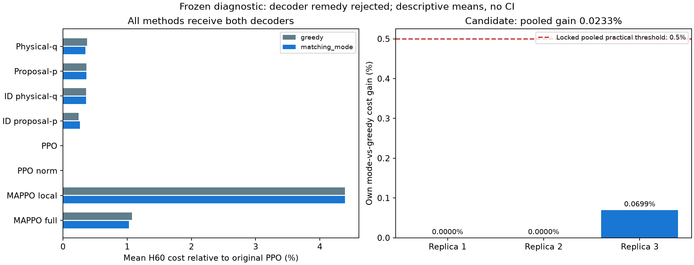

# Frozen matching-mode diagnostic — N4/K2

**Loại remedy “đổi greedy proposal thành mode của matching”.** Candidate chỉ giảm
cost0,0233%, không đạt ngưỡng thực tế0,5%; hai replicas không đổi. Mismatch chỉ
7/9.216 quyết định trên quỹ đạo candidate greedy (0,0760%), dưới ngưỡng1%.
Tất cả điều kiện cần đã khóa không đồng thời đạt. Goal vẫn ACTIVE/chưa đạt;
scientific confirmation/test và larger N/K tiếp tục đóng.

## Vì sao chạy phép kiểm này

[FULL broker-marginal](technician_broker_marginal_v1_findings_vi.md) đã FAIL12/13:
huấn luyện theo xác suất matching thực thi q chỉ cải thiện0,0854% so với control
huấn luyện theo proposal p, cần0,5%. Kết quả đó giữ nguyên. Một nguyên nhân triển
khai cụ thể cần kiểm tra: mode của q(T(U)) không nhất thiết bằng broker áp dụng
lên từng proposal greedy. Ví dụ, nhiều proposal khác nhau có thể cùng tạo ra một
matching, nên tổng xác suất của matching đó có thể cao hơn matching từ proposal
có xác suất riêng cao nhất. Mode xác suất không mặc nhiên tối ưu maintenance cost.

Không huấn luyện/fine-tuning thêm. Dùng nguyên24 checkpoint đã chọn trong FULL
gốc, không reselection, không teacher, không thay entropy/reward/optimizer.
So sánh greedy và exact physical matching-mode cho **cả tám phương pháp**, trên
64physical seeds mới300100000..63 ghép cặp, source physical RNG namespace giữ
nguyên. Ba training replicas đã có ×64seeds ×8methods ×2modes =3.072episodes;
H48policy +12common deadline tail =184.320physical transitions/147.456decisions.

Reference mode liệt kê21matching N4. Core tích phân25latent technician proposals
qua quality/ID broker; MAPPO tích phân81machine proposals qua broker urgency gốc.
PPO/norm có21joint tokens nên mode và greedy phải trùng toàn bộ trajectories.
Đây là diagnostic tham chiếu N4, **chưa phải decoder có khả năng mở rộng**.
Tất cả actor/critic weights giữ nguyên trước/sau. Policy scores ghi trong journal
là matching log masses của mô hình, không phải behavior likelihood của deterministic
mode execution. Representative mode proposals không xung đột theo cách dựng;
điều đó không chứng minh policy học phối hợp tốt hơn.

## Kết quả đầy đủ

Các số dưới đây là descriptive means,3replicas ×64paired physical seeds;
không CI, không scientific superiority claim. Cost/máy trên H60.

| Phương pháp | Greedy cost/máy | Matching-mode cost/máy |
|---|---:|---:|
| Broker physical-q (candidate) |262,748698|262,687500|
| Broker proposal-p |262,720052|262,720052|
| ID physical-q |262,712240|262,712240|
| ID proposal-p |262,410156|262,455729|
| PPO |261,766927|261,766927|
| PPO normalized |261,766927|261,766927|
| MAPPO local |273,255208|273,255208|
| MAPPO full-info |264,582031|264,457031|



| Candidate replica | Greedy | Matching-mode | Own cost gain |
|---|---:|---:|---:|
|290000000|262,695313|262,695313|0%|
|290000001|262,777344|262,777344|0%|
|290000002|262,773438|262,589844|+0,06987%|

Pooled own gain **+0,0232914%**, cần>=0,5%: FAIL. Mỗi replica phải cải thiện
strictly>0: FAIL. Primary same-state mismatch **0,0759549%**, cần>=1%: FAIL.
All-method mode panel vẫn12/13point gates: main gain vs proposal-p chỉ
**+0,0123904%**, cần>=0,5%: FAIL. Zero invalid assignments: PASS. Vì vậy screen
chỉ1/5conditions PASS; không có cơ sở từ phép kiểm này để mở một decoder trial.

Candidate mode cao hơn PPO0,3517%, trong biên gần-PPO1% nhưng chưa có xác nhận
bằng CI. Nó thấp hơn local MAPPO3,8673% và full-info MAPPO0,6691% tại point means;
đây chưa đủ chứng minh đóng góp cơ chế. ID proposal-p control có cost thấp hơn
candidate; không đổi candidate sau khi xem kết quả.

## Health và accounting

H48candidate mode: availability0,667209; pending/máy0; failures/máy0,236979.
PPO:0,667969 /0 /0,118490. Availability delta−0,00075955 đạt bound>=−0,01;
pending delta0 đạt<=0,025; failure delta+0,118490 đạt<=0,25. Cả sáu health
checks so với PPO/norm PASS. Failure vẫn cao hơn PPO, nên không diễn giải
“cost gần PPO” thành “mọi mặt sức khỏe hệ thống tương đương”.

Own mode−greedy H60cost/máy=−0,061198: maintenance+0,005208,
unavailability−0,046875,failure−0,019531,waiting0. Đây là accounting H60,
không phải phân rã nhân quả; failure health endpoint đo riêng H48.

## Cơ chế: tranh chấp không đồng nghĩa có assignment thay thế hữu ích

Trên9.216candidate greedy decisions, có904rejected proposals nhưng chỉ7same-state
mode mismatches. Mean expected latent rejections theo phân phối actor là0,149558
mỗi decision; mode representative có executed rejections0 theo construction.
Số0này không thay đổi underlying proposal law thành một policy học không tranh chấp.

**Exploratory sau kết quả**, chỉ đếm support trên các states đã ghi: trong904
rejected proposals chỉ2có một máy khác vừa eligible vừa chưa được chọn; không
trường hợp nào có failed alternative. Minimum alternative duration ở cả2là1tick.
Không thực thi hành động fallback, không tạo state mới. Những số này không chứng
minh một reassignment sẽ giảm cost; chúng cũng không tạo cơ sở để tự động thêm
retry sau tranh chấp. Phần lớn tranh chấp hiện tại không kèm alternative hợp lệ
ở chính state đó. Không suy rộng sang policy khác, training distribution hoặc N lớn.

## Kiểm chứng và quyết định nghiên cứu

Diagnostic COMPLETED/auditPASS153,38s. Trước chạy:81unit/integration tests PASS,
commit/push5391313; prospective protocol ce30470. Kiểm chứng riêng33a33ce có
10tests PASS trước chạy, artifact PASS27,97s. Replay độc lập3.072episodes và
184.320transitions với seeded event tape/pure dictionary physics; tính lại
147.456decisions bằng float64 NumPy MLP, cộng trực tiếp toàn bộ25/81preimages
thay vì gọi closed-form density của learner. Log-mass absolute error tối đa
**7,5012e−7** so với float32 source; all greedy physical matchings trùng; recompute
toàn bộ means/health/screen trùng. Source/checkpoint/output hashes được ràng buộc.
Không tái tính training gradients, không mở test seeds.

Loại **remedy exact matching-mode này**. Không tự động chuyển sang beam/search,
temperature, thêm training hoặc decoder sweep. Identity marginal-gradient đã kiểm
đúng về toán vẫn không phải bằng chứng cải thiện PPO cost. FULL12/13 cũ giữ nguyên.
Trước vòng học mới cần một nguyên nhân và giả thuyết khác được kiểm cụ thể; số
proposal xung đột không đủ để chọn hướng retry hoặc thêm component. Không mở rộng
N/K để bỏ qua gate N4 thất bại, và không tuyên bố đã đạt goal từ diagnostic âm.

## Artifacts và tái lập

- Diagnostic branch `codex/broker-mode-diagnostic`, frozen code5391313.
- Audit/report branch `codex/broker-mode-verification`; verifier33a33ce, reporter7d5c60c.
- Diagnostic: `artifacts/technician_broker_mode_diagnostic_v1_20261016T161807576637Z`.
- Verification: `artifacts/technician_broker_mode_verification_v1_20261016T162157684784Z`.
- Report: `artifacts/technician_broker_mode_report_v1_20261016T162434442647Z`.
- Protocol: [diagnostic](technician_broker_mode_diagnostic_v1_plan.md),
  [verification](technician_broker_mode_verification_plan.md).

Plot đã kiểm tra trực quan; raw artifacts không sửa. Reporter đầu tiên thiếu
`tqdm` ở interpreter vẽ hình và dừng trước khi tạo artifact; đã chạy lại với
dependency path phù hợp, không thay dữ liệu/code/verdict.

Tùy chọn chạy trên Mac; assistant không thực thi transfer:

```sh
mkdir -p "/Users/bachng/Coding/Reinforcement Learning/marl/lab_results" && \
rsync -avhP --partial \
  bachng@100.111.83.52:~/ht-pdm-fjsp/artifacts/ \
  "/Users/bachng/Coding/Reinforcement Learning/marl/lab_results/"
```
