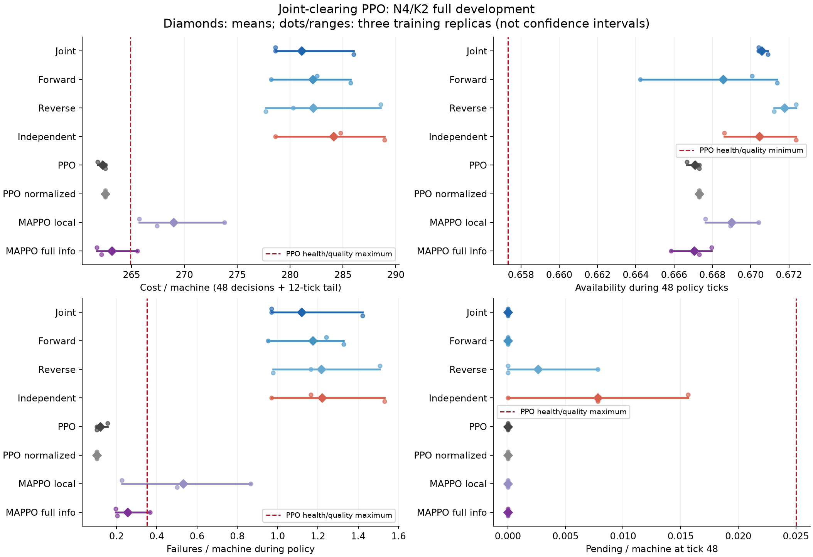
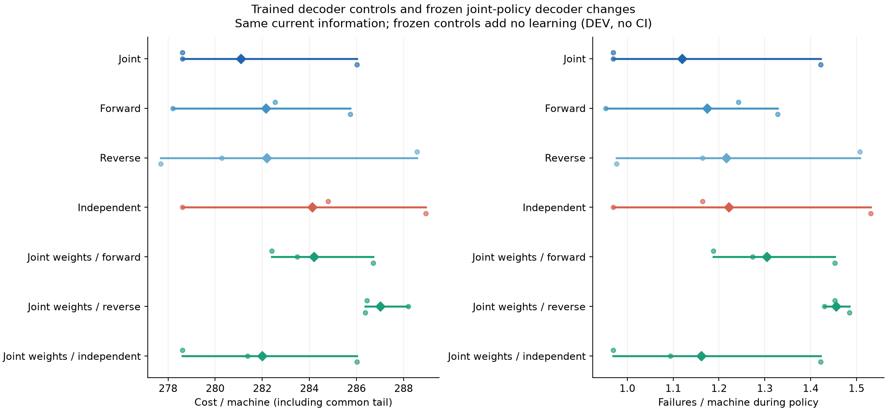
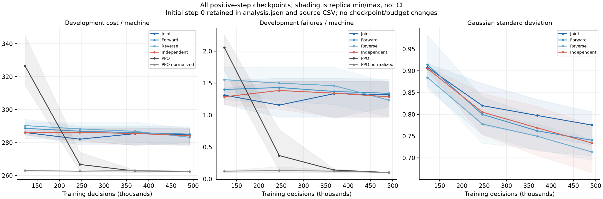

# Joint-clearing PPO v1: phối hợp có tín hiệu DEV, chất lượng chưa đạt

**Vòng FULL không đạt: 7/13 tiêu chí bắt buộc qua, 6 tiêu chí trượt.** Candidate
giảm mean DEV cost 1,0678% so với đề xuất độc lập cùng thông tin, mạng và ngân
sách. Tuy nhiên cost cao hơn PPO 7,1708%, đồng thời failure/máy tăng 1,00 thay
vì tối đa +0,25 cho phép. Availability tốt hơn và backlog bằng 0 không bù được
hai thất bại này. Không mở scientific confirmation hoặc tăng N/K.

Tất cả là kết quả DEVELOPMENT trên 3 training replicas ×32 physical seeds;
không có CI hoặc kết luận thắng trên quần thể. Một replica có cùng cost với
đối chứng độc lập. Mục tiêu nghiên cứu học từ đầu gần PPO vẫn chưa đạt.

## Thiết kế đã chạy

Policy học từ random weights, giữ PPO-MC chuẩn: không teacher, distillation,
warm start, demonstration bank hoặc nhãn matching tối ưu. Actor H32 nhận thông
tin vật lý hiện tại đầy đủ và sinh mean utility cho từng cặp máy–technician.
Khi train, lấy mẫu Gaussian trên các cặp hợp lệ; PPO dùng tổng log density của
utility đã lấy mẫu. Bước min-cost-flow chốt một partial matching tối đa utility.
Nó không tối ưu trực tiếp future maintenance cost và không nhìn event tương lai.

Khi đánh giá greedy, policy chốt matching từ mean utility; đây không phải tuyên
bố matching đó là mode của phân phối hành động vật lý. Nhiều utility matrices
có thể cho cùng matching. Likelihood và entropy của latent Gaussian không phải
likelihood/entropy đã marginalize của matching. Hệ thống cần shared current
graph và clearing service, chưa kiểm chứng network transport/decentralized execution.

Ba ablation giữ cùng actor/critic/tensors/inputs/RNG/491.520 quyết định huấn luyện:
forward/reverse chốt lần lượt từng technician; independent đề xuất trên support
ban đầu, tranh chấp giữ bid cao nhất rồi technician index thấp hơn, bên thua
WAIT. Chỉ decoder khác. Cùng latent initialization không đồng nghĩa cùng initial
physical policy. Bản forward/reverse vẫn có phối hợp; gate của chúng là
noninferiority, không phải bằng chứng joint tốt hơn serial một cách chắc chắn.

Mỗi core có 19.843 parameters (actor8.066/critic11.777); PPO/norm18.966,
localMAPPO15.364/full-infoMAPPO18.052. Khác biệt capacity với baseline được giữ
rõ; mọi mechanism ablation có capacity bằng nhau. Baseline đầy đủ thông tin
được train mới, nên kết luận không dựa riêng vào local MAPPO ít thông tin hơn.

Generic structured/latent matching không phải phát minh của vòng này; xem
[SPG](https://arxiv.org/abs/1805.07010),
[Wolpertinger](https://arxiv.org/abs/1512.07679),
[Action Mapping](https://arxiv.org/abs/2412.04327),
[Projection agents](https://arxiv.org/abs/2605.19721).
Đóng góp chỉ có thể đến từ thiết kế maintenance coordination và bằng chứng
cost/health/mechanism/scaling; vòng hiện tại chưa hoàn thành bằng chứng đó.

## Ngân sách và provenance

Protocol53e3e7e; learning frozen **690be2d8241b9e5a2625c537e0c684f95674b4d0**.
35 correctness tests PASS11,33s; sau tăng cường audit,14 tests liên quan PASS9,85s;
commit/push trước FULL, không có smoke experiment riêng.

24 fits,8 methods ×3replicas,11.796.480 policy decisions /245.760 train episodes /
184.320 Adam steps. Mỗi fit dùng đủ491.520 decisions dù checkpoint tốt nhất
được chọn sớm. 16envs/rollout3072/4epochs/mb256, Adam3e-4, clip0,2, entropy0,01,
value0,5; critic normalized115,2, actor/critic group clip0,5 ở core.

DEV train250000000..2, physical250100000..31; registry366raw/82.429derived đã audit.
3.840 DEV episode conditions trên5checkpoints;768 selected conditions được replay;
288 frozen-decoder conditions và32deadline reference. Không tính các replay này
thành thêm training replicas/physical seeds độc lập. FULL kết thúc
**COMPLETED/audit PASS, 1.069,333148 giây ≈17phút49giây**,0invalid.

Source artifact:
`technician_joint_clearing_ppo_v1_development_20261016T081402007731716Z`.
Runner không có đường thực thi scientific test; mọi test250500000..255 vẫn đóng.

## Chất lượng và sức khỏe

Cost gồm48policy ticks +12common-tail ticks, chia4máy. Availability, failures
và pending dùng cutoff policy48ticks. Các con số dưới đây là mean DEV.

| Method | Cost/máy | Availability | Pending/máy | Failures/máy |
|---|---:|---:|---:|---:|
| Joint candidate |281,083333|0,670573|0|1,119792|
| Forward |282,158854|0,668566|0|1,174479|
| Reverse |282,182292|0,671766|0,002604|1,216146|
| Independent |284,117188|0,670464|0,007812|1,221354|
| PPO gốc |262,276042|0,667101|0|0,119792|
| PPO normalized |262,515625|0,667318|0|0,101563|
| MAPPO local |268,984375|0,669000|0|0,531250|
| MAPPO full info |263,138021|0,667046|0|0,255208|
| Deadline |287,007813|0,666504|0,007813|1,375000|



| Gate đã khóa | Quan sát | Yêu cầu | Đạt |
|---|---:|---:|---|
| Gain vs forward |+0,3812%|≥−1%|Có|
| Gain vs reverse |+0,3894%|≥−1%|Có|
| Gain vs independent |+1,0678%|≥+0,5%|Có|
| Gain vs PPO |−7,1708%|≥−1%|Không|
| Gain vs normalized PPO |−7,0730%|≥−1%|Không|
| Gain vs local MAPPO |−4,4980%|>0|Không|
| Gain vs full-info MAPPO |−6,8197%|>0|Không|
| Availability delta vs PPO / norm |+0,003472 /+0,003255|≥−0,01 cả hai|Có /Có|
| Pending/máy delta vs PPO / norm |0 /0|≤+0,025 cả hai|Có /Có|
| Failure/máy delta vs PPO / norm |+1,00 /+1,018229|≤+0,25 cả hai|Không /Không|

Inference p95 NN+decoder là0,392925ms,432samples, qua50ms. Một phép đo riêng sau
FULL cho0,398826ms,432samples lưu từng dòng. Cả hai loại trừ observation building,
physical transition và transport. Chưa có kết quả hệ thống ở larger N/K.

## Bằng chứng cơ chế có giới hạn

Ba candidate replica có cost278,617188 /278,617188 /286,015625; independent tương
ứng284,789063 /278,617188 /288,945313. Mean gain là tín hiệu DEV, không lợi ích
dương ở mọi replica và không thay thế confidence interval trên test mới.

Tắt decoder tại CÙNG candidate weights, tiếp tục rollout trên cùng DEV panel:

| Decoder tại candidate weights | Cost/máy | Failures/máy |
|---|---:|---:|
| Joint |281,083333|1,119792|
| Forward |284,197917|1,304688|
| Reverse |287,007813|1,455729|
| Independent |282,000000|1,161458|

Frozen independent chỉ tăng cost0,916667/máy (~0,3251% gain của joint); hai trong
ba replica có cùng cost. Không coi các rollout này là thêm model replicas,
không kết luận mọi improvement đến từ decoder. Trained ablation thay cả quá
trình học và execution mapping; frozen ablation đo tác động tại weights đã học.



## Learning curve và cost decomposition

Các candidate chọn checkpoint245.760 /245.760 /122.880, với sigma≈0,77466 /
0,81457 /0,91484. Mọi fit vẫn chạy hết491.520. Curve cuối không cho căn cứ để
tự động nhân đôi budget. Sigma giảm theo train; không suy từ đây thành nguyên
nhân thất bại hay tự động cố định/đổi variance.



Accounting hậu nghiệm trên toàn60ticks: candidate−PPO cost/máy18,807292 khớp
chính xác maintenance+1,494792, unavailability−1,906250, failure+19,218750 và
waiting+0. Failure cost này tính cả tail, còn health gate chỉ tính48policyticks;
không đánh đồng hai đại lượng. Chênh lệch cost chủ yếu nằm ở failure component,
không chứng minh nguyên nhân hành động hoặc một duration penalty sẽ giải quyết.
Full60 service_ticks/máy giảm0,135417, completed_jobs/máy tăng0,221354 soPPO;
occupancy/job counts riêng lẻ không đủ giải thích health failure.

## Kiểm chứng độc lập

Prospective verifier plan df225d4, code061dc6b,15testsPASS1,41s, push trước chạy.
Artifact `technician_joint_clearing_v1_verification_20261016T083337609259828Z`:
PASS15,526377s,451source SHA/size bindings và committed Git source/protocol/registry.

Verifier tự dựng Torch initial modules, khớp toàn bộ24initial checkpoints với
fresh registered seeds; kiểm final digests, đủ160update rows/fit,245.760trainEP,
30.720paired physical tapes (tự sinh lại initial state/shocks), toàn3840DEV grid và
checkpoint choices. Primitive Python dynamics độc lập replay đủ65.280transitions,
52.224decisions,48cutoff health, cost decomposition và broker counts. Không import
simulator transition của repository cho phần này.

ỞK2, top-two alternative bound kiểm matching utility tối ưu mà không liệt kê
matching/call flow solver. Nó chứng minh tối ưu utility đã học, không chứng minh
tối ưu maintenance return. NumPy độc lập kiểm50.688selected actor states, gồm
32.256core/frozen states; max numerical error1,23717e-6 trong tolerance đã khóa.
PPO catalogue chỉ dùng xác nhận interface baseline. Independent13gate verdict
khớp kết quả âm tính ban đầu. Historical training actions/minibatch gradients
không được lưu nên không tuyên bố replay độc lập phần đó; có behavior replay
journals và correctness tests. Tất cả checkpoints/source artifacts giữ nguyên.

Report artifact (3figures đã xem QA, không cắt nhãn):
`technician_joint_clearing_v1_development_report_20261016T084236471124316Z`.
Nó chứa analysis.json, curves/sigma, component accounting, reporter.py và output
bindings; source và verification manifest hashes được bind. Đây là post-hoc DEV,
không thêm endpoint, training hoặc physical trajectory.

## Quyết định

Giữ nguyên kết quả **không đạt**. Cơ chế clearing có tín hiệu so với independent
nhưng chưa chứng minh policy đủ chất lượng để mở rộng. Các serial controls cũng
có failure cao, nên không thể quy toàn bộ gap cho cách giải matching khi chính
matching đã được kiểm utility-optimal; cũng chưa chứng minh lỗi nằm ở encoder,
variance hay cách cập nhật PPO. Cần một giả thuyết kiểm chứng riêng trước khi
tinh chỉnh thành phần tiếp theo. Không mở confirmation/larger-N, không nới health
limits, không dùng teacher hoặc chọn best replica để thay verdict.

Nếu kiểm tiếp, một câu hỏi cụ thể là stochastic policy được huấn luyện khác
mean-projection khi deployment đến mức nào. Hiện chưa có protocol/dữ liệu mới để
kết luận câu hỏi đó hoặc tự động sửa execution. Mọi follow-up học phải đăng ký
trước, random initialization, giữ matched controls/budgets và test panel mới.

Lấy artifacts về Mac thủ công khi cần; không có transfer do agent thực hiện:

```bash
mkdir -p "/Users/bachng/Coding/Reinforcement Learning/marl/lab_results" &&
rsync -avhP --partial \
  bachng@100.111.83.52:~/ht-pdm-fjsp/artifacts/ \
  "/Users/bachng/Coding/Reinforcement Learning/marl/lab_results/"
```
