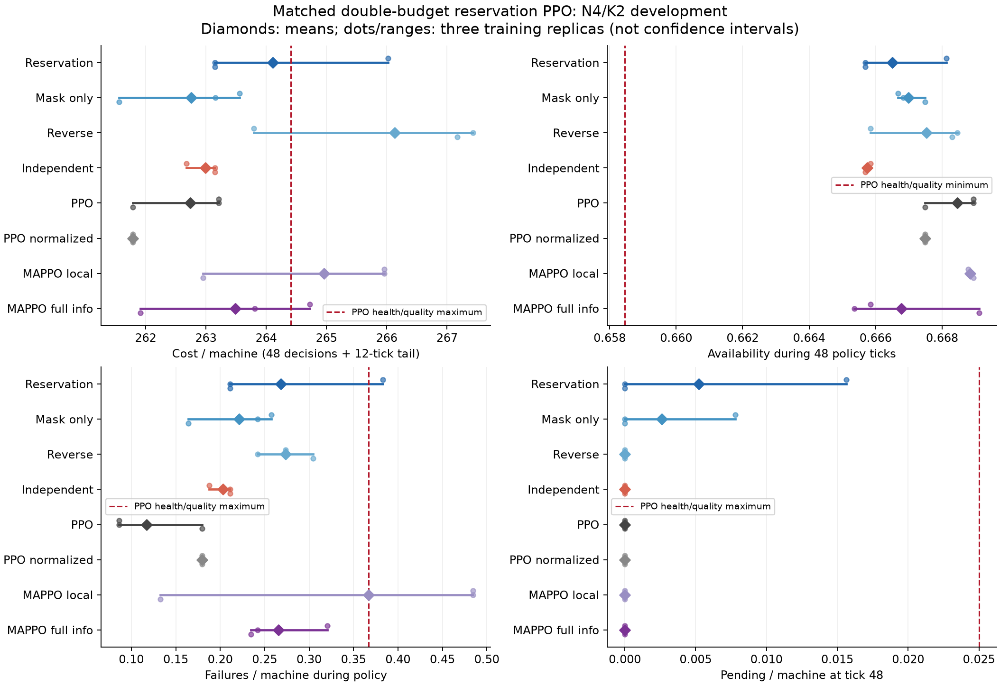
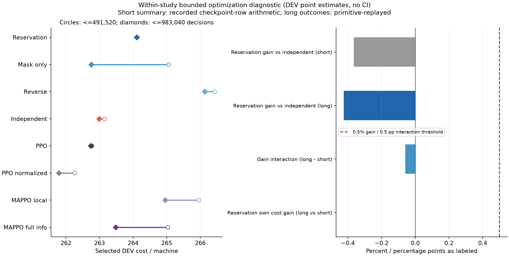
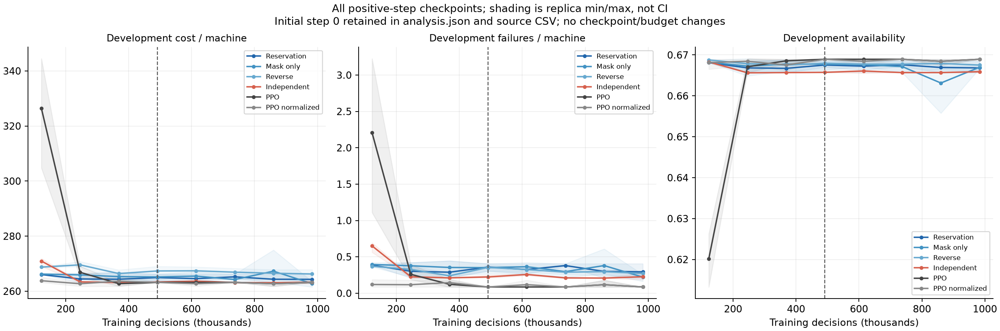
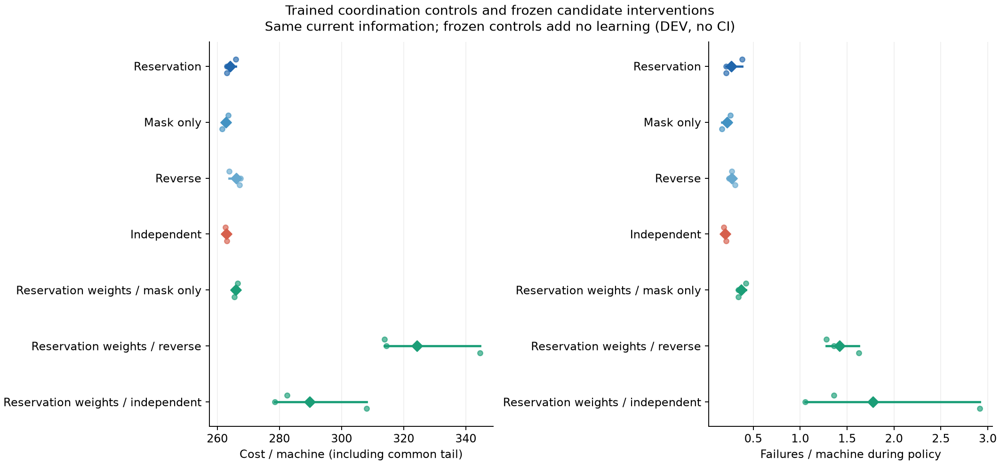

# Bounded double-budget reservation PPO — kết quả FULL N4/K2

**Loại phương án tăng gấp đôi ngân sách đã khóa: candidate không cải thiện selected cost, vẫn thiếu bằng chứng cơ chế.** Primary DEV đạt 11/13 gate; cả hai điều kiện của giả thuyết tăng budget đều FAIL. Scientific test và larger N/K chưa mở. Goal vẫn ACTIVE, chưa đạt.

FULL hoàn tất 1.643,87 giây (khoảng 27,4 phút), built-in audit PASS. Kiểm chứng độc lập PASS 570 bindings, 24 fits, 23.592.960 decisions, 491.520 training episodes, 368.640 Adam updates, 61.440 tapes ghép cặp, 6.912 DEV checkpoint episodes, 65.280 primitive transitions và 52.224 quyết định triển khai. NumPy greedy-logit deficit tối đa 0 trên 33 nhóm policy/replica. Audit không tái tính toàn bộ training gradients vì actions/gradients lịch sử không được lưu.

## Giả thuyết và so sánh

Lượt [raw-state v1](technician_raw_state_reservation_v1_development_findings_vi.md) thất bại cơ chế dù gần PPO. Hai trong ba replicas khi đó chọn checkpoint cuối. Điều này chỉ gợi ý khả năng thiếu budget. Follow-up giữ nguyên actor/critic/optimizer/physics, học lại từ random weights trên seeds mới, tăng budget của CẢ TÁM phương pháp từ 491.520 lên 983.040 decisions/model. Không teacher, distillation, warm-start, reward shaping, encoder/LR/attention sweep.

Bốn core arms cùng 19.974 parameters, cùng initial actor tensors và full current physical sensing. Tám phương pháp có cùng freshly random initial critic tensors ở các object riêng; học private on-policy. Global clipping 0,5 cho mọi phương pháp; normalized PPO/core/MAPPO dùng value unit U4, PPO gốc giữ unit1. PPO/norm 18.966 parameters; local MAPPO 15.364; full-info MAPPO 18.052. Khác biệt dung lượng với baseline được công bố; ablation cơ chế khớp chính xác.

Train 280000000..2; DEV 280100000..31. 16 envs, rollout3072, 4epochs, minibatch256, Adam3e-4, clip0,2, entropy0,01, value0,5, gamma1; H48 + common tail12, balanced_a2_b4_u12. Chín checkpoint 0..983.040 mỗi122.880 steps, mỗi checkpoint32DEV. Chọn earliest minimum H+L cost riêng trong cửa sổ <=491.520 và <=983.040; tiêu hết ngân sách dài cho tất cả. Tập checkpoint dài lớn hơn có thể ảnh hưởng lựa chọn; không gán mọi chênh lệch cho riêng tham số ở step cuối.

## Kết quả primary ở ngân sách dài

Các số là mean DEV qua3replicas×32physical seeds, chưa có CI/scientific confirmation. Cost trên H60; availability/failure trên H48; pending tại48.

| Phương pháp | Cost/máy | Availability | Failure/máy | Pending/máy |
|---|---:|---:|---:|---:|
| Reservation | 264.106771 | 0.666504 | 0.268229 | 0.005208 |
| Mask-only | 262.755208 | 0.666992 | 0.221354 | 0.002604 |
| Reverse | 266.132812 | 0.667535 | 0.273438 | 0.000000 |
| Independent | 262.992188 | 0.665744 | 0.203125 | 0.000000 |
| PPO | 262.736979 | 0.668457 | 0.117188 | 0.000000 |
| PPO normalized | 261.789062 | 0.667480 | 0.179688 | 0.000000 |
| MAPPO local | 264.958333 | 0.668837 | 0.367188 | 0.000000 |
| MAPPO full-info | 263.484375 | 0.666775 | 0.265625 | 0.000000 |



Candidate cao hơn PPO gốc 0,5214% và normalized PPO 0,8853%, đều trong biên gần-PPO1% đã khóa. Gain so với Independent = **−0,4238%**, cần >=+0,5%: FAIL. Gain so với full-info MAPPO = **−0,2362%**, cần >0: FAIL. Gain so với local MAPPO +0,3214% chỉ là point DEV, chưa chứng minh superiority. Các gate NI so với mask-only/reverse và sáu health checks đều PASS. Invalid assignments0; primary NN+decoder p95 **0,707318ms** từ432 raw samples sau workers đóng, không gồm observation/physics/network.

## Kiểm tra giả thuyết tăng budget

| Phương pháp | Selected cost <=491.520 | Selected cost <=983.040 |
|---|---:|---:|
| Reservation | 264.106771 | 264.106771 |
| Mask-only | 265.059896 | 262.755208 |
| Reverse | 266.424479 | 266.132812 |
| Independent | 263.145833 | 262.992188 |
| PPO | 262.768229 | 262.736979 |
| PPO normalized | 262.263021 | 261.789062 |
| MAPPO local | 265.950521 | 264.958333 |
| MAPPO full-info | 265.028646 | 263.484375 |

Cả ba candidate chọn cùng checkpoint ở hai cửa sổ: 122.880 / 245.760 / 368.640. Selected mean cost giữ nguyên **264,106771**. Không có bằng chứng thiếu budget trong phép kiểm đã khóa.

- Candidate own selected-cost gain = **0%**, cần >=0,5%: FAIL.
- Gain so với Independent ngắn = −0,365173%; dài = −0,423809%.
- Interaction dài−ngắn = **−0,058636 điểm phần trăm**, cần >=+0,5 điểm phần trăm: FAIL.

Short summary được tính từ recorded checkpoint rows (768 conditions), không phải một đợt independent primitive short replay bổ sung. Independent verifier kiểm lại cutoff selection/means và cả hai phép tính budget; primary long trajectories được replay độc lập. Không so mean giữa seeds270 và280 để tuyên bố tác động nhân quả của budget.





## Cơ chế và cost accounting

Frozen candidate đổi sang mask-only cost265,916667; reverse324,289063; independent289,718750. Điều này tiếp tục cho thấy trained weights phụ thuộc conditioning/order. Nó không thay thế ablation huấn luyện từ đầu: retrained Independent và full-info MAPPO vẫn thắng candidate.



Candidate−normalized PPO H60 = +2,317708 cost/máy: maintenance+0,036458; unavailability+0,562500; failure+1,718750; waiting0. Candidate−Independent = +1,114583: maintenance+0,184896; unavailability−0,437500; failure+1,367188; waiting0. Đây là accounting H60, không phải phân rã nhân quả; health failure gate dùng H48.

## Quyết định và artifacts

Loại remedy tăng budget này; không tự động nhân đôi lần nữa, đổi LR hoặc thêm encoder để sửa verdict. Phương pháp raw-state/prefix chưa có đủ bằng chứng học phối hợp tốt hơn control. Một hướng khác cần cơ chế riêng và protocol/seed panel mới; không được dùng frozen degradation hoặc điểm gần-PPO để bỏ gate thất bại.

- Protocol learning: `5dbb595`; frozen learning `4ade42381681e073efc8a2c7dc9efb43640a3809`, branch `codex/raw-reservation-budget-followup`.
- 37 correctness tests PASS10,49s trước commit/push/FULL.
- Independent protocol `364e624`, verifier `07e192c`, 18 verifier tests PASS3,07s; report code `bd876b9`.
- FULL: `artifacts/technician_raw_reservation_budget_v1_development_20261016T133319602371704Z`.
- Verification: `artifacts/technician_raw_reservation_budget_v1_verification_20261016T140106818607718Z`, PASS18,52s.
- Report: `artifacts/technician_raw_reservation_budget_v1_development_report_20261016T140143253134185Z`, bốn PNG đã kiểm tra trực quan, analysis.json và manifest có hashes.

Protocol: [learning](technician_raw_reservation_budget_v1_plan.md), [verification](technician_raw_reservation_budget_v1_verification_plan.md).

Lệnh tùy chọn chạy trên Mac để lấy artifacts; assistant không chạy transfer:

```sh
mkdir -p "/Users/bachng/Coding/Reinforcement Learning/marl/lab_results" && \
rsync -avhP --partial \
  bachng@100.111.83.52:~/ht-pdm-fjsp/artifacts/ \
  "/Users/bachng/Coding/Reinforcement Learning/marl/lab_results/"
```
