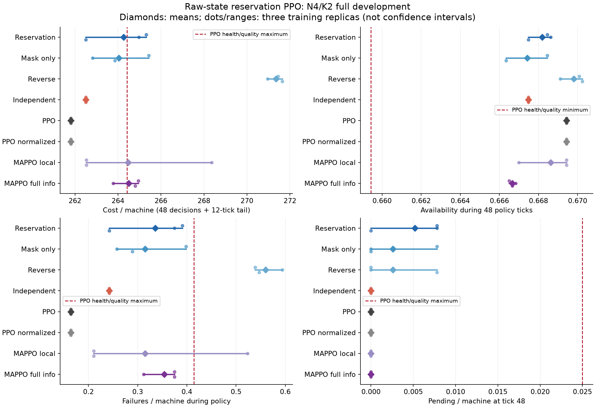
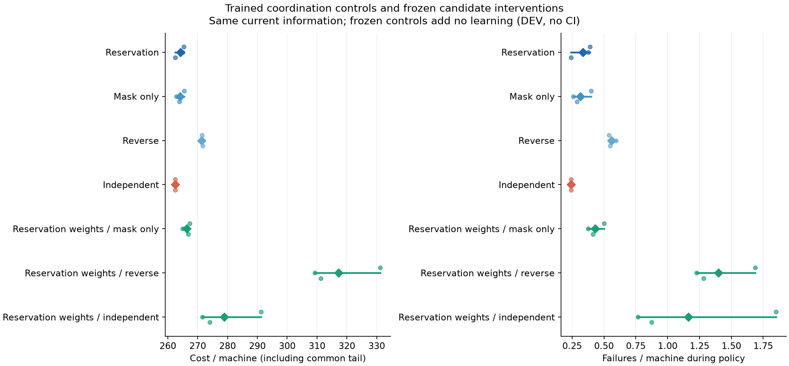
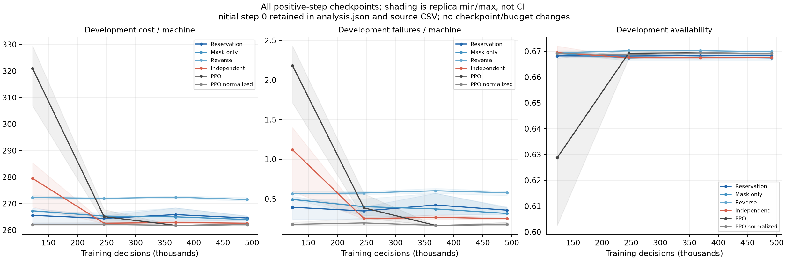

# Raw-state reservation PPO v1 — kết quả FULL N4/K2

## Kết luận hiện tại

**Chưa đạt mục tiêu nghiên cứu: FULL DEV đạt 12/13 gate, thất bại ở bằng chứng cơ chế.** Policy học từ khởi tạo ngẫu nhiên, không teacher, distillation hay warm-start. Cost chỉ cao hơn PPO 0,938%, nằm trong biên gần-PPO 1% đã khóa, nhưng bản độc lập được huấn luyện cùng thông tin, dung lượng và ngân sách lại tốt hơn bản reservation. Chưa mở confirmation hoặc setting lớn.

FULL hoàn thành 864,47 giây; audit tích hợp PASS. Kiểm chứng độc lập PASS toàn bộ 457 bindings, 24 mô hình, 245.760 training episodes, 11.796.480 quyết định, 184.320 Adam steps, 30.720 tapes ghép cặp, 3.840 DEV checkpoint episodes, 65.280 physical transitions và 52.224 quyết định triển khai. Kiểm tra NumPy greedy logits trên 33 nhóm policy/replica có deficit tối đa 0. Không giữ toàn bộ training actions/minibatch gradients nên không tuyên bố tái tính độc lập từng gradient lịch sử.

## Phương pháp và so sánh công bằng

Giữ PPO clipped objective tiêu chuẩn. Actor MLP đọc trực tiếp toàn bộ trạng thái vật lý như PPO, rồi chọn WAIT hoặc máy cho từng technician. Technician sau thấy kế hoạch và các máy đã được giữ chỗ. Sau khi đủ K lựa chọn, mọi phân công bắt đầu đồng thời; không trôi thời gian trong các lựa chọn. Joint log-probability là tổng conditional log-probabilities. Critic chỉ thấy trạng thái vật lý, không thấy current action/prefix.

Khác PPO gốc: PPO chọn một trong 21 matching ở N4/K2; actor mới xuất N+1 token mỗi stage, không tạo matching catalogue. Đây là autoregressive representation và reservation service trên PPO tiêu chuẩn; generic autoregression đã có prior art, không phải objective RL mới.

Bốn core arms có cùng 19.974 parameters, cùng initial actor tensors, private scalar critic, sensing và training budget:

- Reservation đầy đủ: prefix và hard exclusion.
- Mask-only: input prefix/mask bằng 0, vẫn loại máy đã được giữ chỗ.
- Reverse: như bản đầy đủ nhưng đảo thứ tự technician.
- Independent: input prefix bằng 0, không loại máy theo lựa chọn trước; tranh chấp giữ technician có restoration/duration cao nhất rồi ID thấp nhất; bên thua WAIT, không thử lại.

Cả tám phương pháp có cùng freshly random critic tensors và GLOBAL norm clipping 0,5; critic là các object riêng, học từ dữ liệu riêng. PPO gốc giữ value unit 1, core/normalized PPO/MAPPO dùng U4. PPO/normalized PPO có 18.966 parameters; MAPPO local 15.364, full-info 18.052. Core lớn hơn PPO khoảng 5,3%, được công bố; phép ablation cơ chế khớp chính xác dung lượng. Full physical broadcast là giả định của core và full-info controls. Không tuyên bố execution local-only hoặc zero-shot permutation invariance.

## Protocol

24 fits = 8 methods × 3 seeds, 491.520 decisions/model; 16 envs, rollout 3072, 4 epochs, minibatch 256, Adam 3e-4, PPO clip 0,2, entropy 0,01, value weight 0,5, gamma 1. Physics balanced_a2_b4_u12, 48 policy ticks + 12 common-tail ticks. Checkpoint 0/122.880/245.760/368.640/491.520, chọn earliest minimum mean H+L cost trên 32 DEV seeds; vẫn tiêu hết ngân sách.

Train seeds 270000000..2; DEV 270100000..31. Scientific test seeds còn niêm phong. Các số dưới đây là mean DEV qua 3 training replicas × 32 physical seeds, không phải kết luận CI.

| Phương pháp | Cost/máy H60 | Availability H48 | Failure/máy H48 | Pending/máy ở 48 |
|---|---:|---:|---:|---:|
| Reservation | 264,2604 | 0,668186 | 0,335938 | 0,005208 |
| Mask-only | 264,0365 | 0,667426 | 0,315104 | 0,002604 |
| Reverse | 271,3490 | 0,669813 | 0,559896 | 0,002604 |
| Independent | 262,5000 | 0,667480 | 0,242188 | 0 |
| PPO | 261,8047 | 0,669434 | 0,164062 | 0 |
| PPO normalized | 261,8047 | 0,669434 | 0,164062 | 0 |
| MAPPO local | 264,4766 | 0,668620 | 0,315104 | 0 |
| MAPPO full info | 264,5052 | 0,666667 | 0,354167 | 0 |

PPO và PPO normalized có cùng physical outcomes tại checkpoint được chọn, không phải đồng nhất quá trình học: normalized PPO hội tụ sớm hơn ở nhiều replica.



## Gate đã khóa

- Gain so với Independent = **−0,6706%**, cần ≥ +0,5%: FAIL.
- Gain so với Mask-only = −0,0848%, cần ≥ −1%: PASS noninferiority, không phải superiority.
- Gain so với Reverse = +2,6123%, cần ≥ −1%: PASS.
- Gain so với cả hai PPO = −0,9380%, cần ≥ −1%: PASS sát biên.
- Gain so với MAPPO local/full = +0,0817% / +0,0925%, cần > 0: PASS point gate, rất nhỏ, chưa có CI.
- Availability delta so với PPO = −0,001248 ≥ −0,01: PASS.
- Pending delta = +0,005208 ≤ +0,025: PASS.
- Failure delta = +0,171875 ≤ +0,25: PASS. Ba health checks lặp với normalized PPO cũng PASS.
- Invalid assignments = 0; primary NN + token-decoder p95 = **0,6990 ms** ≤ 50 ms: PASS. 432 raw timing samples được kiểm tra lại trực tiếp, torch thread 1, sau khi workers đóng; không gồm observation, physics hoặc transport.

## Cơ chế: hai loại ablation nói hai điều khác nhau

Huấn luyện từ đầu sau khi bỏ reservation cho cost 262,50, tốt hơn 264,26 của bản đầy đủ. Cả ba independent replicas chọn policy cho cùng aggregate metrics. Candidate từng replica cost 265,3125 / 264,96875 / 262,5000. Do đó không thể nói reservation giúp học tốt hơn. Independent vẫn có trung bình 15,427 tranh chấp bị loại/episode; zero conflicts không đồng nghĩa cost thấp.

Giữ nguyên candidate weights rồi can thiệp execution/policy conditioning:

| Can thiệp frozen | Cost/máy | Failure/máy H48 |
|---|---:|---:|
| Không đổi | 264,2604 | 0,335938 |
| Mask-only | 266,3724 | 0,429688 |
| Đảo thứ tự | 317,2422 | 1,398438 |
| Independent | 278,8984 | 1,164062 |

Frozen interventions cho thấy candidate đã phụ thuộc vào prefix/thứ tự khi triển khai. Chúng không chứng minh cơ chế cần thiết để học policy tốt hơn; policy học lại có thể thích nghi, và control Independent đã làm vậy. Không dùng frozen degradation thay cho ablation huấn luyện công bằng. Frozen policy phải đổi cả conditioning lẫn decoder, không chỉ resolve cuối cùng.



## Cost và tiến trình học

Chênh lệch candidate − PPO = +2,455729 cost/máy H60: maintenance +0,143229; unavailability +0,437500; failure +1,875000; waiting 0. Candidate − Independent = +1,760417: maintenance +0,291667; unavailability −0,406250; failure +1,875000; waiting 0. Đây là accounting trên 60 ticks; health gate failure chỉ dùng 48 ticks. Không diễn giải component accounting là bằng chứng nhân quả của encoder hay một loại hành động cụ thể.

Hai candidate replicas chọn checkpoint cuối 491.520; replica còn lại chọn 122.880. Cả ba independent chọn 245.760 / 245.760 / 491.520. Hai PPO đã đạt plateau cùng selected outcomes. Điều này chỉ gợi ý khả năng tốc độ tối ưu khác nhau; chưa chứng minh thêm budget sẽ có ích. Không tự động kéo dài các mô hình hiện tại hoặc sửa verdict.



Một follow-up có giới hạn có thể kiểm tra ngân sách gấp đôi từ random initialization trên seeds mới cho toàn bộ phương pháp, với primary mechanism/health gates giữ nguyên. Đây là kiểm tra optimization, bản thân tăng budget không phải đóng góp thuật toán. Nếu không cứu được mechanism theo gate khóa mới, không tiếp tục nhân đôi ngân sách.

## Artifacts và tái lập

- Learning code: `16ea7cb4bd7748c15399cad2ec9a907e582e8ca6`, branch `codex/raw-state-reservation-ppo-v1`.
- Protocol verification: `772f537`; verifier: `0b707ef`; 17 correctness tests PASS; reporter `f83a81f`.
- FULL: `artifacts/technician_raw_state_reservation_ppo_v1_development_20261016T131132234798616Z`.
- Independent audit: `artifacts/technician_raw_state_reservation_v1_verification_20261016T132610172597243Z`.
- Report/analysis/PNG: `artifacts/technician_raw_state_reservation_v1_development_report_20261016T132638372209555Z`.
- Prospective learning protocol: [plan](technician_raw_state_reservation_ppo_v1_plan.md); independent [verification protocol](technician_raw_state_reservation_v1_verification_plan.md).

Mục tiêu vẫn ACTIVE, chưa đạt N4 confirmation hoặc scalability/generalization. Generic polynomial complexity và synthetic shape tests không thay thế thực nghiệm kích thước lớn.

Transfer tùy chọn từ Mac, không chạy trên lab tự động:

```sh
mkdir -p "/Users/bachng/Coding/Reinforcement Learning/marl/lab_results" &&
rsync -avhP --partial \
  bachng@100.111.83.52:~/ht-pdm-fjsp/artifacts/ \
  "/Users/bachng/Coding/Reinforcement Learning/marl/lab_results/"
```
