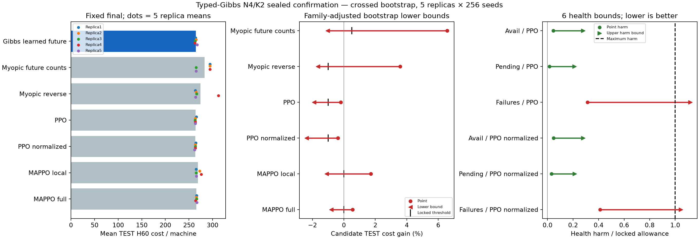
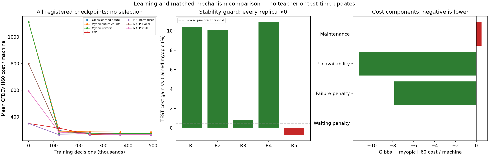

# Typed-capacity Gibbs PPO: kết quả xác nhận N4/K2

**KHÔNG ĐẠT toàn bộ protocol xác nhận N4; không mở N lớn.** 4/12 CI gates đạt; independent audit PASS. Mục tiêu nghiên cứu tổng thể chưa hoàn tất.

## Thiết kế được giữ cố định

Giữ nguyên thuật toán đã qua DEV: máy gửi utility cho hai loại technician, broker tính joint labeled matching bằng weighted count DP. Đối chứng chính cùng thông tin/mạng/dung lượng/budget/entropy/MAP chỉ dùng unweighted future completion counts. Giữ PPO scalar joint chuẩn, học từ khởi tạo mới, không teacher/distillation/warm-start. Fullstate broadcast và hai service profiles là giả định hiện tại, chưa phải fully decentralized hoặc arbitrary heterogeneous profiles.

35fits từ5trainingseeds mới×7methods,491.520decisions/fit; tổng17.203.200decisions/358.400trainEP/268.800Adamupdates.64CFDEVseeds×5checkpoints=11.200nodes. Không chọn checkpoint/seed từ CFDEV: cố định cuối491.520 cho tất cả. Freeze đủ35fileSHA/parameterdigests trước mở256TESTseeds mới.8.960policyEP+256deadline=9.216TESTepisodes,552.960physical transitions/442.368policy decisions; không optimizer trên test.

200.000paired crossed bootstrap resamples: lấy lại5trainingreplicas và256physicalseeds, cùng indices cho mọi phương pháp/metric, trung bình tích Cartesian rồi mới tính costratio. Alpha theo familyround7=.05/(7×8), Bonferroni12directionalbounds; mỗi endpoint alpha≈0.00007440476, quantilelinear. Đây là empirical uncertainty với5trainingreplicas và tail khoảng14,88samples, không phải guarantee coverage chính xác. Strict-zero MAPPO ties trong1e−12 bị loại; không dùng precision để cứu verdict.

## TEST fixed final

| Nhánh | Cost/máy H60 | Availability H48 | Pending/máy H48 | Failure/máy H48 |
|---|---:|---:|---:|---:|
| Gibbs learned future | 264.295898 | 0.667485 | 0.000781 | 0.225000 |
| Myopic future counts | 282.877930 | 0.647347 | 0.009375 | 0.687891 |
| Myopic reverse | 274.108594 | 0.657377 | 0.005664 | 0.422852 |
| PPO | 263.754883 | 0.667944 | 0.000391 | 0.146875 |
| PPO normalized | 263.310938 | 0.667969 | 0.000000 | 0.121875 |
| MAPPO local | 268.924609 | 0.667167 | 0.004883 | 0.432422 |
| MAPPO full | 265.751758 | 0.667928 | 0.000391 | 0.358398 |

## Tất cả khoảng tin cậy và giới hạn đã khóa

| Endpoint | Point | Bound định hướng | Giới hạn | Đạt |
|---|---:|---:|---:|---|
| gain_vs_typed_myopic_ppo | 0.06568922 | lower -0.01031539 | >= 0.005000 | Không |
| gain_vs_reverse_typed_myopic_ppo | 0.03579857 | lower -0.01645716 | >= -0.010000 | Không |
| gain_vs_ppo | -0.00205121 | lower -0.01897382 | >= -0.010000 | Không |
| gain_vs_normalized_ppo | -0.00374068 | lower -0.02376679 | >= -0.010000 | Không |
| gain_vs_mappo | 0.01721193 | lower -0.01102605 | > 0.000000 | Không |
| gain_vs_full_mappo | 0.00547827 | lower -0.00796632 | > 0.000000 | Không |
| availability_delta_vs_ppo | -0.00045980 | lower -0.00278010 | >= -0.010000 | Có |
| normalized_pending_delta_vs_ppo | 0.00039063 | upper 0.00527344 | <= 0.025000 | Có |
| normalized_failures_delta_vs_ppo | 0.07812500 | upper 0.27934341 | <= 0.250000 | Không |
| availability_delta_vs_normalized_ppo | -0.00048421 | lower -0.00279686 | >= -0.010000 | Có |
| normalized_pending_delta_vs_normalized_ppo | 0.00078125 | upper 0.00529670 | <= 0.025000 | Có |
| normalized_failures_delta_vs_normalized_ppo | 0.10312500 | upper 0.26074219 | <= 0.250000 | Không |

Costgains và availability dùng lower bound; pending/failure dùng upper bound. Các số gain ở bảng là fraction (nhân100 ra%). Mọi12bound cùng các extra guard mới quyết định full protocol pass; không lấy point đẹp hoặc một metric tốt thay verdict.

Main TEST gain mỗi seed: 380300000: 10.4226%, 380300001: 10.0840%, 380300002: 0.8440%, 380300003: 10.9153%, 380300004: -0.7314%.
PPO superiority theo rule≥1% lowergainbound vsBOTH PPO/norm và overallpass: False.
Không đạt CI: gain_vs_typed_myopic_ppo, gain_vs_reverse_typed_myopic_ppo, gain_vs_ppo, gain_vs_normalized_ppo, gain_vs_mappo, gain_vs_full_mappo, normalized_failures_delta_vs_ppo, normalized_failures_delta_vs_normalized_ppo. Không đạt extra: every_replica_main_gain_positive.
N4 isolated actor+DP+decoder p95=3.101147ms,720rawsamples; không đo network/observation/physics và chưa chứng minh scaling.

## Cơ chế, tranh chấp và sức khỏe

Retraining myopic có cùng thông tin, tham số và ngân sách là bằng chứng chính cho learned continuation. So local MAPPO ít thông tin hơn không tự chứng minh cơ chế. Zero conflict ở các lõi được đảm bảo bởi hardmatching; không suy ra hiệu năng từ zero conflict. Không thêm knockout test-time để chọn thiết kế hoặc diễn giải lại các CI gates.

| Nhánh | Maintenance/máy | Unavailability/máy | Failure penalty/máy | Waiting penalty/máy | Conflicts/EP | Rejected/EP |
|---|---:|---:|---:|---:|---:|---:|
| Gibbs learned future | 19.567383 | 240.281250 | 4.447266 | 0.000000 | 0.000000 | 0.000000 |
| Myopic future counts | 19.071875 | 251.498437 | 12.307617 | 0.000000 | 0.000000 | 0.000000 |
| Myopic reverse | 19.202344 | 246.328125 | 8.578125 | 0.000000 | 0.000000 | 0.000000 |
| PPO | 19.457617 | 240.670312 | 3.626953 | 0.000000 | 0.000000 | 0.000000 |
| PPO normalized | 19.437891 | 240.644531 | 3.228516 | 0.000000 | 0.000000 | 0.000000 |
| MAPPO local | 19.894727 | 240.956250 | 8.059570 | 0.014063 | 3.500781 | 3.560156 |
| MAPPO full | 19.728320 | 239.695312 | 6.328125 | 0.000000 | 2.115625 | 2.151562 |

## Kiểm chứng và ranh giới kết luận

Bộ kiểm chứng độc lập kiểm tra toàn bộ35initializers/51200pairedtrainingtapes/budgets/CFDEVgrid/freeze/testgate, replay toàn bộ9.216TESTepisodes bằng primitive dictionary physics, NumPy actors và explicit21matching likelihood/entropy/MAP. Tái tạo đủ200.000bootstrap index rows từ registered RNG; tính lại toàn bộ2.400.000endpoint values bằng Cartesian indexing, không gọi hàm bootstrap/count-weight inference của production. Tính lại12bounds,5replica signs,720rawtimings và nguyên verdict. Historical optimizer minibatch gradients không lưu đủ nên không tuyên bố replay từng optimizer update.

Các ý tưởng joint global normalization, structured policy và partition DP đã có prior art. Đóng góp cụ thể về maintenance/two-type matching PPO và cơ chế vẫn phải được đánh giá theo bằng chứng, không chỉ tên thuật toán. Vòng này không có N>4/generalization. Nếu bất kỳ gate thất bại, giữ nguyên kết quả và protocol; không đổi threshold, chọn control/checkpoint/seed/testsubset để cứu. Goal active; chỉ independent ALLPASS mới cho phép protocol scaling riêng.

Nguồn: `/home/bachng/ht-pdm-fjsp/artifacts/technician_typed_gibbs_confirmation_v1_20261017T122835996955Z`.
Kiểm chứng: `/home/bachng/ht-pdm-fjsp/artifacts/technician_typed_gibbs_confirmation_verification_v1_20261017T125736209944Z`.

Không lấy DEV12/12 hoặc TEST point12/12 thay cho kết quả xác nhận4/12. Source flag independent_verification_pending là bản lịch sử đã đóng băng; audit102,59s đã hoàn tất PASS, xác nhận chính verdict âm.
