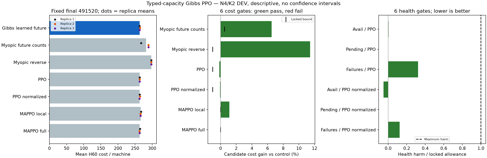
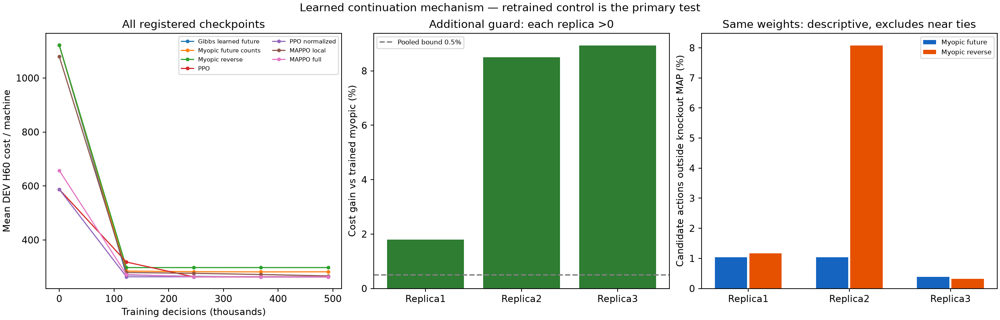

# Typed-capacity Gibbs PPO v1: phương pháp và kết quả N4/K2

**ĐẠT DEV; cần confirmation riêng trước kết luận khoa học.** 12/12 tiêu chí điểm đạt. Mục tiêu nghiên cứu tổng thể chưa đạt.

## Giả thuyết và kiến trúc

Các utility phân công của những máy phía sau có thể giúp phối hợp việc dùng technician tốt hơn việc chỉ đếm số matching còn hợp lệ. Mỗi máy phát hai điểm u(s,m,type), được học từ reward của chính policy. Broker tính xác suất của matching M theo exp(Σu)/Z bằng quy hoạch động trên số technician còn rảnh của hai loại. Đây là điểm policy, không phải future-cost oracle hay Q-label từ PPO gốc.

Giữ PPO scalar joint chuẩn và khởi tạo ngẫu nhiên. Không teacher, distillation, warm-start, nhãn PPO hay objective RL mới. Mạng raw89→64→64→2 dùng state71/own-machine6/type-profile6/machineID4/freecounts2; critic state71→64→64→1. Mỗi nhánh lõi có18.883 tham số, cùng tensor ban đầu nhưng bộ nhớ/optimizer riêng. Critic không chạy khi ra quyết định. Fullstate broadcast nên chưa phải local-only hay fully decentralized.

DP dùng F_i(a,b)=F_next(a,b)+a exp(u_i0)F_next(a−1,b)+b exp(u_i1)F_next(a,b−1), bỏ cạnh không hợp lệ. a/b đếm worker có nhãn; sau chọn type thì chọn đều một worker còn rảnh thuộc type đó. Exact log density có cả gradient qua learned suffix/logZ; entropy và physical MAP cũng tính chính xác. MAP dùng xác suất worker cụ thể, không chọn group lớn nhất.

Đối chứng chính dùng cùng mạng/utility/đầu vào/budget/decoder/entropy, nhưng future utilities được đặt0 trong thông điệp continuation; utility của lựa chọn hiện tại vẫn học. Đối chứng thêm đảo thứ tự máy của myopic. Cả ba bắt đầu uniform trên mọi matching hợp lệ,1/21 khi đủ N4/K2. Candidate có phân phối không phụ thuộc traversal khi giữ utility cố định; đây là thuộc tính toán học, chưa chứng minh cost tốt hơn.

Khác PPO tập trung gốc: PPO gốc có21 logits cho catalogue matching N4/K2. Candidate phát utility theo máy/type rồi tính joint policy bằng DP; vẫn học PPO từ đầu. DP có độ phức tạp O(N(K0+1)(K1+1)) khi cố định hai service profiles giống benchmark. Không tuyên bố đa thức khi mỗi technician có profile riêng; không generalization/scaling từ các kiểm tra tensor tổng hợp. Gibbs/count-DP/RL matching là prior art, xem tài liệu thiết kế.

## Protocol đã khóa

21fits=7nhánh×3trainingseeds mới,491.520 quyết định/fit; tổng10.321.920 quyết định,215.040 trainEP,161.280 Adamupdates.32DEVseeds,5checkpoints gồm0. PRIMARY cố định bước491.520, không chọn checkpoint hoặc replica tốt nhất. H48policy+12deadline tail chung; health tại cutoff48. FULL trực tiếp trên lab sau42tests/commit/push.12pointgates cùng dấu gain dương ở cả3replica,zeroinvalid và p95≤50ms. Không scientific test/CF/Nlớn ở vòng này.

## Kết quả fixed final

| Nhánh | Cost/máy H60 | Availability H48 | Pending/máy H48 | Failure/máy H48 |
|---|---:|---:|---:|---:|
| Gibbs learned future | 263.575521 | 0.666775 | 0.000000 | 0.158854 |
| Myopic future counts | 281.971354 | 0.646647 | 0.007812 | 0.630208 |
| Myopic reverse | 297.578125 | 0.631348 | 0.046875 | 1.039062 |
| PPO | 263.171875 | 0.666829 | 0.000000 | 0.078125 |
| PPO normalized | 263.380208 | 0.666287 | 0.000000 | 0.127604 |
| MAPPO local | 266.583333 | 0.666178 | 0.000000 | 0.242188 |
| MAPPO full | 263.591146 | 0.666070 | 0.000000 | 0.236979 |

| Tiêu chí | Giá trị điểm | Đạt |
|---|---:|---|
| gain_vs_typed_myopic_ppo | 0.06524008 | Có |
| gain_vs_reverse_typed_myopic_ppo | 0.11426446 | Có |
| gain_vs_ppo | -0.00153377 | Có |
| gain_vs_normalized_ppo | -0.00074156 | Có |
| gain_vs_mappo | 0.01128282 | Có |
| gain_vs_full_mappo | 0.00005928 | Có |
| availability_delta_vs_ppo | -0.00005425 | Có |
| normalized_pending_delta_vs_ppo | 0.00000000 | Có |
| normalized_failures_delta_vs_ppo | 0.08072917 | Có |
| availability_delta_vs_normalized_ppo | 0.00048828 | Có |
| normalized_pending_delta_vs_normalized_ppo | 0.00000000 | Có |
| normalized_failures_delta_vs_normalized_ppo | 0.03125000 | Có |

Gain vs myopic từng seed: 380000000: 1.7900%, 380000001: 8.4990%, 380000002: 8.9286%.
P95 actor+DP+decoder: 3.075790ms,432mẫu sau khi pool đóng; chưa phải bằng chứng scale.
Không đạt: không. Extra không đạt: không.

## Cơ chế và sức khỏe

Trên4.608quyết định candidate, có 2414 trạng thái≥2máy cần phục vụ và có worker rảnh; 104 trạng thái có nhu cầu vượt số worker rảnh. Zero conflict của cả ba lõi là hệ quả hardmatching; không lấy đó làm bằng chứng learned continuation hữu ích.

| Seed | Số trạng thái | Outside myopic MAP | Outside reverse MAP | TV điều kiện trung bình | Span future message trung bình |
|---|---:|---:|---:|---:|---:|
| 380000000 | 1536 | 16 | 18 | 0.00762630 | 0.61877511 |
| 380000001 | 1536 | 16 | 124 | 0.00754333 | 0.72454491 |
| 380000002 | 1536 | 6 | 5 | 0.00193672 | 0.78842577 |

Knockout giữ nguyên trọng số trên trajectory candidate và loại near ties; chỉ mô tả thông điệp ảnh hưởng phân phối/MAP như thế nào. Nó không ước lượng causal cost, không thay thế đối chứng huấn luyện độc lập, không thêm seed/update hay mở test.

| Nhánh | Maintenance/máy | Unavailability/máy | Failure-cost/máy | Waiting-cost/máy | Conflicts/EP | Rejected/EP |
|---|---:|---:|---:|---:|---:|---:|
| Gibbs learned future | 19.770833 | 240.250000 | 3.554688 | 0.000000 | 0.000000 | 0.000000 |
| Myopic future counts | 19.104167 | 251.812500 | 11.054688 | 0.000000 | 0.000000 | 0.000000 |
| Myopic reverse | 18.625000 | 259.968750 | 18.984375 | 0.000000 | 0.000000 | 0.000000 |
| PPO | 19.679688 | 240.562500 | 2.929688 | 0.000000 | 0.000000 | 0.000000 |
| PPO normalized | 19.638021 | 240.656250 | 3.085938 | 0.000000 | 0.000000 | 0.000000 |
| MAPPO local | 19.841146 | 241.312500 | 5.429688 | 0.000000 | 2.052083 | 2.072917 |
| MAPPO full | 19.614583 | 240.343750 | 3.632812 | 0.000000 | 1.354167 | 1.354167 |

## Kiểm chứng và giới hạn

Audit độc lập dựng21bộ actor/critic ban đầu và các RNGroles; kiểm tra đủ215.040trainEP/3.360DEVnodes/fixedfinal. Replay704episode/42.240primitive transitions/33.792policy decisions. NumPy dựng utility từ raw features; enumeration21matching kiểm tra jointdensity/entropy/physicalMAP, tách khỏi productionDP. Tính lại12gates,3replica signs và432raw timings. Không lưu đủ historical optimizer minibatches/gradients nên không tuyên bố replay từng optimizer update.

Đây là kết quả DEV mô tả, không CI xác nhận hay bằng chứng ưu thế/scaling. Nếu không đủ mọi gate thì giữ nguyên verdict; không đổi control/checkpoint/seed thành thuật toán thắng hoặc thêm component để cứu kết quả. Các kết quả âm trước đây vẫn nguyên vẹn. Goal còn active.

Nguồn: `/home/bachng/ht-pdm-fjsp/artifacts/technician_typed_gibbs_ppo_v1_development_20261017T115852309901Z`.
Audit: `/home/bachng/ht-pdm-fjsp/artifacts/technician_typed_gibbs_verification_v1_20261017T121421207679Z`.

Global normalization và structured policy đã có prior art; xem [ranh giới đóng góp](technician_typed_gibbs_prior_art_update.md). DEV chưa chứng minh tính mới hay thắng PPO/full-information MAPPO trên test. Chênh so full MAPPO chỉ khoảng0,006%, thực tế gần như ngang điểm.
