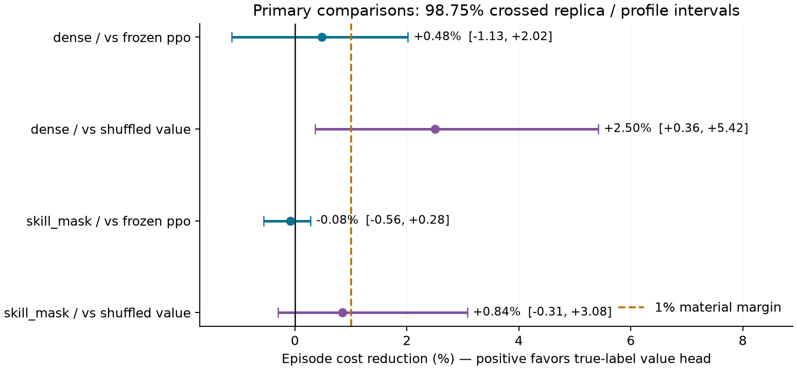
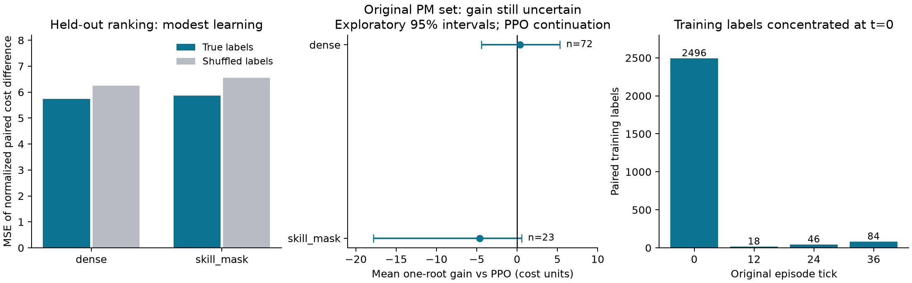

## Material Passport

- Origin Skill: ars-codex:academic-research-suite / experiment-agent.
- Origin Mode: validate, inline; user-authorized local artifact analysis.
- Origin Date: 2026-10-11.
- Verification Status: ANALYZED; source/hashes/statistical aggregates VERIFIED;
  logged decisions and a bounded sample of saved future tapes replayed exactly.
  Full training and all future policy paths have not been rerun.
- Version Label: maintenance_assignment_value_v 1_analysis.
- Overall Confidence: CAUTION — small policy-improvement pilot, three source replicas.

## Kết quả nghiên cứu hiện tại

**Head đánh giá phân công đã học được một phần tín hiệu từ rollout RL,
nhưng chưa chứng minh được rằng nó chọn technician tốt hơn PPO gốc khi chạy
trọn episode. Experiment này vẫn giữ PPO quyết định PM máy nào/thời điểm nào;
chưa huấn luyện đồng thời timing và phân công.**

Điểm mới có bằng chứng: nhãn đúng làm dự đoán chênh lệch chi phí tốt hơn đối
chứng xáo trộn, và giảm chi phí so với đối chứng ở dense. Điểm chưa đạt:
lợi ích so với PPO gốc còn nhỏ/không chắc; skill-mask chưa đạt ngưỡng giảm 1%.
Không suy ra “RL không học được”, “hai policy tương đương”, hay đã có thuật toán
mới vượt baseline.

## Run và kiểm tra dữ liệu

Run: `maintenance_assignment_value_v1_full_cpu_20261011T153135Z`, commit `e821e7f9ccfd9a5cdd06e233dbc39ae39c98bb5c`, clean,
COMPLETED/PASS, CPU một thread; 892.14 giây =14 phút 52 giây. Dataset/run mới,
độc lập cấu hình vật lý với các panel trước; 6 head /3 PPO nguồn.

- 3.036 artifact hash/size khớp; 82.35 MB.189 source snapshot files khớp commit và
 mã đang dùng để phân tích; nguồn PPO có 957 artifact được kiểm tra.
- 1.536 training states /192 dev states; 2.644 paired training labels /348 dev labels;
 3.360 optimizer updates. Mỗi head có 7.745 tham số thêm, PPO đóng băng có 19.650.
- 1.728 test episodes, 24 profiles x 4 shocks x 2 conditions x 3 replicas x 3 controllers;
 48 bước quyết định +12 bước deadline tail. Cohort/shock được ghép giữa controllers.
- 288 held-out assignment states, 972 paired classes; 120 common timing states,
 240 controller timing records.27.46 triệu forecast transitions /501.280 future paths
 là chi phí tạo nhãn/diagnostic, không phải PPO training steps.
- Đã tính lại toàn bộ primary/diagnostic summaries và bootstrap từ CSV; 2.784 NPZ
 khớp shocks/RNG/chi phí/components/tail/counts. Tính lại 2.992 train/dev labels và
 972 ranking deltas từ raw costs. Dataset/control permutations và mọi checkpoint
 candidate được kiểm tra với dev labels, không chọn lại bằng test.
- 27.648 source transitions và 4.320 logged test transitions khớp scalar replay;
 inference của mọi logged test decision khớp action, không có lỗi thay CM/máy PM.
 Dự đoán của checkpoint được xác nhận trên 288 ranking states. Sample 72 saved
 forecast files /246 future paths /11.256 transitions khớp costs/components/boundaries.
 Đây là kiểm tra các tape đã lưu, không phải full experiment mới hay retraining.

`full_test_outcomes_opened=true` là đúng ở thời điểm run đã mở panel sau khi
khóa checkpoint selection, không phải cờ train/test leakage. Nguồn cũ đã từng được
phân tích; run này dùng nguồn đó làm baseline cố định và dùng panel mới.

## Chi phí khi policy thực sự chạy tiếp: primary

Tất cả số dưới là giảm chi phí H48+tail 12 của true-label head; dương = tốt hơn.
Bốn so sánh chính dùng CI 98.75% crossed paired source-replica/profile bootstrap,
20.000 draws, approximate Bonferroni cho 4 contrasts. Ngưỡng thực dụng đã khóa 1%.
CI dựa trên 3 replicas có giới hạn hiệu chỉnh; shocks là panel cố định.

| Điều kiện | Baseline | Giảm chi phí | CI 98.75% | Trạng thái theo ngưỡng 1% |
|---|---|---:|---|---|
| dense | frozen_ppo | +0.479% | [-1.129; +2.017]% | UNRESOLVED |
| dense | shuffled_value | +2.504% | [+0.360; +5.416]% | UNRESOLVED |
| skill_mask | frozen_ppo | -0.084% | [-0.560; +0.282]% | BELOW_MARGIN |
| skill_mask | shuffled_value | +0.843% | [-0.306; +3.079]% | UNRESOLVED |

Dense: mean cost PPO 1173.528, true 1167.903, shuffled 1197.903. True giảm 5.625 cost
units so với PPO (+0.479%); hai replica tốt hơn, một replica kém hơn
(-0.562%, +1.145%, +0.818%). CI còn chứa 0 nên chưa có lợi ích rõ so với PPO.
So với shuffled, cả 3 replica đều tốt hơn; CI[+0.360%, +5.416%] không chứa 0,
ủng hộ lợi ích của nhãn đúng ở dense. Cận dưới chưa vượt 1%, nên status protocol
vẫn UNRESOLVED về lợi ích thực dụng, không có nghĩa “không có tín hiệu”.

Skill-mask: PPO 1210.622, true 1211.635, shuffled 1221.941. True đắt hơn PPO 1.014
cost units (+0.084%cost), cả 3 replica có point estimate kém hơn. CI vẫn chứa 0,
không chứng minh tác hại; cận trên lợi ích 0.282% dưới margin 1% trong pilot này.
True tốt hơn shuffled ở point estimate nhưng CI chứa 0. Không gộp hai điều kiện
để che kết quả khác nhau.

Dense: giảm base cost 6.792, tăng tail cost 1.167, net giảm 5.625. Thành phần
failure giảm 4.740, maintenance giảm 0.135, unavailability giảm 0.333, waiting giảm 0.417.
Skill-mask: base tăng 0.378, tail tăng 0.635, net tăng 1.014. Không có tail mới hay
kết thúc ngắn hơn làm lợi thế giả.

## Head có học được quan hệ trạng thái–phân công không?

Có tín hiệu học, nhưng chất lượng còn hạn chế. Trên tất cả assignment classes
held-out (n=750 dense/n=222 skill), MSE normalized của true vs shuffled là
5.745 vs 6.245 (giảm 8.01%) và 5.863 vs 6.553 (giảm 10.54%). RMSE vẫn xấp xỉ 2.40–2.42,
nhân reward_scale 20 tương ứng khoảng 48 cost units. Dự đoán chọn chiều lợi hơn
đúng 63.1%/58.1% so với 50.1%/50.9% của shuffled; các tỷ lệ này chỉ mô tả và
không coi 972 classes là 972 independent physical profiles.

Phân tích bổ sung sau khi mở test (EXPLORATORY, không primary): paired MSE
improvement true vs shuffled, cluster theo replica/profile, dense 0.500
CI 95%[0.163, 0.986], skill 0.691[0.019, 1.858]. Không chỉnh multiplicity cho các
kiểm tra bổ sung. So với predictor luôn đoán Delta=0, true giảm MSE 7.57%/10.03%;
paired CI dense[0.150, 0.929] dương, skill[-0.009, 1.880] chứa 0. Không thể diễn giải
đơn thuần rằng head đã đánh giá chính xác chênh lệch dài hạn.

Dấu hiệu dự đoán co về 0: standard deviation của predicted Delta chỉ 0.423/0.428,
của measured Delta 2.492/2.558 (normalized units). Correlation 0.306/0.386. Đây là
mô tả phân phối, chưa đủ xác định nguyên nhân kiến trúc hay training budget.
MC noise MSE chỉ 0.171/0.151 trong 64 evaluation futures; không giải thích toàn bộ
residual 5.745/5.863, nhưng bootstrap không mô hình hóa lại mọi shock tương lai.

Subset có |measured Delta|>1.96*paired MCSE cho sign accuracy 68.2%/68.7%.
Subset này được lọc theo outcome để chẩn đoán, không dùng làm headline/pass gate
và không tạo test-tuned policy mới.

## Khi sửa đúng phân công PPO đang dùng, head có tốt không?

Held-out diagnostic giữ nguyên các máy PM và CM; continuation sau root là PPO
đóng băng (Q^pi), không phải head mới. Có 72/144 dense states và 23/144 skill states
thực sự có lựa chọn technician; no-choice states vẫn được lưu.

| Điều kiện | Root selector | States có lựa chọn | Gain trung bình | CI 95% exploratory |
|---|---|---:|---:|---|
| dense | true_value | 72 | +0.363 | [-4.448; +5.303] |
| dense | shuffled_value | 72 | -9.756 | [-25.255; +1.421] |
| dense | simulation_reference | 72 | +4.081 | [+0.033; +9.232] |
| skill_mask | true_value | 23 | -4.612 | [-17.843; +0.555] |
| skill_mask | shuffled_value | 23 | -23.654 | [-72.342; -1.251] |
| skill_mask | simulation_reference | 23 | +0.404 | [-2.587; +4.172] |

True ở dense đổi 25 lần:13 tốt hơn, 12 kém hơn theo 64-future measured means;
6/5 lần có per-state MC 95% khác 0 theo hướng tốt/xấu. Skill-mask đổi 5 lần:1 tốt,
4 xấu; 0 lần tốt và 2 lần xấu có MC 95% khác 0. Những per-state intervals chưa được
chỉnh nhiều so sánh, không phải independent confirmations.

PPO vốn chọn phía có measured cost thấp hơn 45/72 dense và 19/23 skill states.
True chọn đúng 46/72 và 16/23. Vì vậy học tín hiệu tốt hơn đối chứng chưa đồng
nghĩa sửa baseline tốt hơn. Trường hợp skill profile 20600014/source 18100002:
head đổi technician và làm cost tăng 71.828 với MCSE 6.939, trong khi chỉ có
5 overrides ở condition đó. Một số lỗi lớn có thể triệt tiêu nhiều cải thiện nhỏ.
Không bỏ outlier này khỏi primary analysis và không chọn seed “tốt nhất”.

Simulation reference chọn trên 32 selection futures, đo trên 64 independent
futures, giữ cùng PM machines. Dense residual point gain 4.081
CI[0.033, 9.232] cho thấy vẫn có room sửa assignment trong panel này;
skill 0.404 CI[-2.587, 4.172] chưa rõ. Đây là noisy reference, không phải exact oracle,
không so sánh trực tiếp nó với full episode gain vì khác sampling/continuation.

## Timing vẫn giữ riêng

Counterfactual chỉ giữ/hoãn các PM đã chọn, nguyên technician và CM; không thêm
máy PM. Sau root, chính controller đang được đánh giá chạy đến bước 47, sau đó
common deadline tail 12. Chọn root bằng 32 futures rồi đo trên 64 independent futures.
Chỉ first 4 test profiles, mỗi condition có 60 common states; không phải wholetest.

| Điều kiện | Policy tiếp tục chạy | States có timing choice | Timing correction gain | CI 95% exploratory |
|---|---|---:|---:|---|
| dense | frozen_ppo | 30 | +12.805 | [+2.273; +26.286] |
| dense | true_value | 30 | +7.458 | [-0.007; +17.964] |
| skill_mask | frozen_ppo | 25 | +4.179 | [-0.306; +8.766] |
| skill_mask | true_value | 25 | +4.163 | [-0.382; +8.859] |

Dense PPO còn timing correction gain dương trong exploratory CI; head mới
còn point gain 7.458 nhưng CI[-0.007, 17.964] chứa 0. Skill head 4.163
CI[-0.382, 8.859] chưa rõ. Không kết luận head đã tự sửa timing: timing chưa được
training mới. Không kết luận head cải thiện timing từ việc hai điểm trung bình
12.80 và 7.46 khác nhau; đó cần paired contrast và thiết kế riêng.

Blanket “hoãn toàn bộ PM” khác selective delay: dense head gain-4.723
CI[-25.762, 16.217], skill-5.281 CI[-11.551, 0.540]. Không có căn cứ đổi thành rule
“cứ chờ”. Trong closed-loop test, dense head WAIT khi có PM feasible 12/6611
(0.182%), skill 14/6561(0.213%). PM có thể dừng sớm trong partial matching, nên
WAIT chỉ là một phần hành vi timing; không lấy WAIT rate làm thước đo tối ưu.

## Vì sao cần sửa bước học phân công trước?

Nhãn training:2.496/2.644 =94.40% ởtick 0; dev 312/348 =89.66% ởtick 0. Dù đã giữ
1536/192 source states và không lọc outcome, các trạng thái muộn thường không
có 2 feasible PM assignments do technician bận/CM fixed. Điều này tạo tập nhãn
rất lệch về đầu episode; không có nghĩa các trạng thái muộn bị bỏ khỏi coverage.
Đây là giới hạn dữ liệu quan sát được, chưa chứng minh là nguyên nhân duy nhất.

Head học Delta Q dưới continuation PPO, còn full evaluation áp dụng head lặp
lại (policy mới). Có thể có distribution/continuation mismatch; experiment chưa
cô lập nó như một nguyên nhân. Quan trọng là ngay root diagnostic dưới PPO,
head vẫn chưa đem lại gain rõ, nên không thể chỉ đổ lỗi cho mismatch.

## Bước tiếp theo đề xuất (chưa chạy)

Một follow-up nhỏ cho **độ tin cậy của learned assignment advantage so với
phân công PPO**, tiếp tục giữ timing riêng:

1. Thu nhãn trên tập trạng thái mới có so sánh technician ở nhiều giai đoạn;
   chủ động có states technician bận/sắp rảnh/CM tranh nguồn lực. Báo coverage
   cả visited panel tự nhiên và panel diagnostic có chủ đích, không giấu sampling.
2. Học và kiểm tra trực tiếp Delta của alternative so với original PPO trên cùng
   machine set/CM, kiểm tra calibration và MC uncertainty; đối chứng matched
   true/shuffled và luôn giữ PPO. Tập all-PM-subsets vẫn có thể làm phụ nhưng
   không thay metric của quyết định deployment thực tế.
3. So decoder đổi khi predicted advantage vừa dương vs decoder chỉ đổi khi
   lợi thế được mô hình đánh giá đủ chắc. Cách đo uncertainty/margin phải khóa
   trước, chọn bằng dev mới; không lấy threshold từ 23/72 test states đã xem.
4. Dùng test configurations/shocks mới, H48+tail 12; một primary test vs PPO và
   paired assignment-root check. Sau khi có gain ổn định mới kiểm tra tích hợp
   với timing. Đây là đề xuất nghiên cứu, không khẳng định gating sẽ thành công.

## Fallacy scan:11/11 đã kiểm tra

| Pattern | Kiểm tra / giới hạn |
|---|---|
| Simpson | Báo riêng dense/skill và 3 replica; không gộp để đảo chiều skill. |
| Ecological | Classes/futures không được tính như profiles; cost episode và root gains khác đơn vị. |
| Berkson | Chỉ conditional assignment/timing choices khi cóalternative; báo mẫu số, allstates/no-choice. |
| Collider | Không kiểm soát thêm theo improvement hoặc selected checkpoint test; outcome-resolved subset chỉ exploratory. |
| Base rate | Báo exposure 72/144 và 23/144, sign accuracy/PPO baseline và số overrides; không giấu no-choice. |
| Regression to mean | Reference chọn 32, đo 64 independent futures; không chọn lại theo eval means. |
| Survivorship | Đủ grid 1728 episodes, toàn bộ 3 replicas/classes; không drop harmful profile 20600014. |
| Look elsewhere |4 primary intervals 98.75%; tất cảdiagnostic/MSE bổ sung/sign subsets exploratory. |
| Forking paths | Protocol khóa trước; dev chọncheckpoint; không retune threshold/test hoặc chọn seed sau phân tích. |
| Causation | Paired simulator interventions chỉ support trong generator/H48; không transfer/deployment/novelty claim. |
| Reverse causality | Weights được fit trước test; predictions ghi trước futures và independently checked; test không quay lại training. |

Không cóp-values được báo trong protocol; không suy diễnp-value từ percentile
bootstrap. Các intervals không chứng minh global optimality hay uncertainty
coverage tốt chỉ vì hash/replay PASS. Report không sửa raw artifacts và không
SSH/rsync/full-launch thay user.

## Artifacts phân tích

- `audit.json`: phạm vi xác minh và bounded replay.
- `summary_verified.json` /`diagnostic_summary_verified.json`: numerical recomputation.
- `supplementary_diagnostics.json`: MSE/sign/override/coverage, hậu nghiệm exploratory.
- `verified_profile_differences.csv`: primary clustered cells.
- `checkpoint_selection_verified.csv`:3 truth epochs80/20/40; shuffled60/80/20,
  tất cả chọn theo true dev MSE.
- `assignment_state_gains.csv` /`largest_harmful_overrides.csv`: không bỏ zeros/lỗ.
- `label_coverage_by_clock.csv`, `logged_assignment_decode_audit.csv`, figures,
  và script phân tích cùng hash ledger.
