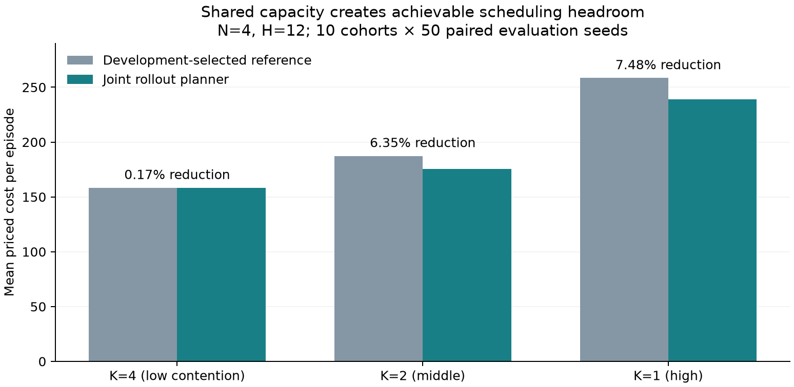
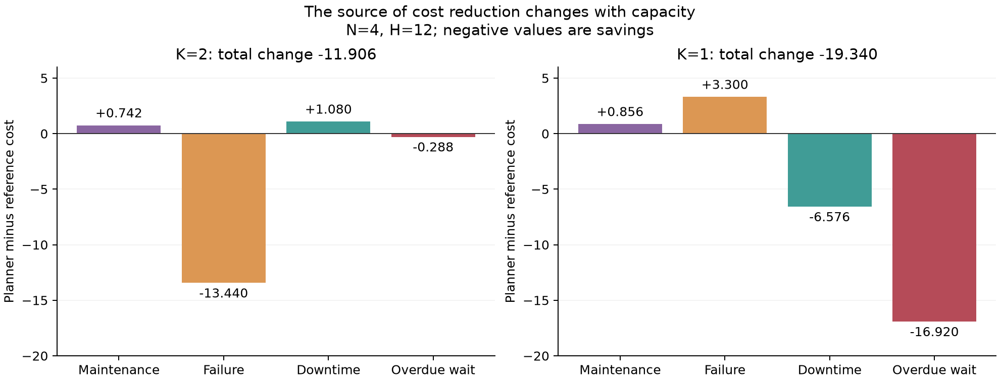

# Phân tích maintenance contention/headroom v1

## Material Passport

- Mode: experiment-agent / validate; language: Vietnamese.
- Input: `/Users/bachng/Coding/Reinforcement Learning/marl/lab_results/maintenance_contention_headroom_v1_full_cpu_20261005T183911Z`; commit `89ccb60152648f0201e11c8df5dbd7fc02d6bc55`.
- Verification Status: ANALYZED; raw audit và replay toàn bộ physics/reference;
  replay forecasts trên 60 episode; tái chạy độc lập 3/30 job exact. Không tái
  chạy toàn bộ 15.000 episode hoặc mọi forecast planner.
- Artifacts: analysis.json, analyze.py, audit.log, report này; PNG/PDF đi kèm.

**Có bằng chứng về chi phí điều phối có thể tránh được khi capacity bị giới hạn.**
Hai đối chiếu primary ở K2 và K1 đạt protocol đã khóa. K4 không đạt. Điều này
ủng hộ việc nghiên cứu quyết định bảo trì có tính tới ảnh hưởng lên các máy khác
qua tài nguyên chung. Khả năng RL học được lợi ích và lợi thế riêng của MARL
chưa được đánh giá trong experiment này.

## Dữ liệu và audit

Run COMPLETED, Git clean, đúng SHA đã handoff; thời gian
`2026-10-05T18:39:15.158993+00:00` → `2026-10-05T18:47:28.695852+00:00` (khoảng 8 phút 14 giây).
Đủ 2.400 episode development, 15.000 episode test, 270.000 khoảng thời gian
quyết định, 60.000 dòng machine, 30 job exact, 120 dòng policy exact. Không cap.
54 file có hash/size đúng manifest; hash raw giữ nguyên sau phân tích.

Tái tạo toàn bộ physics từ seed (initial/hazard streams gốc), đối chiếu action
của 216.000 bước reference và argmin/candidate của 54.000 bước planner.
Tái tạo đầy đủ forecasts cho 1080 bước planner thuộc
60 episode (seed đầu, mọi cohort/capacity/horizon); kết quả trùng JSON, action,
chi phí và state. Không mismatch. Kiểm tra machine/episode cost reconciliation,
seed separation, đủ grid, baseline selection chỉ dùng development và không có
training/optimizer/teacher budget.

Đã đọc kiểm tra 1,421,335 state graph: SOLVED, value=min(Q),
đủ 27 initial states/job; Bellman residual ghi nhận ≤1,43e-14. Tái chạy H6 ở
cohort134000 cho cả ba capacity khớp expected cost, optimum, lower bound và
regret. Các controller/module phân tích trùng hash source snapshot.

## Primary: N4, H12

| Capacity | Reference chọn bằng development | Reference priced cost | Planner | Giảm | Cohort thắng | 99% CI của planner − reference | Gate |
|---|---|---:|---:|---:|---:|---|---|
| low / K=4 | `deadline_matching` | 158.288 | 158.014 | 0.17% | 8/10 | [-0.599, 0.051] | FAIL |
| middle / K=2 | `independent_dp_matching` | 187.400 | 175.494 | 6.35% | 10/10 | [-17.235, -6.577] | PASS |
| high / K=1 | `lookahead_matching` | 258.434 | 239.094 | 7.48% | 10/10 | [-27.306, -11.374] | PASS |

Unit suy luận là 10 workload cohort, mỗi cohort trung bình trên 50 paired seeds.
CI Student-t(df9), critical3,2498355, 99% hai phía; ba primary contrasts dùng
mức này bảo thủ hơn Bonferroni familywise5%. Gate gồm reduction trung bình≥5%,
thắng≥8/10, CI phía trên<0 và base-cost ratio≤1,1. Không coi 500 episode là
500 đơn vị độc lập để tính CI. K2/K1 thắng cả 10 cohort; không có Simpson reversal
ở primary hai mức này. Tất cả baseline còn lại vẫn có trong bảng dưới.

Giảm6,35% và7,48% là effect size quan sát trên panel, không phải cam kết rằng
cận dưới của lợi ích quần thể≥5%. CI cost quy đổi theo mean reference tương ứng
khoảng3,51–9,20% (K2),4,40–10,57% (K1). Mean reference được dùng như mốc quy đổi,
đây không phải CI đã suy luận riêng cho tỷ lệ.

## Cơ chế chi phí: cần phân biệt K2 và K1

| Capacity | Δmaintenance | Δfailure | Δdowntime | Δoverdue waiting | Giảm base cost |
|---|---:|---:|---:|---:|---:|
| middle | +0.742 | -13.440 | +1.080 | -0.288 | 6.21% |
| high | +0.856 | +3.300 | -6.576 | -16.920 | 1.01% |

K2: failure trung bình2,346→1,450/episode (giảm38,2%). Base cost187,112→175,494
(giảm6,21%); waiting penalty vốn nhỏ0,288→0. Planner dùng technician nhiều hơn
(utilization82,0%→90,2%) và có thể chấp nhận thêm downtime bảo trì để tránh
failure. Failed-wait ticks3,322→1,548; violation1,6%→0% trên panel H12.
Đây là bằng chứng trực tiếp về economic base-cost impact ngoài overdue penalty.

K1: base cost239,450→237,030 (giảm1,01%), waiting cost18,984→2,064.
Khoảng87,5% tổng savings19,34 đến từ overdue penalty. Violation63,2%→15,0%;
max-wait trung bình5,260→4,146; overdue ticks1,582→0,172. Failure lại tăng
4,904→5,124 (4,49%). Utilization94,6%→96,3%. Đó là trade-off của objective có
waiting price12: planner giảm bỏ mặc yêu cầu quá hạn, không cải thiện đồng thời
mọi loại tổn thất. Không nên gọi7,48% là mức giảm failure/downtime cost nói chung.
SLA là soft; vẫn còn15% episode K1 vi phạm B4.

K4: urgent excess=0, reference không failure; gain0,17% nhỏ và CI cắt0.
Planner có failure0,024/episode so với0 của reference. Không có bằng chứng về
lợi ích thực tiễn≥5% trong chế độ đủ technician.

## Exact: N3, H6, đồng đều 27 initial age vectors

| Capacity | Relaxed lower bound | Joint optimum | Selected reference | Scarcity không tránh được | Decision cost tránh được | Decision gap / reference |
|---|---:|---:|---:|---:|---:|---:|
| low | 57.233 | 57.233 | 57.233 | 0.000 | 0.000 | 0.00% |
| middle | 57.233 | 58.185 | 60.557 | 0.952 | 2.372 | 3.92% |
| high | 57.233 | 72.186 | 78.963 | 14.952 | 6.777 | 8.58% |

K4 trong N4 trở thành K3=N trong panel exact; mọi reference đạt joint optimum,
đúng đối chứng âm. K2: phần avoidable2,372 lớn hơn phần scarcity0,952. K1: phần
scarcity14,952 lớn hơn avoidable6,777. Bởi vậy cost tăng khi thiếu technician
không thể được quy toàn bộ cho policy; một phần là giới hạn tài nguyên vật lý.
Phần avoidable tồn tại rõ và có thể đo được bằng stochastic joint DP.

Regret selected reference ở K2 chủ yếu nằm nửa đầu episode (2,016/2,372=85,0%);
K1 tương ứng6,485/6,777=95,7%. Đây là chẩn đoán hạn chế lời giải thích rằng gap
chỉ do quyết định ở cuối finite horizon. Không thể suy từ N3/H6 ra optimum của
N4/H12 hoặc H24; rollout N4 chỉ cung cấp achievable cost.

## Secondary H24 và mọi reference H12

H24 giữ nguyên reference chọn tại H12: planner giảm0,009% ở K4,6,81% ở K2,
6,31% ở K1; K2/K1 vẫn thắng10/10 cohort. Base cost giảm6,51% và0,67% tương ứng.
Đây là sensitivity exploratory đã khóa, không được dùng để thay primary thất bại.

| Capacity | Controller | Priced cost | Base cost | Waiting violation | Utilization | Mean urgent excess |
|---|---|---:|---:|---:|---:|---:|
| low | risk_skill_rule | 158.288 | 158.288 | 0.0% | 49.9% | 0.000 |
| low | deadline_matching | 158.288 | 158.288 | 0.0% | 49.9% | 0.000 |
| low | lookahead_matching | 158.288 | 158.288 | 0.0% | 49.9% | 0.000 |
| low | independent_dp_matching | 158.288 | 158.288 | 0.0% | 49.9% | 0.000 |
| low | joint_rollout | 158.014 | 158.014 | 0.0% | 49.6% | 0.000 |
| middle | risk_skill_rule | 190.898 | 190.898 | 0.0% | 89.0% | 0.469 |
| middle | deadline_matching | 188.666 | 188.666 | 0.0% | 88.9% | 0.440 |
| middle | lookahead_matching | 187.622 | 186.830 | 5.4% | 81.9% | 0.469 |
| middle | independent_dp_matching | 187.400 | 187.112 | 1.6% | 82.0% | 0.471 |
| middle | joint_rollout | 175.494 | 175.494 | 0.0% | 90.2% | 0.214 |
| high | risk_skill_rule | 263.474 | 261.506 | 14.8% | 98.4% | 2.031 |
| high | deadline_matching | 261.612 | 258.444 | 23.6% | 98.4% | 1.950 |
| high | lookahead_matching | 258.434 | 239.450 | 63.2% | 94.6% | 1.900 |
| high | independent_dp_matching | 258.992 | 242.240 | 65.0% | 94.8% | 1.929 |
| high | joint_rollout | 239.094 | 237.030 | 15.0% | 96.2% | 1.804 |

Planner thắng cả bốn reference theo mean ở K2/K1, chứ không chỉ reference được
chọn. H12 independent DP và joint rollout đều nhìn đến episode end ở K2;
chênh lệch không chỉ là lookahead ngắn so với dài. Tuy vậy thiết kế không tách
causal contribution riêng của search, forecasts và lựa chọn continuation.

## Diễn giải problem và bước nghiên cứu

Problem được dữ liệu hỗ trợ: **giá trị của quyết định bảo trì phụ thuộc vào
capacity còn lại trong tương lai và thời gian phải chờ của những máy khác**.
Một máy có bid tốt khi tối ưu riêng có thể chiếm technician quá lâu, khiến lịch
chung phát sinh failure hoặc overdue cost. Exact panel định lượng gap giữa
quyết định độc lập và joint scheduling; planner N4 cho thấy giải pháp khả thi
có thể khai thác một phần gap ấy ở panel lớn hơn.

Điều đã chứng minh trong mô hình: impact của điều phối có tính tới tài nguyên
chung ở K2/K1 với objective và panels này. Điều chưa chứng minh: RL học được
planner, learned policy vượt strong references với cùng budget, MARL vượt
centralized RL, hay decentralized execution là yêu cầu vận hành thực tế.
Technician giống nhau nên chưa đánh giá tác dụng skill allocation.

Bước kiểm tra phù hợp: dùng K2 làm trọng tâm economic base-cost impact, K1 làm
sensitivity trade-off overdue/failure, K4 làm đối chứng âm; so learned policy
với cả best reference và joint rollout. Chỉ thêm claim MARL khi so trực tiếp
với centralized policy và nêu rõ ràng buộc thông tin/giao tiếp. Đây là khuyến
nghị từ phân tích, chưa triển khai hoặc chạy experiment tiếp.

## Statistical fallacy scan: 11/11 checked

| Loại | Kết quả / giới hạn |
|---|---|
| Simpson | Phân tích riêng từng capacity/horizon, giữ đủ cohort; K2/K1 thắng10/10. |
| Ecological | Hiệu ứng mean cohort, không đảm bảo mọi máy hoặc episode tốt hơn. |
| Berkson | Workload generator được cố định; không lọc theo thành tích; generalization giới hạn generator. |
| Collider | Không điều kiện hóa kết quả vào failure/utilization sau can thiệp; chúng chỉ là metrics. |
| Base rate | Nêu cả failure/violation rate và số episode, không chỉ phần trăm reduction. |
| Regression to mean | Chọn reference trên dev, dùng test khác seed; không chọn cohort xấu để báo improvement. |
| Survivorship | Đủ tất cả grids và30 exact jobs, không cap hoặc drop. |
| Look elsewhere | Báo3 primary contrasts, đủ4 reference và H24 exploratory; correction đã khóa. |
| Forking paths | Protocol trước run, seed/budget/reference selection cố định; analysis không sửa raw. |
| Causal overreach | Controlled simulator capacity intervention; không suy ra deployment, RL hay MARL necessity. |
| Reverse causality | Dynamics theo thời gian và controller intervention; không phải hồi quy cross-sectional. |

T(df9) với10 cohort là approximate uncertainty; paired differences có thể
không chuẩn, cùng fixed shock panel dùng cho các cohort nên inference là
conditional trên shock panel đó. Không có normality diagnostic được pre-register;
không dùng test bổ sung sau khi xem kết quả để đổi gate. Tính nhất quán10/10
và sensitivityH24 hữu ích, nhưng chưa bảo đảm generalization sang plant thật,
shock law chưa biết, mô hình phục hồi khác, worker skills khác hoặc infinite horizon.
