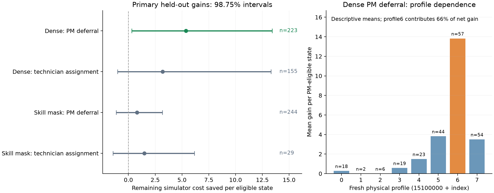

## Material Passport

- Origin Skill: ARS-Codex experiment-agent.
- Origin Mode: validate, inline.
- Origin Date: 2026-10-11.
- Verification Status: ANALYZED. Đã kiểm tra hash, dựng lại thống kê và replay
  độc lập có giới hạn; không chạy lại toàn bộ 11,2 triệu bước forecast.
- Version Label: maintenance_decision_headroom_v1_analysis_v1.
- Source: maintenance_decision_headroom_v1_full_cpu_20261011T103246Z.
- Overall Confidence: CAUTION — tín hiệu thời điểm ở dense, còn ít profile độc
  lập và chưa có phương pháp mới được train/đánh giá end-to-end.

## Kết quả chính

**RL có những quyết định PM còn cải thiện được ở cấu hình mọi kỹ thuật viên
đều làm được mọi máy. Chưa có bằng chứng chắc cho cải thiện chọn kỹ thuật viên,
và tín hiệu thời điểm chưa rõ khi có giới hạn kỹ năng.**

Run hoàn tất, audit PASS, chạy CPU trong 327,57 giây (5 phút 28 giây), dùng lại 10
policy đã chọn bằng development từ thí nghiệm trước. Không train thêm.
Có 2560 trạng thái mới, 16 cấu hình vật lý (8 cặp dense/skill_mask), 640 trajectory.
Đã loại trừ 52.163 physical signatures của những cấu hình cũ trước khi sinh
cấu hình mới. Không lọc trạng thái theo kết quả.

## Đang đo điều gì

Ở mỗi trạng thái, lấy hành động của frozen RL làm mốc. Hai can thiệp tách biệt:

1. **Thời điểm:** giữ PM ngay hoặc bỏ các PM ở bước này để RL quyết định lại
   ở bước sau. Giữ nguyên mọi cặp sửa chữa máy hỏng và mọi công việc đang chạy.
2. **Kỹ thuật viên:** giữ đúng tập máy RL đã chọn, chỉ thay người bằng các
   phân công khả thi khác. Máy khỏe/hỏng và loại PM/CM không đổi.

32 kịch bản mô phỏng riêng dùng để chọn phương án; sau đó 64 kịch bản khác dùng
để đo lợi ích. Không chọn lại bằng kết quả kiểm tra, không xóa kết quả âm.
Trong mỗi bộ, các phương án dùng chung biến cố tương lai để so sánh có cặp.
Sau can thiệp đầu tiên, chính frozen RL chạy tiếp tới tick 47; cùng rule tail
ở ticks 48–59. Giữ horizon H48+L12 và time feature đúng lúc training.

Lợi ích = chi phí hành động RL gốc trừ chi phí phương án đã chọn độc lập.
Số dương nghĩa là sửa quyết định có lợi. Trung bình tính trên tất cả trạng thái
có lựa chọn cho can thiệp đó, kể cả những ca giữ nguyên RL với lợi ích bằng 0.
Đây là lợi ích **của một lần sửa quyết định trong simulator**, không phải mức
cải thiện tổng episode của một policy mới. Bộ chọn dùng forecast không phải
policy RL đã học được hoặc một oracle tối ưu thật sự.

## Bốn so sánh đã khóa trước

| Cấu hình / quyết định | Trạng thái có lựa chọn | Ca đổi quyết định | Giảm chi phí TB | Khoảng tin cậy98,75% | Diễn giải |
|---|---:|---:|---:|---:|---|
| Mọi KTV đều làm được mọi máy / hoãn PM |223/1280 (17,42%)|81|5,36|[0,31;13,41]|Có tín hiệu lợi ích|
| Mọi KTV đều làm được mọi máy / đổi KTV |155/1280 (12,11%)|34|3,18|[-1,02;13,32]|Chưa rõ|
| Có giới hạn kỹ năng / hoãn PM |244/1280 (19,06%)|86|0,81|[-1,13;3,17]|Chưa rõ|
| Có giới hạn kỹ năng / đổi KTV |29/1280 (2,27%)|10|1,48|[-1,45;6,16]|Chưa rõ, rất ít cơ hội|

Khoảng tin cậy dùng 20.000 crossed-bootstrap draws, resample 10 model replicas và 8
physical profile identities; giữ các shock, origin và landmark đi cùng nhau.
Bốn khoảng 98,75% là điều chỉnh Bonferroni xấp xỉ cho bốn câu hỏi chính.
CI conditional trên các forecast tape đã cố định;2560 trạng thái không phải
2560 mẫu độc lập. Chỉ 8 profile nên độ chính xác/coverage vẫn còn hạn chế.

## Ý nghĩa dễ hiểu: không phải cứ chờ là tốt

Bỏ **tất cả** PM mà RL định làm, trên toàn nhóm có PM, làm chi phí tăng trung bình
4,86 ở dense và3,79 ở skill_mask. Đây là trung bình mô tả, không có CI mới.
PM nhìn chung vẫn có ích, phù hợp kết quả continuation trước.

Nhưng ở dense, bộ chọn dựa trên 32 forecast đã giữ nguyên 142/223 ca và hoãn 81 ca.
Khi kiểm tra độc lập, cả 223 ca có lợi ích TB5,36; riêng81 ca được hoãn là 14,76.
62 ca có mean gain dương,19 ca âm; số đếm dấu theo mean không xác nhận từng ca
là nhãn chắc chắn. MC SE trung vị của các ca đổi là 5,08, nên còn nhiễu.

5,36 tương đương khoảng 0,80% **chi phí còn lại ở nhóm trạng thái có PM**
(mốc gốc 671,42). Đây là tỷ lệ mô tả có phạm vi hẹp, không phải giảm0,80% toàn
episode. Tín hiệu có ý nghĩa đối với nghiên cứu thời điểm, nhưng mức cải thiện
trung bình còn nhỏ và CI rất rộng.

Phần lớn tiết kiệm dense timing đến từ giảm chi phí máy không sẵn sàng:4,64;
failure cost giảm0,65; waiting cost giảm0,10; maintenance cost tăng nhẹ0,03.
Lợi ích trong đoạn RL còn chạy là3,51, trong tail là1,85. Lợi ích không chỉ
là tiết kiệm phí bảo trì hay chỉ xuất hiện ở tail.

## Tín hiệu phụ thuộc trạng thái và profile

Các phép phân nhóm sau là **exploratory/descriptive**, không phải thêm kết luận
confirmatory và không có khoảng tin cậy mới:

- Trên trạng thái do chính RL tạo, dense timing gain là5,89 (141 trạng thái);
  trên trạng thái do rule tạo là4,46 (82). Tín hiệu không chỉ ở trạng thái rule.
- Dense timing mean gain dương ở cả10 model replicas;6 profile có mean dương,
  2 profile bằng 0 do bộ chọn không đổi quyết định.
- Profile15100006 đóng góp khoảng65,9% tổng estimated net gain. Bỏ riêng profile
  đó, mean còn2,46; không suy ra CI vẫn dương. Kết quả chưa phải lợi ích ổn định
  trên mọi cấu hình vật lý.
- Dense: nhóm PM chỉ trên máy chưa tới ngưỡng nguy cơ (young_only,n=30) có
  selective gain14,40; bỏ PM toàn nhóm này có gain14,67. Nhóm at_risk_only
  (n=191) selective gain4,00, nhưng bỏ PM tất cả lại tăng chi phí7,68.
- Skill_mask: young_only PM không lặp lại kết quả dense. Bỏ PM toàn nhóm này
  làm chi phí tăng4,26 (n=46). Vì vậy không biến quan sát thành rule chung
  “máy trẻ thì cứ chờ”. Cần xét cả thời gian làm việc, hiệu quả phục hồi,
  khả năng thay thế kỹ thuật viên và trạng thái những máy khác.
- Skill_mask timing gain phụ thuộc profile15100005; bỏ profile này thì mean
  thành-0,14. Không có bằng chứng vững cho timing correction trong điều kiện này.

## Vì sao chưa chốt được phần kỹ thuật viên

Ở dense,155/1280 trạng thái có hơn một cách phân công cho đúng tập máy đã chọn.
Bộ chọn đổi34 ca, mean gain3,18 nhưng CI còn chứa0. Mean trên trạng thái do RL
sinh là3,40 (55 ca), trên trạng thái rule là3,07 (100); chỉ là mô tả.

Ở skill_mask, chỉ29/1280 trạng thái có thể đổi người cho cùng tập máy;23 do RL
sinh,6 do rule sinh. Có7/10 model replicas có ít nhất một ca như vậy. Sample
này không đủ để phân biệt “RL đã chọn người tốt” với “benchmark ít cơ hội hoặc
forecast chọn nhầm do nhiễu”. MC SE trung vị của các ca đổi là khoảng6,65.
Khoảng tin cậy chứa0 không chứng minh phân công không quan trọng hoặc RL tối ưu.

Phạm vi chỉ gồm tập máy RL đã chọn; không đo các tập máy khác hay lợi ích khi
đổi cả thời điểm lẫn người cùng lúc. Cũng không xác định thời gian chờ tối ưu,
và không đo những PM cần làm nhưng RL bỏ qua.

## Kết luận cho hướng nghiên cứu

Kết quả bổ sung bằng chứng rằng **quyết định PM nên phụ thuộc bối cảnh** và policy
hiện tại còn bỏ lỡ lợi ích ở một số trạng thái mới trong dense. Có cơ sở để
đặt giả thuyết phát triển cơ chế RL phân biệt PM ngay với hoãn, nhưng chưa có
thuật toán mới được chứng minh tốt hơn PPO hoặc rule.

Với mục tiêu học đồng thời thời điểm và người thực hiện, bằng chứng hiện tại
mạnh hơn ở timing. Phần assignment cần đủ tình huống mà có nhiều người cùng
khả thi trước khi đánh giá một cơ chế học chọn người. Đây là định hướng từ
kết quả, chưa khởi chạy thí nghiệm hay training nào tiếp theo.

## Kiểm tra độc lập

- 92 file /35,59MB đúng hash và byte count; source snapshot/plan đúng commit
 c5b5cacdecdf1a8daeed4bd6566a65e5d0174ca9, clean checkout, CPU thread1.
- 85 artifact nguồn cũ và10 frozen model được kiểm lại; parameters đúng hash.
- 2560 trạng thái đủ grid, các root/candidate và role seeds dựng lại đúng;
 fresh-profile exclusion và disjoint full/smoke xác nhận bằng metadata.
- Toàn bộ lựa chọn từ selection tapes, gain/SE từ evaluation tapes, valid masks,
 base/tail/components, root-value journals và counters khớp raw arrays.
- Tự dựng lại cả20000 bootstrap draws bằng frequency-weight formulation khác;
 bốn estimate và CI khớp.
- Replay độc lập toàn bộ30720 live physical transitions và30720 quyết định
 policy/reference; mọi landmark gốc khớp trạng thái đã lưu.
- Scalar replay subset160 trạng thái: mọi model, cả hai điều kiện/origin/bốn
 landmark, cohort/shock đầu tiên, hai scenario ở mỗi phase, tất cả root.
 Kiểm31368 transitions và836 returns; base/tail/cost components/cutoff/terminal
 khớp chính xác. Đây là kiểm tra có giới hạn, không phải rerun toàn bộ forecast.
- Không sửa raw artifacts. Báo cáo và bảng phân tích được lưu trong thư mục mới.

## Fallacy scan: 11/11 đã kiểm

| Loại | Kết quả kiểm tra / giới hạn |
|---|---|
| Simpson's paradox | Kiểm origin/profile/model/risk; không đảo dấu dense timing theo origin, có dị biệt profile/risk, không gộp thành kết luận chung mọi điều kiện.|
| Ecological fallacy | Không suy ra từng trạng thái có nhãn chắc từ mean/CI cấp nhóm; không suy ra field performance.|
| Berkson's paradox | Eligibility phụ thuộc root của policy; inference chỉ conditional trên nhóm đó, ghi coverage.|
| Collider bias | So sánh có cặp cùng trạng thái/root machine set; không điều kiện hóa trên held-out gain. Eligibility vẫn giới hạn ngoại suy.|
| Base-rate neglect | Ghi223/244 PM states và155/29 assignment states trên1280, giữ ca không đổi với gain0.|
| Regression to mean | Chọn bằng selection MC, đánh giá independent MC, giữ kết quả âm; selection noise được ghi rõ.|
| Survivorship bias | Grid2560 đầy đủ, không drop các ca ít lựa chọn, forecast không fail/thiếu;10 frozen models được chọn development từ nguồn, giữ đủ10.|
| Look-elsewhere | Báo cáo đủ4 primary contrasts, CI98,75%; phân nhóm/leave-one-out chỉ mô tả exploratory.|
| Garden of forking paths | Protocol/seed/stop/source khóa trước run; audit source commit, không tune lại threshold hoặc tăng seed theo kết quả.|
| Correlation vs causation | Root intervention trong simulator có shared physical futures và cùng continuation; không suy ra hiệu quả thuật toán mới hay triển khai thực tế.|
| Reverse causality | Intervention trước rollout/cost, không chọn root bằng evaluation outcomes; không có thiết kế quan sát ngược thời gian.|

## Artifacts của phân tích

- `audit.json`: provenance, hash/count/seed/physics/statistics checks.
- `primary_results.csv`: bốn kết quả chính và effect-size mô tả.
- `descriptive_strata.csv`: origin/profile/model/tick/risk, base/tail/components.
- `leave_one_profile_out.csv`: sensitivity chỉ theo mean, không có CI mới.
- `state_diagnostics.csv`:2560 trạng thái và các giá trị dựng lại.
- `headroom_results.png` / `.pdf`: hình CI chính và dị biệt profile.

