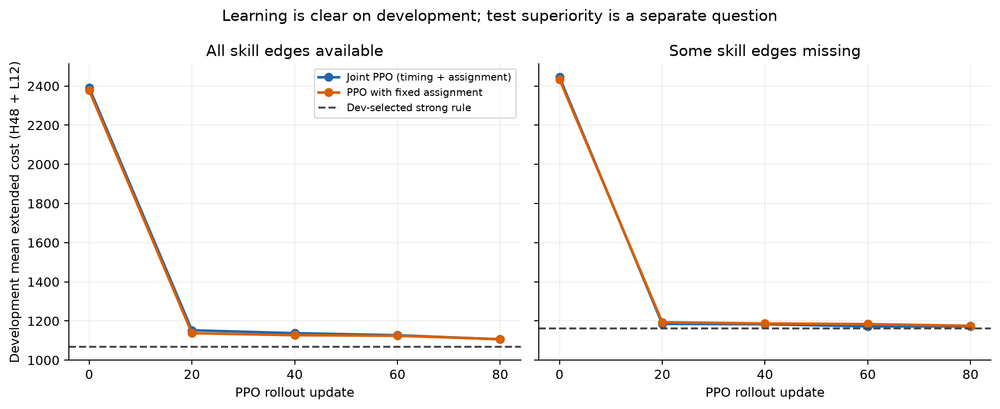
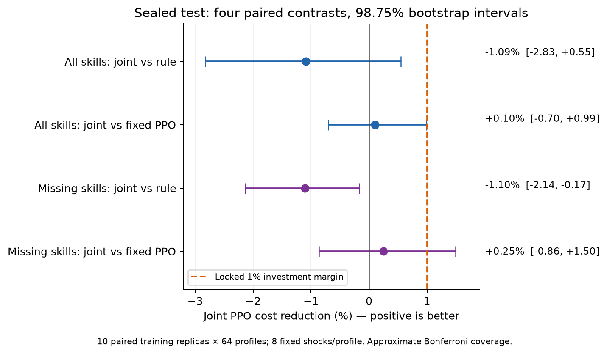
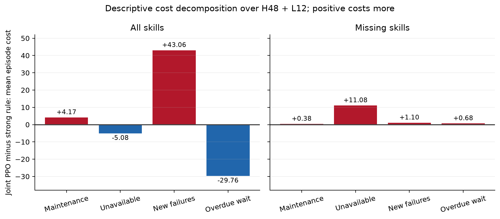

## Material Passport

Origin Skill: academic-research-suite / experiment-agent; Origin Mode: validate,
inline; Date: 2026-10-11; Version: joint-rl-analysis-v1.
Verification Status: **ANALYZED** toàn bộ kết quả. **VERIFIED có giới hạn** cho
169 hash, sổ dữ liệu, lựa chọn checkpoint, 10 khoảng tin cậy tính lại độc lập và
replay 168 episode/10.080 quyết định đã khóa trước. Không train lại 20 model,
không replay tất cả 1.290.240 tick; audit online toàn bộ tick là bằng chứng được
runner ghi lại, khác với replay độc lập trên Mac. Không gửi dữ liệu ra ngoài.

## Kết quả chính

**RL đã học được một policy bảo trì và phân công, nhưng chưa vượt rule mạnh;
lợi ích tăng thêm từ học kỹ thuật viên chưa rõ ràng.** Bản joint PPO được học
trực tiếp cả WAIT, chọn máy và ghép máy–kỹ thuật viên; không có teacher label.
Policy thay đổi trọng số, giảm mạnh chi phí trên dev và có phân công khác rule
cố định. Điều đó xác nhận khả năng học trong benchmark này, chưa chứng minh
học được cơ hội tương lai một cách tối ưu hoặc có lợi ích triển khai.

Run: `maintenance_joint_rl_v1_full_cpu_20261011T045434Z`; commit `ed032858ebf174738e9c00bfe2dce72b7fff4277`. CPU/thread1,
hoàn tất **46 phút 54 giây**, 20 model, 10 seed/bản PPO, 21.504 episode test,
**137,90 MB** file đã hash (chưa tính console log/manifest). Giữ nguyên raw data.

Trên dev, joint PPO từ **2418.50 xuống 1139.26** ở checkpoint cuối,
giảm **52.89%**. Cả 10 seed joint và 10 seed fixed đều giảm so với
policy ban đầu. Đây là so sánh với mạng chưa học bằng greedy inference, không
phải với rule mạnh và không phải test độc lập của mức cải thiện ban đầu.
Checkpoint cuối cố định thể hiện đường học; checkpoint chọn bằng dev có thể
lạc quan trên chính dev. Không đánh giá initial policy trên sealed test.



## So sánh trên test đã khóa

Chi phí gồm cả 48 tick policy và 12 tick tiếp diễn bởi cùng deadline rule;
đơn vị quy ước/máy/tick, không phải tiền thật. Tỷ lệ cải thiện dương là joint
tốt hơn. Chọn rule bằng dev riêng từng điều kiện: đủ kỹ năng dùng
`adaptive_isolated_matching`, thiếu cạnh dùng `deadline_matching`.

| Điều kiện | So với | Joint giảm chi phí | CI 98,75% | Phân loại theo ngưỡng 1% |
|---|---|---:|---|---|
| Đủ kỹ năng | Rule mạnh | -1.09% | [-2.83%; +0.55%] | BELOW_MARGIN |
| Đủ kỹ năng | PPO phân công cố định | +0.10% | [-0.70%; +0.99%] | BELOW_MARGIN |
| Thiếu cạnh kỹ năng | Rule mạnh | -1.10% | [-2.14%; -0.17%] | BELOW_MARGIN |
| Thiếu cạnh kỹ năng | PPO phân công cố định | +0.25% | [-0.86%; +1.50%] | INCONCLUSIVE |

- Đủ kỹ năng: chi phí rule **4,7382**, joint **4,7899**, fixed **4,7946**.
  Joint đắt hơn rule trung bình 1,09%; CI chứa 0 nên chưa xác nhận hướng chênh
  lệch ở mức tin cậy đã khóa. CI cho lợi ích assignment cũng chứa 0.
- Thiếu cạnh kỹ năng: rule **5,0042**, joint **5,0593**, fixed **5,0721**.
  Joint đắt hơn rule 1,10%, và cả CI dưới 0. Lợi ích assignment trung bình
  0,25%, nhưng CI từ -0,86% tới +1,50% nên vẫn chưa chốt.
- Không contrast nào đạt MATERIAL_GAIN. BELOW_MARGIN nghĩa CI trên dưới 1%,
  không có nghĩa lợi ích bằng 0 hoặc RL bất khả thi. CI assignment đủ kỹ năng
  có cận trên **0,9908%**, rất sát ngưỡng 1%; không nên xem đó là ranh giới
  vật lý chính xác. Bootstrap có sai số Monte Carlo và coverage gần đúng.

Bootstrap ghép cặp, lấy lại mẫu độc lập theo **10 training replica và 64 profile**,
trung bình 8 shock/profile trước. Cùng draw cho bốn contrast, Bonferroni
98,75%; 21.504 episode không được coi là 21.504 lần học độc lập. Shock panel
được giữ cố định, suy luận có điều kiện trên panel đó. Các CI được tính lại từ
CSV bằng implementation độc lập và khớp summary trong sai số số học.



## Policy hiện học thiên về hành vi nào?

Ở điều kiện đủ kỹ năng, số lần WAIT mặc dù có hành động khả thi là **0,288**
trên mỗi 48 tick cho joint, so với **8,896** cho rule. Đây là 0,60% và 18,53%
của tất cả tick, không phải tỷ lệ có điều kiện trên những lúc được lựa chọn.
Ở điều kiện thiếu cạnh, các con số là 0,813 và 2,613.
Quan sát gợi ý policy ít chọn trì hoãn chiến lược, thiên về bắt đầu bảo trì khi
nguồn lực rảnh. WAIT vẫn có trong mask và được policy chọn: không phải lỗi
code cấm chờ. Chưa thể quy hết phần chi phí xấu cho WAIT mà chưa ablation.

Đủ kỹ năng: PM bắt đầu trong 48 tick **13,01 vs 14,82** của rule;
CM **13,55 vs 9,97**. Số sự cố mới trong toàn bộ 60 tick **17,89 vs 15,02**,
tăng khoảng 19,1%. Chi phí bị hỏng tăng nhiều hơn phần tiết kiệm chờ:

| Thành phần chi phí/episode: joint trừ rule | Chênh lệch |
|---|---:|
| maintenance_cost | +4.173 |
| unavailability_cost | -5.080 |
| failure_cost | +43.063 |
| waiting_cost | -29.756 |
| objective | +12.401 |

Ở điều kiện thiếu cạnh, phần tăng chi phí chủ yếu là máy không sẵn sàng:
**+11,08** trên tổng **+13,24** chi phí/episode. Vì vậy không thể đem giải thích
“tránh chờ nhưng hỏng nhiều” ở điều kiện đủ kỹ năng áp cho toàn bộ benchmark.
Đây là phân rã mô tả trên các quỹ đạo khác nhau, không phải xác định nguyên
nhân của từng quyết định.



Joint có quyền chọn mọi phân công hợp lệ nhưng thường gần cách ghép cố định:
**0,648** phân công khác cố định/episode đủ kỹ năng, **0,073** khi thiếu cạnh.
Với chính nhóm máy đã chọn, có khoảng **4,54** và **0,95** tick/episode với
nhiều cách ghép; tỷ lệ chọn khác cố định trong những tick này là **14,28%**
và **7,67%**. Đây là hành vi trên quỹ đạo và nhóm máy policy chọn, không phải
độ phủ mọi cơ hội phân công trong không gian trạng thái. Không chứng minh
assignment vô ích hay policy đã học opportunity cost chuẩn.

## Chất lượng phục vụ và sự ổn định

Đủ kỹ năng: pending interior **0,829 → 0,670**, giảm 0,159 máy; overdue/tick
**0,0661 → 0,00658**, giảm khoảng 90%. Nhưng tổng máy hỏng interior (kể cả
đang sửa) **1,410 → 1,512**, tăng 0,102. CI khám phá 95% cho các chênh lệch
lần lượt [-0,201;-0,118], [-0,0756;-0,0452], [0,0193;0,1854]. Giảm queue
không đồng nghĩa giảm tổng số máy hỏng. Không đủ bằng chứng bảo đảm service
guard +0,1 máy hỏng: CI trên vượt guard; cũng không chốt vi phạm guard vì CI
bao trùm +0,1. Các khoảng này là exploratory, không có bảo đảm đồng thời.

Thiếu cạnh: pending/failed/overdue gần rule hơn, các CI khám phá chứa 0;
không suy ra tương đương. Chi phí vẫn cao hơn trong primary contrast.
Chỉ **1/10** seed joint đủ kỹ năng và **2/10** seed thiếu cạnh có mean test
tốt hơn rule. Joint tốt hơn fixed ở **5/10** seed mỗi điều kiện. Không chọn
seed tốt nhất dựa trên test để tuyên bố thành công.

## Kiểm tra tính toàn vẹn và giới hạn

169 file hash đúng, source snapshot khớp commit, 120 file checkpoint/model
được kiểm tra, dev-only selection và ngân sách đúng. Tái tạo 51.200 cấu hình
train của 10 seed, kiểm tra hash từng cấu hình và tape của hai arm ghép cặp;
profile train không trùng dev/test/lịch sử theo signature không phụ thuộc nhãn.
20 model có cùng 19.650 tham số, từng cặp seed cùng initialization và budget.

Đối chiếu tất cả 21.504 episode, 693.269 request rows, 16.886 carryover rows và
time profiles; chi phí cộng đúng và censoring khớp. Replay độc lập toàn bộ
10.080 decision/168 episode trong audit subpanel: trạng thái, hành động từ
checkpoint, vật lý, request/carryover đều khớp. Sai số lớn nhất inference giữa
Mac batch1 và Linux batch32: log-prob 1,2e-6, value 7,6e-6, trong tolerance;
không lệch hành động hay chi phí. Không coi audit subpanel là mẫu đại diện
để kết luận tỷ lệ hành vi toàn bộ test.

Đây là một phân phối mới có duration/restoration độc lập; không so raw cost
với các run cũ như trước/sau có kiểm soát. N4/K2, ngân sách 245.760 quyết định
học/model, tail12 hữu hạn, inference greedy. Chưa có thử N/K lớn hơn, seed
nhiều hơn, nhiều hyperparameter hay runtime thật. So joint/fixed là hai policy
được train riêng, thay cả action space và tối ưu, không phải can thiệp chỉ
assignment trên đúng cùng chuỗi máy đã chọn.

## Fallacy scan — 11/11 đã kiểm tra

| Loại | Đánh giá có giới hạn |
|---|---|
| Simpson | Hai điều kiện báo riêng; không giấu thất bại bằng gộp mean. |
| Ecological | Không suy từ mean sang mọi seed/profile; giữ test_by_seed.csv. |
| Berkson | Profile lấy theo generator trước kết quả; chỉ áp dụng phân phối này. |
| Collider | Không lọc theo performance; selected-subset assignment rate là có điều kiện. |
| Base rate | WAIT và assignment ghi rõ denominator; censoring giữ lại. |
| Regression to mean | Không chọn seed cực đoan; initial→dev không dùng làm test superiority. |
| Survivorship | Giữ cả 20 model/10 seed; không bỏ episode hay request censored. |
| Look-elsewhere | Báo đủ bốn primary contrast; service/mechanism là khám phá. |
| Forking paths | Giữ ngưỡng/budget/checkpoint selection đã khóa; không tune trên test. |
| Causation | Phân rã chi phí/quỹ đạo không được gọi là ablation nguyên nhân. |
| Reverse causality | Train trước test; không suy phương pháp học từ tương quan hành vi. |

## Hướng tiếp theo từ bằng chứng hiện có

Tiếp tục joint RL phù hợp mục tiêu của bạn. Tuy nhiên nút cần kiểm tra tiếp là
**thời điểm phòng ngừa và khả năng chủ động chờ**, trước khi tăng compute.
Một diagnostic nhỏ nên giữ nguyên môi trường/reward/assignment và so quyết
định thời điểm của policy với rule trên cùng trạng thái, ghi tuổi máy, thời gian
kỹ thuật viên đang bận và tác động tiếp diễn. Sau đó mới chọn thay biểu diễn,
objective credit hoặc cách train. Đây là đề xuất khám phá sau test, cần protocol
mới và panel mới nếu dùng để xác nhận cải tiến; chưa khởi chạy experiment mới.

Reproduce các audit/statistic từ workspace (tạo report directory mới, không train):

```bash
cd "/Users/bachng/Coding/Reinforcement Learning/marl"
/Users/bachng/.codex/worktrees/maintenance-joint-rl-v1/marl/.venv/bin/python "reports/maintenance_joint_rl_v1_analysis_20261011T064853Z/analysis_driver.py"
```
