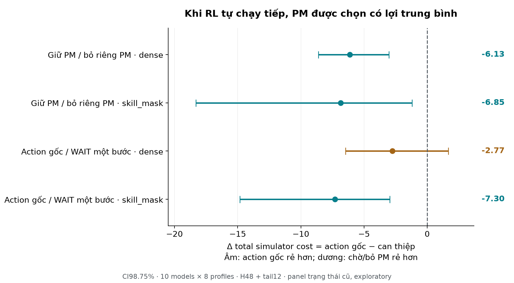

## Material Passport

- Origin Skill: academic-research-suite / experiment-agent
- Origin Mode: validate, inline
- Origin Date: 2026-10-11
- Verification Status: ANALYZED; source/artifact audit và scalar subset exact PASS;
  chưa chạy lại full experiment/training độc lập.
- Version Label: maintenance_policy_continuation_v1_analysis
- Source: maintenance_policy_continuation_v1_full_cpu_20261011T081315Z,
  commit3fd164ce912f09ed8ddfea7b099ac99ff6abddc7.
- Overall Confidence: CAUTION về phạm vi; bốn primary CI đã tính lại đúng protocol.

## Kết quả chính

**Có bằng chứng cho giá trị của PM mà policy chọn khi chính RL chạy tiếp.**
Giữ PM tốt hơn bỏ riêng PM trung bình ở cả dense và skill_mask; CI98.75% đều âm.
Làm action gốc thay vì WAIT hoàn toàn cũng có chi phí thấp hơn rõ ở skill_mask;
dense chưa phân biệt rõ. Đây là bằng chứng về root timing trong simulator trên
panel đã khóa, chưa chứng minh policy chờ/chọn kỹ thuật viên tối ưu.

Δ = chi phí(action gốc) − chi phí(can thiệp), từ tick lấy mẫu đến hết59.
Âm ủng hộ action gốc; dương ủng hộ can thiệp chờ/bỏ PM. H1 giữ nguyên mọi
CM/kỹ thuật viên khi bỏ PM. H2 WAIT bỏ cả PM/CM start hiện tại trong một bước;
repair đang chạy vẫn tiếp tục. Sau bước đầu, cùng frozen RL tự quyết định trên
trạng thái riêng từng nhánh đến47, sau đó deadline_matching tail48..59.

| Điều kiện | Can thiệp so với action RL | n trạng thái | Δ cost | CI98.75% | Kết luận |
| --- | --- | --- | --- | --- | --- |
| dense | Bỏ riêng PM, giữ CM | 347 | -6.127 | [-8.601; -3.024] | Action gốc có chi phí thấp hơn |
| skill_mask | Bỏ riêng PM, giữ CM | 381 | -6.853 | [-18.307; -1.208] | Action gốc có chi phí thấp hơn |
| dense | WAIT: bỏ mọi start hiện tại | 734 | -2.769 | [-6.471; 1.677] | Chưa phân biệt rõ |
| skill_mask | WAIT: bỏ mọi start hiện tại | 741 | -7.305 | [-14.834; -2.960] | Action gốc có chi phí thấp hơn |

Ba trong bốn primary contrasts có CI hoàn toàn âm. Đơn vị là total simulator
cost, không phải reward đã scale, tỷ lệ %, cost/tick hay VND. Relative descriptive
savings PM so với nhánh bỏ PM khoảng1.02%/1.14% trên đúng các nhóm eligible;
chưa có ngưỡng practical importance được khóa. CI skill_mask PM rộng hơn,
reflect heterogeneity của8 profiles; không trình bày effect này như chính xác cao.
Mỗi condition có10/10 model means PM âm; dense7/8 profile means âm, skill_mask8/8
âm. Đây là consistency descriptive, không phải các kiểm định độc lập bổ sung.

CI tính bằng20.000 crossed bootstrap model/profile, tỷ số tổng numerator/exposure,
shocks/origins/landmarks giữ paired. Four98.75% intervals là approximate correction
cho4 primary contrasts. Không có empty draws. CI conditional trên fixed32 MC
forecast tapes; không bootstrap riêng noise MC hoặc lập giả định2560 states IID.
Median paired MCSE từng state PM khoảng6.16 dense/5.45 skill_mask; dấu của một
state mean với32 scenarios không phải bằng chứng action đó tốt/xấu chắc chắn.

## PM có lợi ở đâu, còn sai ở đâu?

Risk dùng age+1>=failure_age trên máy được PM; young là các máy PM không chạm
ngưỡng hazard ở interval hiện tại. ALL_RISK/ALL_YOUNG là thuộc tính TOÀN BỘ PM
starts trong root, có thể có thêm CM. Mixed gồm PM ở cả hai loại máy.
Đây là contrast bỏ toàn bộ PM starts của root, không phải single-machine deletion.

| Điều kiện | PM trong action gốc | n | Δ cost | n âm | n dương |
| --- | --- | --- | --- | --- | --- |
| dense | ALL_RISK | 296 | -7.526 | 206 | 90 |
| dense | ALL_YOUNG | 46 | 3.823 | 17 | 29 |
| dense | MIXED_RISK | 5 | -14.856 | 4 | 1 |
| skill_mask | ALL_RISK | 287 | -9.695 | 215 | 72 |
| skill_mask | ALL_YOUNG | 88 | 1.463 | 38 | 50 |
| skill_mask | MIXED_RISK | 6 | 7.125 | 0 | 6 |

PM chỉ máy at-risk có mean âm khoảng−7.53/−9.70. PM chỉ máy young có mean dương
+3.82/+1.46: nhánh bỏ PM rẻ hơn trung bình trong các nhóm này. Điều này là
**descriptive subgroup evidence**, không có CI subgroup đã khóa, không áp dụng
cứng cho từng máy hay kết luận PM ở máy trẻ luôn sai. Mixed skill_mask chỉ6 states,
mean+7.125; số mẫu và MC noise không cho phép kết luận rộng.

H1 trên trạng thái do RL tự tạo cũng có mean âm:−2.61 dense/−5.68 skill_mask,
không chỉ do phần occupancy từ reference rule. Hiệu ứng dense mạnh hơn ở nguồn
best_rule (−10.14) so với own RL (−2.61); do đó estimand gộp hai origin không
đồng nhất với kỳ vọng trên riêng rollout của RL. Bảng sau không phải primary CI.

| Điều kiện | Contrast | n trên trạng thái RL | Δ cost trung bình |
| --- | --- | --- | --- |
| dense | pm | 185 | -2.610 |
| dense | now | 366 | -1.318 |
| skill_mask | pm | 217 | -5.676 |
| skill_mask | now | 414 | -7.948 |

Theo thành phần cost, lợi PM chủ yếu nằm ở việc giảm failure cost, bù phần tăng
unavailability do dừng máy để bảo trì. Các chênh lệch là tổng future cost trên
cùng branch pair, không chỉ immediate cost và không phải số lần failure.
Phần lợi không chỉ đến từ tail; base H48 cũng có mean âm ở cả hai condition.

| Điều kiện | Maintenance | Unavailability | Failure | Waiting | Base H48 | Tail L12 |
| --- | --- | --- | --- | --- | --- | --- |
| dense | -0.389 | 4.252 | -9.873 | -0.117 | -4.552 | -1.575 |
| skill_mask | -0.321 | 2.711 | -8.029 | -1.214 | -4.842 | -2.011 |

## RL có học chờ hay chưa?

| Điều kiện | Có lựa chọn | RL chủ động WAIT | Tỷ lệ | Rule chủ động WAIT | WAIT bắt buộc | Tổng WAIT RL |
| --- | --- | --- | --- | --- | --- | --- |
| dense | 742 | 8 | 1.08% | 273 | 538 | 546 |
| skill_mask | 753 | 12 | 1.59% | 94 | 527 | 539 |

RL chủ động WAIT20/1495 choice states=1.34%; rule367/1495=24.55%.
Trong1085 WAIT roots của RL,1065=98.16% là forced WAIT. Các hành vi này giống
panel timing cũ vì experiment cố ý reuse states/actions; chúng không phải một
replication hành vi trên trajectory mới. Histogram3.277.216 future RL decision
rows có nhiều WAIT, nhưng thiếu mask/choice metadata từng future row, nên không
suy mọi future WAIT là strategic từ histogram.

20 WAIT roots chỉ có8 root khác action reference:5 có mean WAIT rẻ hơn reference,
3 có mean đắt hơn;12 remaining roots cả hai chọn WAIT. Này chỉ là mô tả trên ít
states,32 future scenarios/state và reference root hạn chế; không có search toàn
21 actions, không chứng minh WAIT tối ưu hoặc xác định hazard threshold chính xác.
Primary H2 chỉ xét roots RL NONEMPTY; vì vậy H2 không đánh giá trực tiếp các
state RL đã chọn WAIT. Nó chỉ hỏi có nên trì hoãn root mà policy định làm.

## Continuation và giới hạn diễn giải

| Điều kiện | Contrast | RL chạy tiếp | Rule chạy tiếp | Thay đổi Δ |
| --- | --- | --- | --- | --- |
| dense | pm | -6.127 | -3.189 | -2.938 |
| dense | now | -2.769 | -2.077 | -0.693 |
| skill_mask | pm | -6.853 | -4.799 | -2.054 |
| skill_mask | now | -7.305 | -5.369 | -1.936 |

Arm rule dùng cùng root intervention/cùng32 tapes/cùng stop60, nên đây là matched
continuation comparison; các interaction means là secondary descriptive chưa có
primary CI. Không suy RL continuation luôn tốt hơn rule từ việc PM delta âm hơn:
so sánh này là khác biệt giữa CONTRASTS, không phải absolute full-policy ranking.
Diagnostic cũ dùng rule24; run này thay cả continuation, horizon và forecast tapes.
Không gán toàn bộ thay đổi so với số cũ cho riêng RL continuation.

Root RL/reference mean khác nhau khoảng+1.46 dense/+0.92 skill_mask trên choice
states, tức reference-root có lợi mean nhỏ nếu cả hai để RL tiếp tục. Đây không
phải đánh giá full reference policy hay bằng chứng chọn worker tối ưu. Thí nghiệm
không giữ nguyên machine choice rồi đổi technician riêng; vì vậy chưa tách được
chất lượng học technician assignment khỏi machine/timing choices.

Không được kết luận: luôn PM; luôn WAIT; override PM máy trẻ chắc chắn cải thiện
full rollout; policy tối ưu ở mọi state; đã generalize sang trạng thái vật lý mới.
Để chốt mục tiêu when+who, evidence còn thiếu cho strategic WAIT/worker-specific
assignment và full-trajectory intervention trên seeds vật lý mới. Không launch
thêm experiment trong lần phân tích này.

## Audit và reproducibility scope

- COMPLETED/PASS, clean commit đúng3fd164c, CPU/thread1;185.231s toàn run,
 171.705s phần fork,88 artifact files/14.591MB (không tính manifest/log sibling).
- Đủ2560 fixed states,10 frozen models,16 physical configurations,4417 unique
 roots,8834 root-value rows.10.229.376 forecast transition samples trong runner.
- Manifest của nguồn timing được pin; toàn85 source files và10 payloads/weights,
 source root actions/probabilities/values/roles/grid được verify lại.
- New snapshots khớp exact committed bytes. Full/smoke forecast/analysis seed
 roles đúng registry,1284 fresh derived roles; reuse historical identities rõ ràng.
- Toàn bộ arrays/cost metadata/deltas/paired MCSE/base+tail/alias/boundary metrics,
 budget/counts/immutable model hashes được đối chiếu từ dữ liệu thô.
- Raw cost arrays655.360 label-index slots gồm duplicate aliases;282.688 unique
 arm/root/scenario cost totals. Không coi là independent statistical units.
- Independent scalar subset: cố định firstcohort/firstphysicalshock, mọi10 models,
 2 conditions,2 origins,4 landmarks=160 states; scenario indices0/31, mọi unique
 root/arm.45.480 scalar physical transitions khớp exact base/tail return và toàn
 physical state tại48/60; component sums reconcile. Không replay độc lập toàn
10.229.376 transitions, không rerun training/full lab experiment.
- Bốn primary estimates/CIs và profile-cell numerator/exposure independently
 recomputed với implementation bootstrap frequency weights, không gọi production
 summarize/crossed_ratio. Raw files không sửa/xóa; analysis outputs riêng timestamp.
- Initial audit read compressed NPZ repeatedly, was stopped before any final
report; optimized audit caches arrays once. Completed audit/report is this folder.

## Fallacy scan:11/11 checked

| Mục | Trạng thái | Phạm vi |
| --- | --- | --- |
| Simpson | CHECKED | Tách condition/origin/landmark/risk. PM tổng thể âm, cả hai origin âm; nhóm chỉ PM máy trẻ dương là dị biệt hiệu ứng, không suy tổng thể cho mọi nhóm. |
| Ecological | CAUTION | Hiệu ứng trung bình conditional trên nhóm state; không suy action đúng ở mỗi state hoặc mỗi kỹ thuật viên. |
| Berkson/selection | CAUTION | H1 chỉ xét root có PM, H2 root nonempty; xác định estimand conditional, không áp dụng cho state RL đã chọn WAIT. |
| Collider | CHECKED | Can thiệp và so sánh trên cùng trạng thái trước action; không lọc bằng outcome. Strata risk/worker là thuộc tính pre-action; occupancy do policy trước đó tạo ra. |
| Base rate | CHECKED | Báo cáo mẫu số choice states; 20 chủ động WAIT/1495 khác1065 forced WAIT/2560. Không gọi tổng WAIT là chờ chiến lược. |
| Regression to mean | CHECKED | Không chọn states theo gap hay outcome; reuse đủ panel đã khóa. So cùng forecast tape, không so before-after cực trị. |
| Survivorship | CHECKED | Đủ2560 states,10 models,8 cohorts; không bỏ run/state vì effect bất lợi. |
| Look elsewhere | CAUTION | Báo cáo đủ4 primary; CI98.75% cho approximate Bonferroni family. Các bảng subgroup/continuation/component chỉ descriptive, không chọn subgroup p-value. |
| Forking paths | NOTE | Follow-up exploratory đã khóa trước full mới. Input cũ đã mở; không gọi là preregistered independent confirmatory replication. |
| Correlation/causation | CAUTION | Root intervention trong simulator cho contrast một bước dưới cùng frozen continuation; không chứng minh causal effect ngoài thực địa hay giá trị rollout nếu luôn override policy. |
| Reverse causality | CHECKED | State pre-action, intervention xảy ra trước future cost. Khác biệt occupancy theo origin không được diễn giải thành học nhân quả từ observational strata. |

Phạm vi reproducibility: ANALYZED with exact deterministic audit subset; chưa
full independent replication. Không fabricate p-values hay Cohen's d vì estimand
là conditional raw cost contrast; effect size và CI báo trực tiếp theo protocol.
