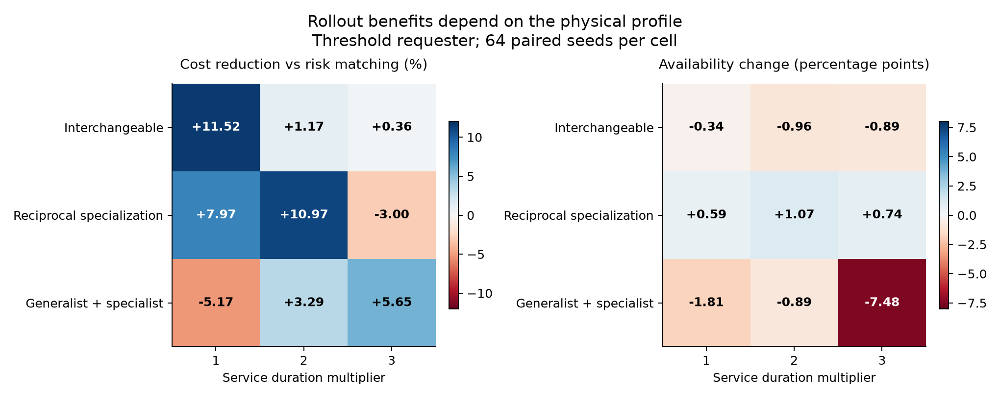
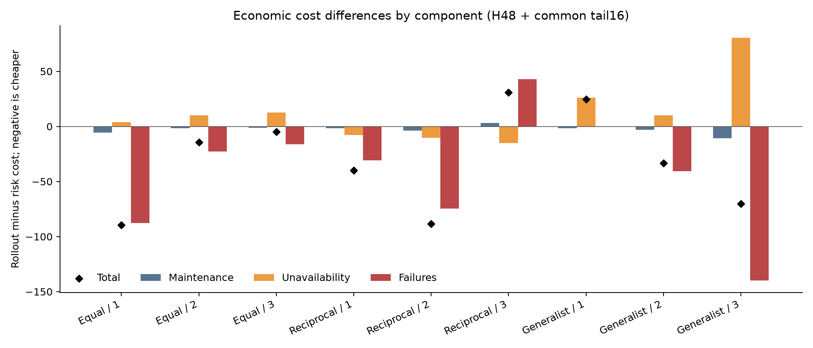

# Phân tích diagnostic yêu cầu bảo trì dùng chung

## Material Passport

Run `maintenance_request_lifecycle_v1_full_cpu_20261019T141931Z`, commit
`8855c7e3f79424b1d828b2e66ef6fcf941c3fcd9`, CPU lab, COMPLETED trong 944,28s.
Verification Status: ANALYZED; xác minh số học và tái dựng scalar các physical
transition đã ghi, không chạy lại controller hoặc forecast bank, không mở seed
mới. Không training; đây không phải benchmark PPO/MARL. Phân tích do cùng
assistant thực hiện trong phiên này, không phải đánh giá mù hoặc cross-model.
Raw artifacts chỉ đọc; hash trước/sau khớp.

## Kết luận chính

Simulator đã hoạt động đúng hợp đồng và có các quyết định tạo khác biệt kinh
tế. Tuy nhiên, lợi ích phụ thuộc mạnh vào physical profile. Rollout giảm mean
cost ở7/9 profile so risk matching với requester threshold, nhưng thua2 profile;
6 profile có CI khám phá hoàn toàn phía giảm cost,1chưa rõ và2phía tăng cost.
Không có bảo đảm familywise cho45 contrast. Không kết luận rollout hay MARL
tốt hơn nói chung.

`reciprocal_scale2` là ví dụ khám phá đáng đọc sâu: cost giảm 10,97%, availability
tăng 1,074điểm phần trăm, CM waiting và backlog giảm. Ngược lại,
`specialist_generalist_scale3` giảm cost 5,65% nhưng mất 7,479điểm phần trăm
availability và gần gấp đôi CM waiting. Không chọn riêng trường hợp tốt để
thay thế toàn bộ family.

Quy tắc gửi yêu cầu sớm hiện tại chưa tạo lợi ích kinh tế nhất quán. Ở6/9 profile,
hai requester tạo lịch phân công và physical states giống hệt trên cả64 seed
với risk matching; với rollout là7/9 profile. Request timestamps và backlog PM
vẫn có thể khác, nên metric thời gian chờ cần đọc cùng cơ chế tạo yêu cầu.

## Phạm vi và kiểm tra dữ liệu

- Đủ9 profile ×2 requester ×3 dispatcher ×64 physicalseed =3.456 episode.
- Mỗi episode H48+common tail16, không reset tại H;221.184 physicaltransition.
- Kiểm tra8artifact hash và7source/protocol/registry hash; CSV streaming và
  CSV cuối giống byte. Lặp lại hash sau phân tích, không thay raw data.
- Recompute54 mean rows và45registered paired contrast từ episodes.csv.
  Tái lập bootstrap bằng count weights thay vì indexed averaging: khớp 2.000 draw
  và CI của từng contrast, sai số so sánh1e−9.
- Bản scalar riêng, không import simulator modules, tái dựng mọi physical
  state, seeded failure tape, hành động hợp lệ, request lifecycle, cost và
  metrics cộng dồn của221.184transition: PASS. Đây là kiểm tra implementation
  theo cùng hợp đồng mô hình, không xác nhận mô hình đại diện nhà máy thật.
- Không tái thực thi forecast bank đầy đủ. Audit gốc kiểm tra logged-score
  winners; không gọi đó là tái lập toàn bộ planner hoặc xác nhận optimality.

Các profile giữ N4/K2. Scale1/2/3 nhân thời gian service, không tăng số máy.
Interchangeable: duration[[2,2]]×4; reciprocal:[[1,3],[1,3],[3,1],[3,1]];
specialist_generalist:[[1,0],[1,3],[1,2],[1,4]], zero là không đủ kỹ năng.
Technician0 trong profile cuối làm được mọi máy nhanh hơn technician1;
technician1 làm được3/4máy. Restoration luôn.75. Vì matrix duration và mask
khác giữa profile, không quy mọi khác biệt giữa profile cho riêng một yếu tố.

## Cost theo từng cấu hình

Bảng dưới dùng requester threshold. Cost H+tail thấp hơn là tốt. Gain bằng
100×(1−mean rollout/mean risk), không phải mean phần trăm của từng seed.
CI là khoảng95% khám phá của **rollout minus risk**, đơn vị cost; số âm có lợi.
FCFS là shared-queue greedy fastest-worker rule, không phải FCFS có matching
tối ưu. Risk matching là heuristic có trọng số urgency/duration, không phải
economic optimum một bước.

| Profile | FCFS | Risk matching | Rollout | Gain rollout/risk | CI chênh cost |
|---|---:|---:|---:|---:|---|
| Interchangeable, scale1 |777,69|777,48|687,92|+11,52%|[−107,02;−73,18]|
| Interchangeable, scale2 |1214,50|1220,44|1206,16|+1,17%|[−25,52;−4,64]|
| Interchangeable, scale3 |1319,89|1320,33|1315,53|+0,36%|[−15,41;6,55]|
| Reciprocal, scale1 |487,47|501,48|461,52|+7,97%|[−55,70;−25,34]|
| Reciprocal, scale2 |885,20|806,16|717,69|+10,97%|[−110,64;−65,26]|
| Reciprocal, scale3 |1128,31|1026,95|1057,73|−3,00%|[0,14;60,95]|
| Generalist/specialist, scale1 |476,50|475,64|500,22|−5,17%|[16,84;33,45]|
| Generalist/specialist, scale2 |1013,02|1017,61|984,11|+3,29%|[−48,28;−19,39]|
| Generalist/specialist, scale3 |1231,75|1241,42|1171,31|+5,65%|[−87,00;−52,79]|

Hai phía CI rất gần0 ởreciprocal_scale3 cần đặc biệt giữ nhãn khám phá; không
đổi confidence hoặc tăng seed sau khi nhìn kết quả. Mọi phương pháp, kể cả
những bên thua và contrast có CI chứa0, được giữ trong các CSV đi kèm.

## Lợi ích và đánh đổi vận hành

**Reciprocal, scale2:** rollout so risk giảm cost 88,47, từ 806,16 xuống717,69;
availability H 58,13%→59,20%; failures H5,94→2,20/episode; CM waiting H+tail
2,45→1,94 machine-tick; pending H0,344→0,031 và cuối tail0,250→0,031.
51/64 seed có cost thấp hơn,9bằng,4cao hơn. Tiết kiệm có ởH70,73vàtail17,73,
nên không chỉ là đẩy cost khỏi cutoff H. Đây là case khám phá có nhiều chỉ tiêu
cùng thuận lợi, chưa là chứng minh policy tối ưu hoặc lợi thế MARL.

**Generalist/specialist, scale3:** cost1241,42→1171,31, nhưng availability
42,42%→34,94%; CM waiting H+tail23,48→44,09 machine-tick. Pending H giảm
1,547→1,109 nhưng cuối tail tăng0,891→1,031. Phân rã chênh cost:
maintenance−10,86; unavailability+80,44; failures−139,69; tổng−70,11.
Vì objective không có một availability floor hoặc waiting penalty, đây là
đánh đổi được hàm mục tiêu hiện tại cho phép. Không gọi là cải thiện service
toàn diện hoặc tự thêm guard sau khi thấy kết quả.

Log H trong case này ghi PM starts tăng505→1006 trên64 episode, failures
954→363, hazard-exposed machine-ticks2126→788. Các số đếm cho thấy nhiều can
thiệp PM và ít tiếp xúc hazard hơn; chưa có ablation để quy tỉ lệ lợi ích cho
từng cơ chế. Có126/3072 decision tick rollout để một CM chưa phục vụ trong khi
còn worker rảnh có kỹ năng phù hợp; risk matching không có tick loại này.
Hiện tượng đó không tự chứng minh WAIT sai, nhưng cần kiểm tra dưới reference
dài hạn hơn và yêu cầu vận hành cụ thể.

**Hai case rollout thua:** reciprocal_scale3 cost tăng3,00%, failures H
7,94→9,97, CM waiting H+tail10,05→18,94 dù availability tăng0,741pp;
generalist/specialist_scale1 cost tăng5,17%, chủ yếu unavailability cost
tăng26,25, failures cost gần như không giảm. Không dùng sốscenario lớn để
biến mất các trường hợp bất lợi này.

## Quyết định có ích là chọn technician hay chọn máy/thời điểm?

Đếm trên state của rollout, so action nó chọn với current risk-matching root
được ghi trong cùng forecast bank. Đây không phải hai trajectory bị ép giữ
cùng toàn bộ lịch sử.

- Reciprocal_scale2:165/3072 tick thay đổi matching;6chỉ đổi technician trên
  cùng tập máy,159đổi tập máy hoặc thời điểm. Trong159có135đổi cardinality,
  103chọn WAIT thay cho một action service; các số này chồng lấp.
- Interchangeable_scale1:102 tick đổi action, tất cả là subset/timing; mọi
  technician có cùng duration/restoration. Lợi ích11,52% không thể giải thích
  bằng việc học chọn người có kỹ năng kinh tế tốt hơn.
- Generalist/specialist_scale1:137 tick đổi,103chỉ đổi assignment; rollout lại
  thua. Có lựa chọn khác không đồng nghĩa có lợi ích cải thiện so baseline.

Suy luận: diagnostic này ủng hộ việc nghiên cứu priority/selection/timing trước
khi đặt đóng góp vào assignment learning. Chưa có assignment-only ablation
trên panel này để định lượng đóng góp nhân quả riêng của từng quyết định.

Rollout nhìn6 tick/16scenario, không có value sau cửa sổ. Một số service kéo
dài6–12 tick, nên bias cuối cửa sổ là giả thuyết cần kiểm tra. Không tái chạy
forecast/horizon khác trong phân tích này; chưa quy mọi thua hoặc WAIT cho
nguyên nhân đó. Tail16của evaluation không tự sửa terminal value của planner.

## Gửi yêu cầu sớm và bẫy đo thời gian chờ

Resource-aware ở đây chỉ hạ ngưỡng theo **minimum remaining time của worker
đủ kỹ năng**, không dự báo toàn bộ workload, hàng đợi hoặc nhu cầu máy khác.
Gửi sớm không tốn phí, không dừng máy, không bắt dispatcher phải làm ngay.

Với risk matching,6/9 profile có physical states và matching giống hệt trên
cả64 seed giữa hai requester; với rollout là7/9 profile. Ngoài3 profile có thay
đổi nhỏ với risk, cost cải thiện tốt nhất chỉ0,078% và CI vẫn chứa0. FCFS là
nơi tác động lớn hơn: resource-aware làm cost reciprocal_scale2 tăng7,93%
(chênh70,17;CI[42,95;100,55]), còn generalist/specialist_scale2 giảm 1,38%
(chênh−13,94;CI[−24,56;−3,89]). Đây là tương tác của các rule cụ thể, không
là định lý rằng gửi sớm luôn tốt hoặc luôn vô ích.

Ví dụ reciprocal_scale3/risk: hai requester có lịch sửa và physical states
giống nhau64/64 episode. Tuy vậy mean request-wait32,78→62,30 machine-tick,
pending H0,328→1,391 vì PM request được mở sớm hơn; CM waiting không đổi.
Do đó không dùng tổng request-wait hoặc tổng PM backlog một mình để so chất
lượng hệ thống giữa các requester. Cần đọc cùng availability, CM waiting,
failures, trạng thái máy và thời điểm tạo yêu cầu. Cả endpoint backlog và
completed-only waiting đều có giới hạn riêng; bản báo cáo giữ tất cả.

## Kiểm tra11 sai lệch suy luận

| Kiểm tra | Cách xử lý trong phân tích |
|---|---|
| Simpson | Báo riêng9 profile; không dùng mean gộp để kết luận mọiprofile |
| Ecological | Không suy mean toàn hệ thành hiệu quả trên từng máy |
| Berkson | Giữ đủ9 profile; reciprocal_scale2 là case được chú ý sau khi thấy kết quả |
| Collider | Không lọc riêng seed thắng, request hoàn tất hoặc state có lợi |
| Base rate | Ghi64pairedseed,3072Hdecisiontick/cell/method và hazard exposure |
| Regression to mean | Không tái gọi case tốt nhất là xác nhận; follow-up cần panel mới |
| Survivorship | Giữ3.456 episode, request còn chờ, việc đang sửa, H và tail |
| Look elsewhere |45 CI không hiệu chỉnh; tất cảcontrast được xuấtCSV, chỉ diễn giải khám phá |
| Forking paths | Không đổi seed/horizon/cost/controller; raw hash khớp trước/sau |
| Causality | So chính sách trong simulator; component association chưa là causal ablation, không suy nhà máy |
| Reverse causality | Policy tạo phân phối queue/state, không mặc định queue dài gây cost cao |

Coverage:11/11checked. Không thêm p-value hoặc hậu kiểm chọn ngưỡng pass/fail.

## Đề xuất bước tiếp theo

1. Giữ kernel và toàn bộ kết quả này làm diagnostic đã hoàn tất. Chưa mở thêm
   thuật toán MARL hoặc tuning để buộc thắng.
2. Ưu tiên kiểm tra reference solver: bài thật nhỏ có DP cùng dynamics/tail,
   và đối chứng forecast có continuation đến endpoint hoặc terminal value.
   Khóa protocol/panel mới trước khi chạy; không chọn horizon từ panel này.
3. Tách selection/timing-only, assignment-only và joint trên cùng môi trường
   để xác định cơ chế có headroom; current rollout thay đổi cả ba nên chưa đủ.
4. Làm rõ mục tiêu: cost kinh tế thuần chấp nhận tradeoff downtime hiện tại,
   hay có yêu cầu service/availability cần được đặt trước. Không thêm penalty
   hoặc hạ gate vì thích kết quả. Request timing chỉ thành đóng góp riêng khi
   cơ chế vận hành tạo đánh đổi có lý do; free submission chưa cung cấp điều đó.

Phân tích không chỉnh simulator, không chạy lại full, không chuyển dữ liệu,
không có training hay checkpoint mới. Các file means.csv,
registered_contrasts.csv,rollout_vs_risk.csv,requester_identity.csv,
mechanisms.csv,validation.json và analyze.py cho phép kiểm tra các nhận xét trên.
